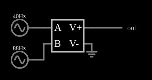

# Multiplicador de tensões (VCVS)

<!-- navegacao:inicio -->
[Índice](README.md) · [Anterior: VCVS Op-Amp With Rails](cs-opamprail.md) · [Próximo: VCVS Full Rectifier](cs-fullrectifier.md)
<!-- navegacao:fim -->

## Objetivo

Mostrar um multiplicador analógico feito com uma VCVS de expressão $a\cdot b$: o produto de dois sinais senoidais contém as frequências **soma** e **diferença**, o princípio da modulação em amplitude e dos misturadores de frequência (*mixers*).

## O circuito

<!-- esquema:inicio -->

<!-- esquema:fim -->

Duas fontes senoidais de $5\ \text{V}$ de pico ($40\ \text{Hz}$ e $88\ \text{Hz}$) alimentam as entradas $a$ e $b$ de uma VCVS cuja expressão é $a\cdot b$. Um elemento de saída e um osciloscópio mostram a saída.

<!-- componentes:inicio -->
| N.º | Tipo | Elemento | Valores |
|----:|------|----------|---------|
| 0 | `VCVSElm` | VCVS | Output Function = a*b; # of Inputs = 2 |
| 1 | `RailElm` | A/C source | Max Voltage = 5; Waveform = A/C; DC Offset (V) = 0; Internal Resistance (ohms) = 0; Show Voltage = não; Frequency (Hz) = 40; Phase Offset (degrees) = 0 |
| 3 | `RailElm` | A/C source | Max Voltage = 5; Waveform = A/C; DC Offset (V) = 0; Internal Resistance (ohms) = 0; Show Voltage = não; Frequency (Hz) = 88; Phase Offset (degrees) = 0 |
| 4 | `GroundElm` | ground | Symbol = Earth |
| 5 | `OutputElm` | output | Show Voltage = não |
<!-- componentes:fim -->

## Teoria

As fontes controladas deste simulador são definidas por uma **expressão** sobre as entradas, que se chamam $a$, $b$, $c$, ... (as tensões ou correntes nos terminais de controle). O resultado é a tensão (VCVS, CCVS) ou a corrente (VCCS, CCCS) que a fonte impõe na saída. Com $a = 5\sin(2\pi f_1 t)$ e $b = 5\sin(2\pi f_2 t)$,

$$a\,b = 25\,\sin(2\pi f_1 t)\,\sin(2\pi f_2 t) = \frac{25}{2}\Bigl[\cos\bigl(2\pi(f_2 - f_1)t\bigr) - \cos\bigl(2\pi(f_2 + f_1)t\bigr)\Bigr].$$

O espectro da saída tem duas componentes de amplitude $12{,}5\ \text{V}$: uma na frequência diferença, $88 - 40 = 48\ \text{Hz}$, e outra na soma, $88 + 40 = 128\ \text{Hz}$. As frequências de entrada desaparecem. O valor médio é zero e o valor eficaz é $12{,}5\ \text{V}$, o produto dos valores eficazes das entradas ($5/\sqrt 2$ cada).

## Resultados esperados

| Grandeza | Teoria | Simulador |
|----------|-------:|----------:|
| Saída em $t = 10\ \text{ms}$ ($a = 2{,}944$, $b = -3{,}433\ \text{V}$) | $a\cdot b = -10{,}106\ \text{V}$ | $-10{,}106\ \text{V}$ |
| Valor eficaz em $0{,}25\ \text{s}$ (10 ciclos de $40\ \text{Hz}$ e 22 de $88\ \text{Hz}$) | $12{,}5\ \text{V}$ | $12{,}5\ \text{V}$ |

As verificações conferem o produto instantâneo e o valor eficaz.

## O que observar

- A forma de onda da saída é um batimento de duas componentes de $48$ e $128\ \text{Hz}$, e não uma senoide de $40$ ou $88\ \text{Hz}$.
- Se uma das entradas fosse um sinal de áudio e a outra uma portadora, o produto seria uma onda modulada em amplitude (com portadora suprimida).
- Os valores de pico da saída chegam a quase $25\ \text{V}$, o produto dos picos.

## Limites do modelo

O multiplicador é perfeito e sem limite de tensão ou banda; um multiplicador real (célula de Gilbert) tem ganho dependente da temperatura, *offset* e *feedthrough* das entradas, e a faixa de entrada é de poucos volts.

## Referências

- A. S. Sedra e K. C. Smith, *Microeletrônica*, Pearson.
- P. Horowitz e W. Hill, *The Art of Electronics*, Cambridge University Press.
- P. Falstad, *CircuitJS1 — Controlled Sources* (documentação do simulador).

O circuito deste exemplo faz parte da coleção do simulador original de Paul Falstad e Iain Sharp (CircuitJS1); a explicação é deste projeto.
