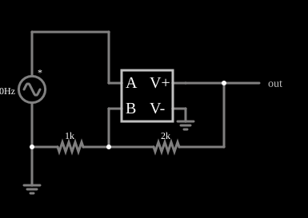

# Amplificador operacional feito com uma VCVS

<!-- navegacao:inicio -->
[Índice](README.md) · [Anterior: VCCS Varying Resistor](cs-varyresistor.md) · [Próximo: VCVS Op-Amp With Rails](cs-opamprail.md)
<!-- navegacao:fim -->

## Objetivo

Mostrar que um amplificador operacional é, no modelo mais simples, uma fonte de tensão controlada por tensão (VCVS) com ganho alto: a expressão $(a-b)\cdot 1000$ implementa um operacional de ganho $1000$.

## O circuito

<!-- esquema:inicio -->

<!-- esquema:fim -->

Uma fonte senoidal de $40\ \text{Hz}$ e $5\ \text{V}$ de pico liga-se à entrada $a$ (não inversora) da VCVS. A saída está ligada à entrada $b$ (inversora) por um divisor: um resistor de $2\ \text{k}\Omega$ da saída à entrada inversora e um de $1\ \text{k}\Omega$ da entrada inversora à terra. É um amplificador não inversor. Um elemento de saída e dois osciloscópios mostram a entrada e a saída.

<!-- componentes:inicio -->
| N.º | Tipo | Elemento | Valores |
|----:|------|----------|---------|
| 0 | `DCVoltageElm` | A/C source | Max Voltage = 5; Waveform = A/C; DC Offset (V) = 0; Internal Resistance (ohms) = 0; Show Voltage = não; Frequency (Hz) = 40; Phase Offset (degrees) = 0 |
| 1 | `GroundElm` | ground | Symbol = Earth |
| 4 | `ResistorElm` | resistor | Resistance (ohms) = 2k |
| 5 | `ResistorElm` | resistor | Resistance (ohms) = 1k |
| 8 | `OutputElm` | output | Show Voltage = não |
| 9 | `VCVSElm` | VCVS | Output Function = (a-b)*1000; # of Inputs = 2 |
| 10 | `GroundElm` | ground | Symbol = Earth |
<!-- componentes:fim -->

## Teoria

As fontes controladas deste simulador são definidas por uma **expressão** sobre as entradas, que se chamam $a$, $b$, $c$, ... (as tensões ou correntes nos terminais de controle). O resultado é a tensão (VCVS, CCVS) ou a corrente (VCCS, CCCS) que a fonte impõe na saída. A VCVS produz $V_\text{out} = A\,(V_+ - V_-)$ com $A = 1000$. Com a realimentação $\beta = R_1/(R_1 + R_2) = 1/3$ ($V_- = \beta V_\text{out}$):

$$V_\text{out} = \frac{A}{1 + A\beta}\,V_+ = \frac{1000}{1 + 333{,}3}\,V_+ = 2{,}991\,V_+.$$

O ganho ideal, $1 + R_2/R_1 = 3$, difere do real em $0{,}3\%$ por causa do ganho finito.

## Resultados esperados

Em $t = 10\ \text{ms}$ a entrada vale $2{,}944\ \text{V}$ e a saída, $2{,}991\cdot 2{,}944 = 8{,}806\ \text{V}$ (ideal: $8{,}832\ \text{V}$). A diferença entre as entradas é de $8{,}8\ \text{mV}$ ($= V_\text{out}/A$). Sem limite de saída, a saída chega a $14{,}95\ \text{V}$ nos picos ($2{,}991\cdot 5$), o que a verificação confere em um ciclo (máximo de $14{,}9\ \text{V}$ com tolerância de 1%).

## O que observar

- O sinal de saída é a entrada multiplicada por $\approx 3$ e em fase.
- Compare com o exemplo seguinte, em que a expressão tem um limite de saída de $\pm 10\ \text{V}$: aqui nada limita a tensão.
- Mude o ganho da expressão para $10$ (em vez de $1000$) e veja o ganho de malha fechada cair para $2{,}3$.

## Limites do modelo

A VCVS não tem saturação, resistência de saída, banda finita nem *offset*: é um operacional de ganho constante em todas as frequências e sem limite de tensão (a tensão de saída pode passar de qualquer alimentação). O ganho de $1000$ é bem menor que o de um operacional real, de $10^5$ ou mais.

## Referências

- A. S. Sedra e K. C. Smith, *Microeletrônica*, Pearson.
- P. Horowitz e W. Hill, *The Art of Electronics*, Cambridge University Press.
- P. Falstad, *CircuitJS1 — Controlled Sources* (documentação do simulador).

O circuito deste exemplo faz parte da coleção do simulador original de Paul Falstad e Iain Sharp (CircuitJS1); a explicação é deste projeto.
