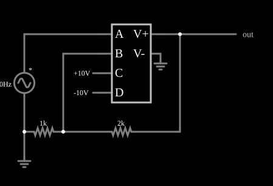

# Amplificador operacional com limites de saída

<!-- navegacao:inicio -->
[Índice](README.md) · [Anterior: VCVS Op-Amp](cs-opamp.md) · [Próximo: VCVS Multiplier](cs-multiplier.md)
<!-- navegacao:fim -->

## Objetivo

Mostrar como incluir a saturação na VCVS: a função $\text{clamp}(x, d, c)$ limita a saída a uma faixa, aqui definida por duas fontes de $\pm 10\ \text{V}$ ligadas a duas entradas adicionais, como os trilhos de alimentação de um operacional.

## O circuito

<!-- esquema:inicio -->

<!-- esquema:fim -->

O mesmo amplificador não inversor do exemplo anterior (ganho $\approx 3$, entrada senoidal de $40\ \text{Hz}$ e $5\ \text{V}$ de pico), mas a VCVS tem quatro entradas: $a$ e $b$ (as entradas do operacional), $c$ (o trilho positivo, $+10\ \text{V}$) e $d$ (o trilho negativo, $-10\ \text{V}$), e a expressão $\text{clamp}\bigl((a-b)\cdot 1000,\ d,\ c\bigr)$. Um elemento de saída e dois osciloscópios mostram a entrada e a saída.

<!-- componentes:inicio -->
| N.º | Tipo | Elemento | Valores |
|----:|------|----------|---------|
| 0 | `DCVoltageElm` | A/C source | Max Voltage = 5; Waveform = A/C; DC Offset (V) = 0; Internal Resistance (ohms) = 0; Show Voltage = não; Frequency (Hz) = 40; Phase Offset (degrees) = 0 |
| 1 | `GroundElm` | ground | Symbol = Earth |
| 4 | `ResistorElm` | resistor | Resistance (ohms) = 2k |
| 5 | `ResistorElm` | resistor | Resistance (ohms) = 1k |
| 6 | `OutputElm` | output | Show Voltage = não |
| 7 | `VCVSElm` | VCVS | Output Function = clamp((a-b)*1000,d,c); # of Inputs = 4 |
| 11 | `GroundElm` | ground | Symbol = Earth |
| 12 | `RailElm` | voltage source | Voltage = 10; Waveform = D/C; DC Offset (V) = 0; Internal Resistance (ohms) = 0 |
| 13 | `RailElm` | voltage source | Voltage = -10; Waveform = D/C; DC Offset (V) = 0; Internal Resistance (ohms) = 0 |
<!-- componentes:fim -->

## Teoria

As fontes controladas deste simulador são definidas por uma **expressão** sobre as entradas, que se chamam $a$, $b$, $c$, ... (as tensões ou correntes nos terminais de controle). O resultado é a tensão (VCVS, CCVS) ou a corrente (VCCS, CCCS) que a fonte impõe na saída. A função $\text{clamp}(x, d, c)$ devolve $x$ se $d \le x \le c$, $d$ se $x < d$ e $c$ se $x > c$. Aqui, o ganho de $1000$ é aplicado à diferença entre as entradas e o resultado é limitado a $[-10, +10]\ \text{V}$. Enquanto o limite não é atingido, o circuito se comporta como o anterior ($V_\text{out} = 2{,}991\,V_+$). Quando $2{,}991\,V_+ > 10\ \text{V}$, isto é, $|V_+| > 3{,}34\ \text{V}$, a saída satura e a realimentação perde o efeito (o circuito passa a ser um comparador): a senoide é achatada nos picos.

## Resultados esperados

| Situação | Saída |
|----------|------:|
| $t = 10\ \text{ms}$ (entrada de $2{,}944\ \text{V}$, abaixo do limite) | $8{,}806\ \text{V}$ (linear, como no exemplo anterior) |
| Máximo em um ciclo | $+10\ \text{V}$ (limitado; sem limite seria $14{,}95\ \text{V}$) |
| Mínimo em um ciclo | $-10\ \text{V}$ |

As verificações conferem o valor linear e os dois limites.

## O que observar

- A saída é uma senoide **achatada** nos picos em $\pm 10\ \text{V}$ (distorção por ceifamento).
- Aumente a amplitude da entrada e o trecho achatado fica mais longo.
- Mude os valores das fontes de trilho e o limite acompanha.

## Limites do modelo

A saturação é instantânea e simétrica, sem a queda de $1$ a $2\ \text{V}$ em relação aos trilhos de um operacional real, e sem recuperação lenta da saturação. As fontes de $\pm 10\ \text{V}$ são ideais e não fornecem a corrente de carga, que o modelo da VCVS não limita.

## Referências

- A. S. Sedra e K. C. Smith, *Microeletrônica*, Pearson.
- P. Horowitz e W. Hill, *The Art of Electronics*, Cambridge University Press.
- P. Falstad, *CircuitJS1 — Controlled Sources* (documentação do simulador).

O circuito deste exemplo faz parte da coleção do simulador original de Paul Falstad e Iain Sharp (CircuitJS1); a explicação é deste projeto.
