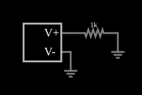

# Rampa de tensão (VCVS com função linear por partes)

<!-- navegacao:inicio -->
[Índice](README.md) · [Anterior: VCVS Full Rectifier](cs-fullrectifier.md) · [Próximo: Current Adder](cs-currentadder.md)
<!-- navegacao:fim -->

## Objetivo

Mostrar uma fonte de tensão controlada pelo **tempo**: a função $\text{pwl}(t, \ldots)$ define uma tensão linear por partes que passa por pontos dados, o que permite gerar rampas, degraus ou formas de onda arbitrárias.

## O circuito

<!-- esquema:inicio -->

<!-- esquema:fim -->

Uma VCVS sem entradas de controle, com a expressão $\text{pwl}(t, 0, 0, 0{,}1, 5)$, alimenta um resistor de $1\ \text{k}\Omega$ ligado à terra.

<!-- componentes:inicio -->
| N.º | Tipo | Elemento | Valores |
|----:|------|----------|---------|
| 0 | `VCVSElm` | VCVS | Output Function = pwl(t,0,0,.1,5); # of Inputs = 0 |
| 1 | `GroundElm` | ground | Symbol = Earth |
| 2 | `ResistorElm` | resistor | Resistance (ohms) = 1k |
| 3 | `GroundElm` | ground | Symbol = Earth |
<!-- componentes:fim -->

## Teoria

As fontes controladas deste simulador são definidas por uma **expressão** sobre as entradas, que se chamam $a$, $b$, $c$, ... (as tensões ou correntes nos terminais de controle). O resultado é a tensão (VCVS, CCVS) ou a corrente (VCCS, CCCS) que a fonte impõe na saída. A função $\text{pwl}(x, x_1, y_1, x_2, y_2, \ldots)$ interpola linearmente entre os pontos $(x_k, y_k)$ e mantém o último valor depois do último ponto. Com $x = t$ e os pontos $(0, 0)$ e $(0{,}1\ \text{s}, 5\ \text{V})$,

$$V(t) = \begin{cases} 50\ \text{V/s}\cdot t, & 0 \le t \le 0{,}1\ \text{s},\\ 5\ \text{V}, & t > 0{,}1\ \text{s}.\end{cases}$$

A corrente no resistor é $V/R$.

## Resultados esperados

| Instante | Tensão (teoria) | Simulador |
|----------|----------------:|----------:|
| $t = 10\ \text{ms}$ | $0{,}5\ \text{V}$ | $0{,}4998\ \text{V}$ |
| $t = 50\ \text{ms}$ | $2{,}5\ \text{V}$ | $2{,}5\ \text{V}$ |
| $t = 100\ \text{ms}$ | $5\ \text{V}$ | $5\ \text{V}$ |
| $t = 200\ \text{ms}$ | $5\ \text{V}$ (constante) | $5\ \text{V}$ |

A diferença de $0{,}0002\ \text{V}$ em $10\ \text{ms}$ é de um passo de tempo da simulação. As verificações conferem os valores em $50$, $100$ e $200\ \text{ms}$.

## O que observar

- A tensão sobe em linha reta durante $0{,}1\ \text{s}$ e depois fica constante em $5\ \text{V}$.
- Acrescente mais pontos à função para gerar qualquer forma de onda (por exemplo, um pulso trapezoidal).
- A rampa pode ser usada como "tensão de teste" para varrer uma característica de um circuito.

## Limites do modelo

O valor depende do tempo de simulação e é determinístico: ao reiniciar, a rampa recomeça. A fonte é ideal, e não limita a corrente que fornece ao resistor.

## Referências

- J. W. Nilsson e S. A. Riedel, *Circuitos Elétricos*, Pearson.
- A. S. Sedra e K. C. Smith, *Microeletrônica*, Pearson.
- P. Falstad, *CircuitJS1 — Controlled Sources* (documentação do simulador).

O circuito deste exemplo faz parte da coleção do simulador original de Paul Falstad e Iain Sharp (CircuitJS1); a explicação é deste projeto.
