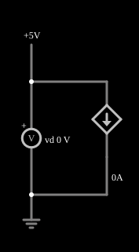

# Resistor feito com uma fonte de corrente controlada

<!-- navegacao:inicio -->
[Índice](README.md) · [Próximo: CCS Varying Resistor](cs-varyresistor.md)
<!-- navegacao:fim -->

## Objetivo

Mostrar o mais simples uso de uma fonte de corrente controlada: com a expressão $v(\text{vd})/1000$ ela se comporta exatamente como um resistor de $1\ \text{k}\Omega$, porque a sua corrente é proporcional à tensão lida pelo voltímetro `vd`, que está sobre os mesmos dois nós.

## O circuito

<!-- esquema:inicio -->

<!-- esquema:fim -->

Uma fonte de $5\ \text{V}$ alimenta uma fonte de corrente controlada ligada entre o seu terminal e a terra. Um voltímetro com o rótulo `vd`, ligado entre os mesmos dois nós, dá o nome pelo qual a expressão lê a tensão: $v(\text{vd})$.

<!-- componentes:inicio -->
| N.º | Tipo | Elemento | Valores |
|----:|------|----------|---------|
| 3 | `GroundElm` | ground | Symbol = Earth |
| 4 | `RailElm` | voltage source | Voltage = 5; Waveform = D/C; DC Offset (V) = 0; Internal Resistance (ohms) = 0 |
| 5 | `ControlledCurrentElm` | Controlled Current Source | Output Current = v(vd)/1000 |
| 6 | `ProbeElm` | voltmeter | Show Voltage = sim; Value = Voltage; Scale = Auto; Use Circle Symbol = sim; Series Resistance (0 = infinite) = 0; Label = vd |
<!-- componentes:fim -->

## Teoria

As fontes controladas de dois terminais (o losango) são definidas por uma **expressão** que lê o resto do circuito **pelo nome**: $v(\text{nome})$ é a tensão de um nó rotulado ou sobre um voltímetro com rótulo, $i(\text{nome})$ a corrente de um amperímetro com rótulo, e $\text{dvdt}$ / $\text{didt}$ as suas taxas de variação. O resultado é a tensão (fonte de tensão controlada, com o $+$ no segundo terminal) ou a corrente (fonte de corrente controlada, no sentido da seta) que a fonte impõe. Aqui a expressão é

$$I = \frac{v(\text{vd})}{1000\ \Omega},$$

e $v(\text{vd})$ é a tensão entre os dois nós em que a fonte está ligada. A corrente é a mesma que um resistor de $1\ \text{k}\Omega$ ligado entre esses nós deixaria passar. Variando a expressão pode-se simular qualquer relação corrente-tensão (resistores não lineares, resistências que variam com o tempo, etc.).

## Resultados esperados

Com $v(\text{vd}) = 5\ \text{V}$:

$$I = \frac{5\ \text{V}}{1000\ \Omega} = 5\ \text{mA}.$$

O simulador mostra que a fonte de $5\ \text{V}$ fornece exatamente $5{,}000\ \text{mA}$. A verificação confere essa corrente (tolerância de 1%).

## O que observar

- Passe o ponteiro sobre a fonte de $5\ \text{V}$: a corrente é a de um resistor de $1\ \text{k}\Omega$.
- Edite a expressão para $v(\text{vd})/500$ e a corrente dobra.
- O mesmo se faria com um resistor comum; o interesse da fonte controlada é poder usar funções arbitrárias (veja os exemplos seguintes).

## Limites do modelo

O modelo é ideal e instantâneo: não há capacitância nem indutância parasita. A expressão é avaliada a cada passo de tempo, o que pode exigir iterações em circuitos com muita realimentação não linear.

## Referências

- J. W. Nilsson e S. A. Riedel, *Circuitos Elétricos*, Pearson.
- A. S. Sedra e K. C. Smith, *Microeletrônica*, Pearson.
- P. Falstad, *CircuitJS1 — Controlled Sources* (documentação do simulador).

O circuito deste exemplo faz parte da coleção do simulador original de Paul Falstad e Iain Sharp (CircuitJS1); a explicação é deste projeto.
