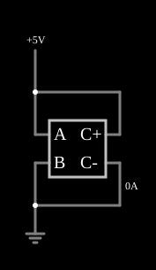

# Resistor feito com uma fonte de corrente controlada por tensão

<!-- navegacao:inicio -->
[Índice](README.md) · [Próximo: VCCS Varying Resistor](cs-varyresistor.md)
<!-- navegacao:fim -->

## Objetivo

Mostrar o mais simples uso de uma fonte de corrente controlada por tensão (VCCS): com a expressão $-(a-b)/1000$ ela se comporta exatamente como um resistor de $1\ \text{k}\Omega$, porque a corrente é proporcional à tensão entre os seus terminais de controle.

## O circuito

<!-- esquema:inicio -->

<!-- esquema:fim -->

Uma fonte de $5\ \text{V}$ está ligada ao terminal positivo de controle de uma VCCS e a corrente que ela impõe passa de volta ao mesmo nó. Os terminais de controle $a$ e $b$ estão ligados aos dois lados do "componente" (a fonte de $5\ \text{V}$ e a terra), e a saída da VCCS está ligada em paralelo com os mesmos dois nós.

<!-- componentes:inicio -->
| N.º | Tipo | Elemento | Valores |
|----:|------|----------|---------|
| 0 | `VCCSElm` | VCCS | Output Function = -(a-b)/1000; # of Inputs = 2 |
| 7 | `GroundElm` | ground | Symbol = Earth |
| 8 | `RailElm` | voltage source | Voltage = 5; Waveform = D/C; DC Offset (V) = 0; Internal Resistance (ohms) = 0 |
<!-- componentes:fim -->

## Teoria

As fontes controladas deste simulador são definidas por uma **expressão** sobre as entradas, que se chamam $a$, $b$, $c$, ... (as tensões ou correntes nos terminais de controle). O resultado é a tensão (VCVS, CCVS) ou a corrente (VCCS, CCCS) que a fonte impõe na saída. A VCCS tem duas entradas, $a$ (a tensão do nó positivo) e $b$ (a do nó negativo), e a expressão de saída é

$$I = -\frac{a - b}{1000\ \Omega}.$$

O sinal negativo é o da convenção de sentido de corrente do simulador: a corrente que a fonte controlada **absorve** do nó $a$ é $(a-b)/1000$, igual à de um resistor de $1\ \text{k}\Omega$ ligado entre $a$ e $b$. Variando a expressão pode-se simular qualquer relação corrente-tensão (resistores não lineares, resistências que variam com o tempo, etc.).

## Resultados esperados

Com $a - b = 5\ \text{V}$:

$$I = \frac{5\ \text{V}}{1000\ \Omega} = 5\ \text{mA}.$$

O simulador mostra que a fonte de $5\ \text{V}$ fornece exatamente $5{,}000\ \text{mA}$. A verificação confere essa corrente (tolerância de 1%).

## O que observar

- Passe o ponteiro sobre a fonte de $5\ \text{V}$: a corrente é a de um resistor de $1\ \text{k}\Omega$.
- Edite a expressão para $-(a-b)/500$ e a corrente dobra.
- O mesmo se faria com um resistor comum; o interesse da fonte controlada é poder usar funções arbitrárias (veja os exemplos seguintes).

## Limites do modelo

O modelo é ideal e instantâneo: não há capacitância nem indutância parasita. A expressão é avaliada a cada passo de tempo, o que pode exigir iterações em circuitos com muita realimentação não linear.

## Referências

- J. W. Nilsson e S. A. Riedel, *Circuitos Elétricos*, Pearson.
- A. S. Sedra e K. C. Smith, *Microeletrônica*, Pearson.
- P. Falstad, *CircuitJS1 — Controlled Sources* (documentação do simulador).

O circuito deste exemplo faz parte da coleção do simulador original de Paul Falstad e Iain Sharp (CircuitJS1); a explicação é deste projeto.
