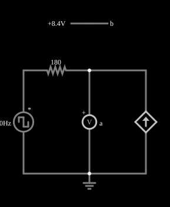

# Capacitor variável (fonte de corrente controlada)

<!-- navegacao:inicio -->
[Índice](README.md) · [Anterior: CCS Variable Inductor](cs-varinduct.md)
<!-- navegacao:fim -->

## Objetivo

Mostrar como simular um capacitor cuja capacitância é controlada por uma tensão (um *varicap*): uma fonte de corrente controlada com a expressão $-\text{dvdt}(a)\cdot v(b)\cdot 10^{-5}$ comporta-se como um capacitor $C = 10\ \mu\text{F}/\text{V}\cdot v_b$, em que `a` é um voltímetro sobre o "capacitor" e `b` um nó rotulado com a tensão de controle.

## O circuito

<!-- esquema:inicio -->

<!-- esquema:fim -->

Uma fonte de onda quadrada de $20\ \text{Hz}$ e $\pm 5\ \text{V}$ alimenta, por um resistor de $180\ \Omega$, a fonte de corrente controlada. O voltímetro com o rótulo `a` mede a tensão sobre ela (a tensão do "capacitor"), e o nó rotulado `b` recebe a tensão de controle, de uma fonte ajustável por um *slider* chamado "Capacitance" (de $0{,}5$ a $10\ \text{V}$, em $8{,}385\ \text{V}$ ao abrir).

<!-- componentes:inicio -->
| N.º | Tipo | Elemento | Valores |
|----:|------|----------|---------|
| 0 | `DCVoltageElm` | square wave gen | Max Voltage = 5; Waveform = Square Wave; DC Offset (V) = 0; Internal Resistance (ohms) = 1m; Show Voltage = não; Specify As = Frequency/Duty Cycle; Frequency (Hz) = 20; Phase Offset (degrees) = 0; Duty Cycle = 50; Rise/Fall Time (s) = 0 |
| 1 | `ResistorElm` | resistor | Resistance (ohms) = 180 |
| 5 | `GroundElm` | ground | Symbol = Earth |
| 6 | `RailElm` | voltage source | Voltage = 8.4; Waveform = D/C; DC Offset (V) = 0; Internal Resistance (ohms) = 1m |
| 7 | `LabeledNodeElm` | Labeled Node | Text = b; Internal Node = não; Rotate Text When Vertical = não |
| 8 | `ControlledCurrentElm` | Controlled Current Source | Output Current = -(dvdt(a))*v(b)*.00001 |
| 9 | `ProbeElm` | voltmeter | Show Voltage = não; Value = Voltage; Scale = Auto; Use Circle Symbol = sim; Series Resistance (0 = infinite) = 10M; Label = a |
<!-- componentes:fim -->

## Teoria

As fontes controladas de dois terminais (o losango) são definidas por uma **expressão** que lê o resto do circuito **pelo nome**: $v(\text{nome})$ é a tensão de um nó rotulado ou sobre um voltímetro com rótulo, $i(\text{nome})$ a corrente de um amperímetro com rótulo, e $\text{dvdt}$ / $\text{didt}$ as suas taxas de variação. O resultado é a tensão (fonte de tensão controlada, com o $+$ no segundo terminal) ou a corrente (fonte de corrente controlada, no sentido da seta) que a fonte impõe. Aqui a corrente é proporcional à derivada da tensão $v$ lida pelo voltímetro `a`:

$$i = C\,\frac{dv}{dt}, \qquad C = v_b\cdot 10^{-5}\ \frac{\text{F}}{\text{V}} = 8{,}385\ \text{V}\cdot 10\ \mu\text{F/V} = 83{,}85\ \mu\text{F}.$$

É um capacitor cuja capacitância segue a tensão $v_b$. O circuito é um RC em série, de constante de tempo $\tau = RC = 180\ \Omega\cdot 83{,}85\ \mu\text{F} = 15{,}09\ \text{ms}$, e em resposta a um degrau de $5\ \text{V}$ a tensão no capacitor é $v(t) = 5\,(1 - e^{-t/\tau})$, de modo que a queda no resistor é $5\,e^{-t/\tau}$.

## Resultados esperados

A onda quadrada de $20\ \text{Hz}$ ($50\ \text{ms}$ de período) vai de $-5$ a $+5\ \text{V}$: fica em $+5\ \text{V}$ de $0$ a $25\ \text{ms}$ e em $-5\ \text{V}$ de $25$ a $50\ \text{ms}$. A queda no resistor de $180\ \Omega$ é a tensão da fonte menos a do capacitor:

| Instante | Queda no resistor (teoria) | Simulador |
|----------|---------------------------:|----------:|
| $t = 10\ \text{ms}$ | $5\,e^{-10/15{,}09} = 2{,}578\ \text{V}$ | $2{,}5779\ \text{V}$ |
| $t = 40\ \text{ms}$ | $-9{,}046\,e^{-15/15{,}09} = -3{,}348\ \text{V}$ | $-3{,}3488\ \text{V}$ |

Em $t = 25\ \text{ms}$ o capacitor está carregado a $5\,(1 - e^{-25/15{,}09}) = 4{,}046\ \text{V}$; depois de a fonte ir a $-5\ \text{V}$, a tensão do capacitor tende a $-5\ \text{V}$ com a mesma constante de tempo, partindo de um degrau de $9{,}046\ \text{V}$ ($4{,}046 + 5$), e em $t = 40\ \text{ms}$ ($15\ \text{ms}$ depois) a queda no resistor é $-9{,}046\,e^{-15/15{,}09} = -3{,}348\ \text{V}$. (A versão 5.x do original mudou a tensão de controle de $4{,}965$ para $8{,}385\ \text{V}$; com ela a capacitância e os valores acima também mudaram.) As verificações conferem os dois valores (tolerância de 1%).

## O que observar

- Mova o *slider* "Capacitance": a constante de tempo muda e a curva de carga fica mais lenta (maior $v_b$, maior $C$).
- A capacitância é proporcional à tensão de controle $v_b$: se ela variar no tempo, o capacitor é "paramétrico" (um varicap).
- Compare com um capacitor fixo de $83{,}85\ \mu\text{F}$ no mesmo circuito: a resposta com $v_b$ constante é idêntica.

## Limites do modelo

A fonte controlada é um modelo matemático, sem a não linearidade nem as perdas de um varicap real; a derivada $\text{dvdt}$ é calculada numericamente entre dois passos, e se $v_b$ variar rápido o modelo conserva carga de forma diferente de um capacitor real.

## Referências

- J. W. Nilsson e S. A. Riedel, *Circuitos Elétricos*, Pearson.
- A. S. Sedra e K. C. Smith, *Microeletrônica*, Pearson.
- P. Falstad, *CircuitJS1 — Controlled Sources* (documentação do simulador).

O circuito deste exemplo faz parte da coleção do simulador original de Paul Falstad e Iain Sharp (CircuitJS1); a explicação é deste projeto.
