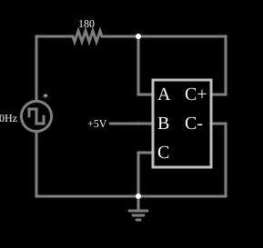

# Capacitor variável (VCCS)

<!-- navegacao:inicio -->
[Índice](README.md) · [Anterior: CCVS Variable Inductor](cs-varinduct.md)
<!-- navegacao:fim -->

## Objetivo

Mostrar como simular um capacitor cuja capacitância é controlada por uma tensão (um *varicap*): uma fonte de corrente controlada por tensão (VCCS) com a expressão $-(\text{dadt} - \text{dcdt})\cdot b\cdot 10^{-5}$ comporta-se como um capacitor $C = 10\ \mu\text{F}/\text{V}\cdot b$.

## O circuito

<!-- esquema:inicio -->

<!-- esquema:fim -->

Uma fonte de onda quadrada de $20\ \text{Hz}$ e $\pm 5\ \text{V}$ alimenta, por um resistor de $180\ \Omega$, a VCCS. Os terminais de controle $a$ e $c$ são os dois lados do "capacitor" (a tensão sobre ele é $a - c$) e $b$ é a tensão de controle, de uma fonte ajustável por um *slider* chamado "Capacitance" (de $0{,}5$ a $10\ \text{V}$, em $4{,}965\ \text{V}$ ao abrir).

<!-- componentes:inicio -->
| N.º | Tipo | Elemento | Valores |
|----:|------|----------|---------|
| 0 | `DCVoltageElm` | square wave gen | Max Voltage = 5; Waveform = Square Wave; DC Offset (V) = 0; Internal Resistance (ohms) = 0; Show Voltage = não; Specify As = Frequency/Duty Cycle; Frequency (Hz) = 20; Phase Offset (degrees) = 0; Duty Cycle = 50; Rise/Fall Time (s) = 0 |
| 1 | `ResistorElm` | resistor | Resistance (ohms) = 180 |
| 3 | `VCCSElm` | VCCS | Output Function = -(dadt-dcdt)*b*.00001; # of Inputs = 3 |
| 10 | `GroundElm` | ground | Symbol = Earth |
| 11 | `RailElm` | voltage source | Voltage = 5; Waveform = D/C; DC Offset (V) = 0; Internal Resistance (ohms) = 0 |
<!-- componentes:fim -->

## Teoria

As fontes controladas deste simulador são definidas por uma **expressão** sobre as entradas, que se chamam $a$, $b$, $c$, ... (as tensões ou correntes nos terminais de controle). O resultado é a tensão (VCVS, CCVS) ou a corrente (VCCS, CCCS) que a fonte impõe na saída. A corrente da VCCS é proporcional à derivada da tensão $v = a - c$ sobre os seus terminais de controle:

$$i = C\,\frac{dv}{dt}, \qquad C = b\cdot 10^{-5}\ \frac{\text{F}}{\text{V}} = 4{,}965\ \text{V}\cdot 10\ \mu\text{F/V} = 49{,}65\ \mu\text{F}.$$

É um capacitor cuja capacitância segue a tensão $b$. O circuito é um RC em série, de constante de tempo $\tau = RC = 180\ \Omega\cdot 49{,}65\ \mu\text{F} = 8{,}94\ \text{ms}$, e em resposta a um degrau de $5\ \text{V}$ a tensão no capacitor é $v(t) = 5\,(1 - e^{-t/\tau})$, de modo que a queda no resistor é $5\,e^{-t/\tau}$.

## Resultados esperados

A onda quadrada de $20\ \text{Hz}$ ($50\ \text{ms}$ de período) vai de $-5$ a $+5\ \text{V}$: fica em $+5\ \text{V}$ de $0$ a $25\ \text{ms}$ e em $-5\ \text{V}$ de $25$ a $50\ \text{ms}$. A queda no resistor de $180\ \Omega$ é a tensão da fonte menos a do capacitor:

| Instante | Queda no resistor (teoria) | Simulador |
|----------|---------------------------:|----------:|
| $t = 10\ \text{ms}$ | $5\,e^{-10/8{,}94} = 1{,}634\ \text{V}$ | $1{,}6336\ \text{V}$ |
| $t = 40\ \text{ms}$ | $-9{,}695\,e^{-15/8{,}94} = -1{,}810\ \text{V}$ | $-1{,}8106\ \text{V}$ |

Em $t = 25\ \text{ms}$ o capacitor está carregado a $5\,(1 - e^{-25/8{,}94}) = 4{,}695\ \text{V}$; depois de a fonte ir a $-5\ \text{V}$, a tensão do capacitor tende a $-5\ \text{V}$ com a mesma constante de tempo, partindo de um degrau de $9{,}695\ \text{V}$ ($4{,}695 + 5$), e em $t = 40\ \text{ms}$ ($15\ \text{ms}$ depois) a queda no resistor é $-9{,}695\,e^{-15/8{,}94} = -1{,}810\ \text{V}$. As verificações conferem os dois valores (tolerância de 1%).

## O que observar

- Mova o *slider* "Capacitance": a constante de tempo muda e a curva de carga fica mais lenta (maior $b$, maior $C$).
- A capacitância é proporcional à tensão de controle $b$: se $b$ variar no tempo, o capacitor é "paramétrico" (um varicap).
- Compare com um capacitor fixo de $49{,}65\ \mu\text{F}$ no mesmo circuito: a resposta com $b$ constante é idêntica.

## Limites do modelo

A VCCS é um modelo matemático, sem a não linearidade nem as perdas de um varicap real; a derivada $\text{dadt}$ é calculada numericamente entre dois passos, e se $b$ variar rápido o modelo conserva carga de forma diferente de um capacitor real.

## Referências

- J. W. Nilsson e S. A. Riedel, *Circuitos Elétricos*, Pearson.
- A. S. Sedra e K. C. Smith, *Microeletrônica*, Pearson.
- P. Falstad, *CircuitJS1 — Controlled Sources* (documentação do simulador).

O circuito deste exemplo faz parte da coleção do simulador original de Paul Falstad e Iain Sharp (CircuitJS1); a explicação é deste projeto.
