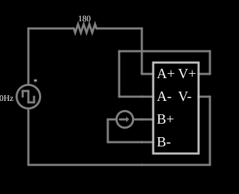

# Indutor variável (CCVS)

<!-- navegacao:inicio -->
[Índice](README.md) · [Anterior: VCVS Differentiator](cs-diff.md) · [Próximo: VCCS Variable Capacitor](cs-varicap.md)
<!-- navegacao:fim -->

## Objetivo

Mostrar como simular um indutor cuja indutância é controlada por uma corrente: uma fonte de tensão controlada por corrente (CCVS) com a expressão $\text{dadt}\cdot b\cdot 400$ comporta-se como um indutor $L = 400\cdot b$, em que $b$ é a corrente do ramo de controle.

## O circuito

<!-- esquema:inicio -->

<!-- esquema:fim -->

Uma fonte de onda quadrada de $10\ \text{Hz}$ e $\pm 5\ \text{V}$ alimenta, por um resistor de $180\ \Omega$, a CCVS. A entrada $a$ da CCVS é a corrente do circuito, e a entrada $b$ é a corrente de uma fonte de $7{,}08\ \text{mA}$ (ajustável por um *slider* chamado "Inductance", de $1$ a $20\ \text{mA}$).

<!-- componentes:inicio -->
| N.º | Tipo | Elemento | Valores |
|----:|------|----------|---------|
| 0 | `DCVoltageElm` | square wave gen | Max Voltage = 5; Waveform = Square Wave; DC Offset (V) = 0; Internal Resistance (ohms) = 0; Show Voltage = não; Specify As = Frequency/Duty Cycle; Frequency (Hz) = 10; Phase Offset (degrees) = 0; Duty Cycle = 50; Rise/Fall Time (s) = 0 |
| 1 | `ResistorElm` | resistor | Resistance (ohms) = 180 |
| 3 | `CCVSElm` | CCVS | Output Function = dadt*b*400; # of Inputs = 4 |
| 11 | `CurrentElm` | current source | Current (A) = 7.1m; Max Voltage (V, 0=unlimited) = 0 |
<!-- componentes:fim -->

## Teoria

As fontes controladas deste simulador são definidas por uma **expressão** sobre as entradas, que se chamam $a$, $b$, $c$, ... (as tensões ou correntes nos terminais de controle). O resultado é a tensão (VCVS, CCVS) ou a corrente (VCCS, CCCS) que a fonte impõe na saída. A tensão da CCVS é $v = \dfrac{di}{dt}\cdot b\cdot 400$ (com $i$ a corrente $a$ e $b$ em amperes), o que é a lei de um indutor com

$$L = 400\ \frac{\text{H}}{\text{A}}\cdot b = 400\cdot 7{,}08\ \text{mA} = 2{,}83\ \text{H}.$$

O circuito é um RL em série, e a corrente em resposta a um degrau $V$ é

$$i(t) = \frac{V}{R}\left(1 - e^{-t/\tau}\right), \qquad \tau = \frac{L}{R} = \frac{2{,}83\ \text{H}}{180\ \Omega} = 15{,}7\ \text{ms}.$$

## Resultados esperados

Em resposta ao primeiro semiciclo positivo ($0$ a $50\ \text{ms}$, com a fonte em $+5\ \text{V}$), com $V/R = 27{,}8\ \text{mA}$:

| Instante | Corrente (teoria) | Simulador |
|----------|------------------:|----------:|
| $t = 10\ \text{ms}$ | $27{,}78\,(1 - e^{-0{,}636}) = 13{,}08\ \text{mA}$ | $13{,}065\ \text{mA}$ |
| $t = 40\ \text{ms}$ | $27{,}78\,(1 - e^{-2{,}54}) = 25{,}6\ \text{mA}$ | $25{,}6\ \text{mA}$ |

As verificações conferem as duas correntes (tolerância de 1%).

## O que observar

- Mova o *slider* "Inductance": a constante de tempo muda e a curva de subida da corrente fica mais lenta (maior corrente de controle, maior $L$) ou mais rápida.
- A "indutância" é proporcional à corrente de controle $b$: pode-se simular um indutor saturável, ou ajustável, só mudando a expressão.
- Compare com um indutor real de $2{,}83\ \text{H}$ no mesmo circuito: a resposta é idêntica.

## Limites do modelo

A CCVS não é um componente físico: o "indutor" é um modelo matemático ideal, sem resistência série, sem saturação nem capacitância entre espiras. A derivada $\text{dadt}$ é calculada numericamente, e mudanças bruscas de $b$ durante a simulação produziriam transitórios não físicos.

## Referências

- J. W. Nilsson e S. A. Riedel, *Circuitos Elétricos*, Pearson.
- A. S. Sedra e K. C. Smith, *Microeletrônica*, Pearson.
- P. Falstad, *CircuitJS1 — Controlled Sources* (documentação do simulador).

O circuito deste exemplo faz parte da coleção do simulador original de Paul Falstad e Iain Sharp (CircuitJS1); a explicação é deste projeto.
