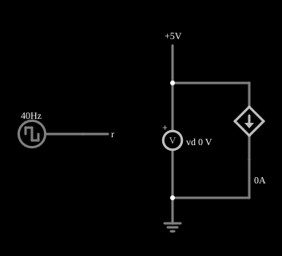

# Resistor variável com fonte de corrente controlada

<!-- navegacao:inicio -->
[Índice](README.md) · [Anterior: CCS Resistor](cs-resistor.md) · [Próximo: CVS Op-Amp](cs-opamp.md)
<!-- navegacao:fim -->

## Objetivo

Mostrar como uma fonte de corrente controlada simula um resistor cujo valor é controlado por uma tensão: a expressão $v(\text{vd})/(1000\,(1+v(r)))$ é a de um resistor de $1\ \text{k}\Omega\,(1 + v_r)$, em que `vd` é um voltímetro sobre o \"resistor\" e `r` um nó rotulado com a tensão de controle.

## O circuito

<!-- esquema:inicio -->

<!-- esquema:fim -->

Uma fonte de $5\ \text{V}$ alimenta a fonte de corrente controlada, ligada entre o seu terminal e a terra; o voltímetro `vd` mede essa tensão. O nó rotulado `r` recebe uma onda quadrada de $40\ \text{Hz}$ que vai de $1$ a $5\ \text{V}$ (amplitude de $2\ \text{V}$ sobre $3\ \text{V}$).

<!-- componentes:inicio -->
| N.º | Tipo | Elemento | Valores |
|----:|------|----------|---------|
| 3 | `GroundElm` | ground | Symbol = Earth |
| 4 | `RailElm` | voltage source | Voltage = 5; Waveform = D/C; DC Offset (V) = 0; Internal Resistance (ohms) = 0 |
| 5 | `RailElm` | square wave gen | Max Voltage = 2; Waveform = Square Wave; DC Offset (V) = 3; Internal Resistance (ohms) = 0; Show Voltage = não; Specify As = Frequency/Duty Cycle; Frequency (Hz) = 40; Phase Offset (degrees) = 0; Duty Cycle = 50; Rise/Fall Time (s) = 0 |
| 6 | `ControlledCurrentElm` | Controlled Current Source | Output Current = v(vd)/(1000*(1+v(r))) |
| 7 | `LabeledNodeElm` | Labeled Node | Text = r; Internal Node = não; Rotate Text When Vertical = não |
| 8 | `ProbeElm` | voltmeter | Show Voltage = sim; Value = Voltage; Scale = Auto; Use Circle Symbol = sim; Series Resistance (0 = infinite) = 0; Label = vd |
<!-- componentes:fim -->

## Teoria

As fontes controladas de dois terminais (o losango) são definidas por uma **expressão** que lê o resto do circuito **pelo nome**: $v(\text{nome})$ é a tensão de um nó rotulado ou sobre um voltímetro com rótulo, $i(\text{nome})$ a corrente de um amperímetro com rótulo, e $\text{dvdt}$ / $\text{didt}$ as suas taxas de variação. O resultado é a tensão (fonte de tensão controlada, com o $+$ no segundo terminal) ou a corrente (fonte de corrente controlada, no sentido da seta) que a fonte impõe. Com $v(\text{vd})$ a tensão sobre o "resistor" e $v(r) = v_r$ a tensão de controle, a corrente é

$$I = \frac{v(\text{vd})}{1000\,(1 + v_r)}\ \Omega^{-1},$$

o que equivale a uma resistência $R = 1\ \text{k}\Omega\,(1 + v_r)$ controlada pela tensão do nó `r`. Com $v_r = 1\ \text{V}$, $R = 2\ \text{k}\Omega$; com $v_r = 5\ \text{V}$, $R = 6\ \text{k}\Omega$.

## Resultados esperados

| Instante | $v_r$ | $R = 1\ \text{k}\Omega\,(1+v_r)$ | Corrente a $5\ \text{V}$ |
|----------|----:|-------------------------------:|---------------------:|
| $t = 10\ \text{ms}$ (meio ciclo alto) | $5\ \text{V}$ | $6\ \text{k}\Omega$ | $0{,}8333\ \text{mA}$ |
| $t = 20\ \text{ms}$ (meio ciclo baixo) | $1\ \text{V}$ | $2\ \text{k}\Omega$ | $2{,}5\ \text{mA}$ |

As verificações conferem as duas correntes (tolerância de 1%).

## O que observar

- A corrente da fonte de $5\ \text{V}$ alterna entre $0{,}83$ e $2{,}5\ \text{mA}$ conforme o estado da onda quadrada, mesmo com tensão constante: o "resistor" muda de valor.
- Troque a onda quadrada por uma senoide e a resistência varia continuamente.
- Esse tipo de modelo representa sensores resistivos (LDR, termistor) e potenciômetros controlados.

## Limites do modelo

A resistência varia sem atraso e não há limite de potência. A expressão não protege contra $1 + v_r = 0$ (resistência nula, corrente infinita), e se $v_r$ chegasse perto de $-1\ \text{V}$ o resultado perderia significado físico.

## Referências

- J. W. Nilsson e S. A. Riedel, *Circuitos Elétricos*, Pearson.
- A. S. Sedra e K. C. Smith, *Microeletrônica*, Pearson.
- P. Falstad, *CircuitJS1 — Controlled Sources* (documentação do simulador).

O circuito deste exemplo faz parte da coleção do simulador original de Paul Falstad e Iain Sharp (CircuitJS1); a explicação é deste projeto.
