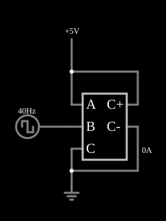

# Resistor variável com fonte de corrente controlada

<!-- navegacao:inicio -->
[Índice](README.md) · [Anterior: VCCS Resistor](cs-resistor.md) · [Próximo: VCVS Op-Amp](cs-opamp.md)
<!-- navegacao:fim -->

## Objetivo

Mostrar como uma VCCS com três entradas simula um resistor cujo valor é controlado por uma terceira tensão: a expressão $-(a-c)/(1000(1+b))$ é a de um resistor de $1\ \text{k}\Omega\,(1 + b)$.

## O circuito

<!-- esquema:inicio -->

<!-- esquema:fim -->

Uma fonte de $5\ \text{V}$ alimenta o terminal de controle $a$ da VCCS, com $c$ na terra. A entrada $b$ recebe uma onda quadrada de $40\ \text{Hz}$ que vai de $1$ a $5\ \text{V}$ (amplitude de $2\ \text{V}$ sobre um nível contínuo de $3\ \text{V}$).

<!-- componentes:inicio -->
| N.º | Tipo | Elemento | Valores |
|----:|------|----------|---------|
| 0 | `VCCSElm` | VCCS | Output Function = -(a-c)/(1000*(1+b)); # of Inputs = 3 |
| 6 | `GroundElm` | ground | Symbol = Earth |
| 7 | `RailElm` | voltage source | Voltage = 5; Waveform = D/C; DC Offset (V) = 0; Internal Resistance (ohms) = 0 |
| 9 | `RailElm` | square wave gen | Max Voltage = 2; Waveform = Square Wave; DC Offset (V) = 3; Internal Resistance (ohms) = 0; Show Voltage = não; Specify As = Frequency/Duty Cycle; Frequency (Hz) = 40; Phase Offset (degrees) = 0; Duty Cycle = 50; Rise/Fall Time (s) = 0 |
<!-- componentes:fim -->

## Teoria

As fontes controladas deste simulador são definidas por uma **expressão** sobre as entradas, que se chamam $a$, $b$, $c$, ... (as tensões ou correntes nos terminais de controle). O resultado é a tensão (VCVS, CCVS) ou a corrente (VCCS, CCCS) que a fonte impõe na saída. Com as três entradas $a$ (tensão alimentada), $b$ (controle) e $c$ (referência), a corrente absorvida é

$$I = \frac{a - c}{1000\,(1 + b)}\ \Omega^{-1},$$

o que equivale a uma resistência $R = 1\ \text{k}\Omega\,(1 + b)$ controlada por $b$. Com $b = 1\ \text{V}$, $R = 2\ \text{k}\Omega$; com $b = 5\ \text{V}$, $R = 6\ \text{k}\Omega$.

## Resultados esperados

| Instante | $b$ | $R = 1\ \text{k}\Omega\,(1+b)$ | Corrente a $5\ \text{V}$ |
|----------|----:|-------------------------------:|---------------------:|
| $t = 10\ \text{ms}$ (meio ciclo alto) | $5\ \text{V}$ | $6\ \text{k}\Omega$ | $0{,}8333\ \text{mA}$ |
| $t = 20\ \text{ms}$ (meio ciclo baixo) | $1\ \text{V}$ | $2\ \text{k}\Omega$ | $2{,}5\ \text{mA}$ |

As verificações conferem as duas correntes (tolerância de 1%).

## O que observar

- A corrente da fonte de $5\ \text{V}$ alterna entre $0{,}83$ e $2{,}5\ \text{mA}$ conforme o estado da onda quadrada, mesmo com tensão constante: o "resistor" muda de valor.
- Troque a onda quadrada por uma senoide e a resistência varia continuamente.
- Esse tipo de modelo representa sensores resistivos (LDR, termistor) e potenciômetros controlados.

## Limites do modelo

A resistência varia sem atraso e não há limite de potência. A expressão não protege contra $1 + b = 0$ (resistência nula, corrente infinita), e se $b$ chegasse perto de $-1\ \text{V}$ o resultado perderia significado físico.

## Referências

- J. W. Nilsson e S. A. Riedel, *Circuitos Elétricos*, Pearson.
- A. S. Sedra e K. C. Smith, *Microeletrônica*, Pearson.
- P. Falstad, *CircuitJS1 — Controlled Sources* (documentação do simulador).

O circuito deste exemplo faz parte da coleção do simulador original de Paul Falstad e Iain Sharp (CircuitJS1); a explicação é deste projeto.
