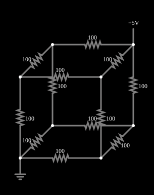

# Cubo de resistores

<!-- navegacao:inicio -->
[Índice](README.md) · [Anterior: Resistor Grid 2](grid2.md) · [Próximo: Phase-Sequence Network](phaseseq.md)
<!-- navegacao:fim -->

## Objetivo

Mostrar um problema clássico: a resistência equivalente entre dois vértices opostos de um cubo de 12 resistores iguais, que se resolve pela simetria do circuito, sem equações.

## O circuito

<!-- esquema:inicio -->

<!-- esquema:fim -->

Doze resistores de $100\ \Omega$ formam as arestas de um cubo. Uma fonte de $5\ \text{V}$ está ligada a um vértice e a terra, ao vértice **oposto** (o que difere do primeiro em todas as três direções).

<!-- componentes:inicio -->
| N.º | Tipo | Elemento | Valores |
|----:|------|----------|---------|
| 0 | `ResistorElm` | resistor | Resistance (ohms) = 100 |
| 1 | `ResistorElm` | resistor | Resistance (ohms) = 100 |
| 2 | `ResistorElm` | resistor | Resistance (ohms) = 100 |
| 3 | `ResistorElm` | resistor | Resistance (ohms) = 100 |
| 4 | `ResistorElm` | resistor | Resistance (ohms) = 100 |
| 5 | `ResistorElm` | resistor | Resistance (ohms) = 100 |
| 6 | `ResistorElm` | resistor | Resistance (ohms) = 100 |
| 7 | `ResistorElm` | resistor | Resistance (ohms) = 100 |
| 8 | `ResistorElm` | resistor | Resistance (ohms) = 100 |
| 9 | `ResistorElm` | resistor | Resistance (ohms) = 100 |
| 10 | `ResistorElm` | resistor | Resistance (ohms) = 100 |
| 11 | `ResistorElm` | resistor | Resistance (ohms) = 100 |
| 12 | `RailElm` | voltage source | Voltage = 5; Waveform = D/C; DC Offset (V) = 0; Internal Resistance (ohms) = 0 |
| 13 | `GroundElm` | ground | Symbol = Earth |
<!-- componentes:fim -->

## Teoria

Por simetria, as três arestas que saem do vértice da fonte têm a mesma corrente, e os vértices a que elas chegam têm o mesmo potencial; o mesmo vale para o vértice da terra. Os vértices do cubo se agrupam então em quatro camadas equipotenciais:

| camada | vértices | arestas até a camada seguinte |
|:------:|:--------:|:-----------------------------:|
| 0 (fonte) | 1 | 3 arestas em paralelo |
| 1 | 3 | 6 arestas em paralelo |
| 2 | 3 | 3 arestas em paralelo |
| 3 (terra) | 1 | — |

Os vértices de uma mesma camada podem ser curto-circuitados sem alterar o circuito (eles já estão ao mesmo potencial), e o cubo vira a associação em série de três conjuntos de resistores em paralelo:

$$R_{eq} = \frac{R}{3} + \frac{R}{6} + \frac{R}{3} = \frac{5R}{6}.$$

## Resultados esperados

Com $R = 100\ \Omega$: $R_{eq} = 83{,}33\ \Omega$ e a corrente da fonte é $I = 5/83{,}33 = 60\ \text{mA}$. Essa corrente se divide em

- $20\ \text{mA}$ em cada uma das 3 arestas que saem da fonte (queda de $2\ \text{V}$);
- $10\ \text{mA}$ em cada uma das 6 arestas do meio (queda de $1\ \text{V}$);
- $20\ \text{mA}$ em cada uma das 3 arestas que chegam à terra (queda de $2\ \text{V}$).

Os potenciais das camadas são, portanto, $5\ \text{V}$, $3\ \text{V}$, $2\ \text{V}$ e $0\ \text{V}$. As verificações conferem a corrente da fonte ($60\ \text{mA}$), a de uma aresta de cada tipo e a queda de tensão de uma aresta da primeira camada, com tolerância de 1%.

## O que observar

- Passe o ponteiro por qualquer aresta e confira as três correntes ($20$, $10$ e $20\ \text{mA}$).
- Ligue a fonte a outros pares de vértices (vizinhos ou na diagonal de uma face): as resistências equivalentes passam a $\tfrac{7R}{12}$ e $\tfrac{3R}{4}$, respectivamente.
- Compare com o exemplo da grade de resistores: aqui a simetria dispensa a álgebra de matrizes.

## Limites do modelo

Resistores ideais. O argumento de simetria só vale para os vértices opostos; para outros pares de vértices é preciso resolver as equações de nós.

## Referências

- J. W. Nilsson e S. A. Riedel, *Circuitos Elétricos*, Pearson.
- C. K. Alexander e M. N. O. Sadiku, *Fundamentos de Circuitos Elétricos*, AMGH.

O circuito deste exemplo faz parte da coleção do simulador original de Paul Falstad e Iain Sharp (CircuitJS1); a explicação é deste projeto.
