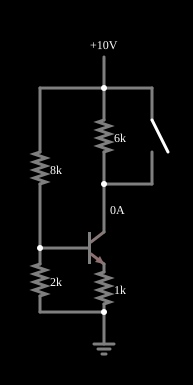

# Fonte de corrente a transistor

<!-- navegacao:inicio -->
[Índice](README.md) · [Anterior: Schmitt Trigger](schmitt.md) · [Próximo: Current Source Ramp](currentsrcramp.md)
<!-- navegacao:fim -->

## Objetivo

Mostrar uma fonte de corrente construída com um transistor: a corrente de coletor é fixada pelo emissor e pela base, e praticamente não depende da carga ligada ao coletor.

## O circuito

<!-- esquema:inicio -->

<!-- esquema:fim -->

A alimentação é de $10\ \text{V}$. Um divisor de $8\ \text{k}\Omega$ e $2\ \text{k}\Omega$ fixa a base em $\approx 2\ \text{V}$; o emissor tem um resistor de $1\ \text{k}\Omega$ para a terra; o coletor alimenta uma carga de $6\ \text{k}\Omega$, que pode ser curto-circuitada por uma chave.

<!-- componentes:inicio -->
| N.º | Tipo | Elemento | Valores |
|----:|------|----------|---------|
| 0 | `NTransistorElm` | transistor | Beta/hFE = 100; Swap E/C = não; Draw Circle = não; Model = default |
| 1 | `ResistorElm` | resistor | Resistance (ohms) = 1k |
| 2 | `GroundElm` | ground | Symbol = Earth |
| 6 | `RailElm` | voltage source | Voltage = 10; Waveform = D/C; DC Offset (V) = 0; Internal Resistance (ohms) = 0 |
| 7 | `SwitchElm` | switch (SPST) | Momentary Switch = não; IEC Symbol = não; Label (for linking) = ; Keyboard Shortcut = ; On Resistance (ohms) = 0 |
| 8 | `ResistorElm` | resistor | Resistance (ohms) = 6k |
| 11 | `ResistorElm` | resistor | Resistance (ohms) = 2k |
| 12 | `ResistorElm` | resistor | Resistance (ohms) = 8k |
<!-- componentes:fim -->

## Teoria

O transistor bipolar do simulador (modelo "default") segue o modelo de Ebers–Moll, com $V_{BE}$ e $V_{BC}$ as tensões base-emissor e base-coletor (para um NPN):

$$I_C = I_s\left(e^{V_{BE}/V_T} - e^{V_{BC}/V_T}\right) - \frac{I_s}{\beta_R}\left(e^{V_{BC}/V_T} - 1\right),\qquad I_B = \frac{I_s}{\beta}\left(e^{V_{BE}/V_T} - 1\right) + \frac{I_s}{\beta_R}\left(e^{V_{BC}/V_T} - 1\right),$$

com $I_s = 10^{-13}\ \text{A}$, $\beta = 100$, $\beta_R = 1$ e $V_T = 25{,}865\ \text{mV}$; sem efeito Early, sem capacitâncias e sem resistências série. Na **região ativa** ($V_{BE} \approx 0{,}65$ a $0{,}75\ \text{V}$, junção base-coletor com polarização inversa) isso se reduz a $I_C = \beta I_B = I_s\,e^{V_{BE}/V_T}$, com transcondutância $g_m = I_C/V_T$ e resistência de emissor $r_e = V_T/I_E$. O PNP é o complementar, com todas as tensões e correntes invertidas.

## Resultados esperados

A tensão de emissor segue a da base, $V_E = V_B - V_{BE}$, e a corrente de emissor é $I_E = V_E/R_E$. Como $I_C = \dfrac{\beta}{\beta + 1}I_E$ e, na região ativa, $I_C$ não depende de $V_{CE}$, a corrente na carga fica constante enquanto o transistor não satura (enquanto $V_C > V_E + V_{CE(sat)}$):

$$I_C \approx \frac{V_B - V_{BE}}{R_E},\qquad V_B = V_{CC}\frac{R_2}{R_1 + R_2} - I_B (R_1\,\|\,R_2).$$

A tensão na carga acompanha $I_C R_L$ ($= 8{,}2\ \text{V}$): a fonte de corrente "empurra" a mesma corrente por qualquer carga, dentro da faixa de tensão disponível (aqui, $10 - 1{,}4 - 0{,}2 = 8{,}4\ \text{V}$ no máximo).

## O que observar

Com $V_B = 2 - I_B\cdot 1{,}6\ \text{k}\Omega \approx 1{,}98\ \text{V}$ e $V_{BE} = 0{,}6035\ \text{V}$: $I_E = 1{,}375\ \text{mA}$ e $I_C = 1{,}361\ \text{mA}$ (cálculo independente, a menos de $10^{-5}$ do simulador). A tensão na carga de $6\ \text{k}\Omega$ é $8{,}166\ \text{V}$ e o transistor opera com $V_{CE} = 0{,}459\ \text{V}$ (perto da saturação, o que limita a carga máxima). Fechando a chave, a carga é curto-circuitada, e a mesma corrente de $1{,}361\ \text{mA}$ passa a circular pela chave. As verificações conferem a corrente na carga, a de emissor e a corrente da chave fechada (tolerância de 1%).

## Limites do modelo

- Feche a chave: a corrente não muda, só a tensão na carga ($8{,}2\ \text{V}$ para $0$).
- Aumente a carga (por exemplo, para $9\ \text{k}\Omega$): o transistor satura e a corrente cai; é o limite de conformidade da fonte.
- Mude o resistor de emissor: a corrente muda em proporção inversa.

## Referências

O modelo não tem efeito Early, de modo que a fonte tem resistência de saída infinita; um transistor real tem $r_o = V_A/I_C$ (de dezenas de $\text{k}\Omega$) e a corrente varia um pouco com a tensão de coletor. A corrente depende de $V_{BE}$ e, portanto, da temperatura.

O circuito deste exemplo faz parte da coleção do simulador original de Paul Falstad e Iain Sharp (CircuitJS1); a explicação é deste projeto.
