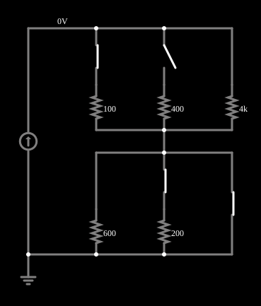

# Fonte de corrente

<!-- navegacao:inicio -->
[Índice](README.md) · [Anterior: Critically Damped LRC](lrc-critical.md) · [Próximo: Inductive Kickback](inductkick.md)
<!-- navegacao:fim -->

## Objetivo

Mostrar uma fonte de corrente ideal: ela entrega sempre a mesma corrente, e é a **tensão** nos seus terminais que se ajusta à resistência da carga, ao contrário de uma fonte de tensão.

## O circuito

<!-- esquema:inicio -->

<!-- esquema:fim -->

Uma fonte de corrente de $10\ \text{mA}$ alimenta duas redes de resistores em série. A de cima tem três ramos em paralelo: $100\ \Omega$ e $400\ \Omega$ (cada um com uma chave) e $4\ \text{k}\Omega$ (sempre ligado). A de baixo tem dois ramos em paralelo, $600\ \Omega$ (sempre ligado) e $200\ \Omega$ (com chave), e uma chave que **curto-circuita** toda a rede de baixo. Na posição inicial, estão fechadas as chaves do ramo de $100\ \Omega$, do de $200\ \Omega$ e do curto-circuito; a do ramo de $400\ \Omega$ está aberta.

<!-- componentes:inicio -->
| N.º | Tipo | Elemento | Valores |
|----:|------|----------|---------|
| 3 | `SwitchElm` | switch (SPST) | Momentary Switch = não; IEC Symbol = não; Label (for linking) = ; Keyboard Shortcut = ; On Resistance (ohms) = 0 |
| 4 | `SwitchElm` | switch (SPST) | Momentary Switch = não; IEC Symbol = não; Label (for linking) = ; Keyboard Shortcut = ; On Resistance (ohms) = 0 |
| 5 | `ResistorElm` | resistor | Resistance (ohms) = 100 |
| 6 | `ResistorElm` | resistor | Resistance (ohms) = 400 |
| 7 | `ResistorElm` | resistor | Resistance (ohms) = 4k |
| 13 | `SwitchElm` | switch (SPST) | Momentary Switch = não; IEC Symbol = não; Label (for linking) = ; Keyboard Shortcut = ; On Resistance (ohms) = 0 |
| 14 | `ResistorElm` | resistor | Resistance (ohms) = 600 |
| 15 | `ResistorElm` | resistor | Resistance (ohms) = 200 |
| 16 | `SwitchElm` | switch (SPST) | Momentary Switch = não; IEC Symbol = não; Label (for linking) = ; Keyboard Shortcut = ; On Resistance (ohms) = 0 |
| 20 | `CurrentElm` | current source | Current (A) = 10m; Max Voltage (V, 0=unlimited) = 0 |
| 21 | `GroundElm` | ground | Symbol = Earth |
<!-- componentes:fim -->

## Teoria

Uma fonte de corrente ideal mantém $I = 10\ \text{mA}$ qualquer que seja a carga; pela lei de Ohm a tensão em seus terminais é

$$V = I\,R_{eq},\qquad R_{eq} = R_{cima} + R_{baixo},$$

com as resistências de cada rede combinadas em paralelo, $\dfrac{1}{R_{rede}} = \sum_k \dfrac{1}{R_k}$ (e $R_{baixo} = 0$ quando o curto-circuito está fechado). Ao contrário de uma fonte de tensão, que **não** pode ser curto-circuitada (a corrente seria infinita), a fonte de corrente fica em perfeita ordem com um curto-circuito ($V = I\cdot R_{cima}$) e é o **circuito aberto** que ela não admite: a tensão tenderia ao infinito (aqui o ramo de $4\ \text{k}\Omega$ está sempre ligado, de modo que a fonte sempre tem caminho).

## Resultados esperados

A tabela mostra a tensão na fonte para cinco posições das chaves (as chaves trocadas em relação à posição inicial são as indicadas):

| trocadas | $R_{cima}$ ($\Omega$) | $R_{baixo}$ ($\Omega$) | $V = I\,R_{eq}$ ($\text{V}$) |
|:---------|----:|----:|----:|
| nenhuma | 97.56 | 0.00 | 0.9756 |
| curto aberto | 97.56 | 150.00 | 2.4756 |
| curto e $200\ \Omega$ abertos | 97.56 | 600.00 | 6.9756 |
| mais o de $100\ \Omega$ aberto | 4000.00 | 600.00 | 46.0000 |
| curto e $200\ \Omega$ abertos, $400\ \Omega$ fechado | 78.43 | 600.00 | 6.7843 |

Em todos os casos a corrente da fonte permanece $10\ \text{mA}$ (a última verificação confere isso na quarta linha, onde a tensão chega a $46\ \text{V}$). As cinco primeiras verificações conferem a tensão em cada posição, com tolerância de 1%.

## O que observar

- Clique nas chaves: a corrente da fonte não muda, mas a tensão sobe e desce com a resistência total.
- Com o curto-circuito fechado, a rede de baixo desaparece; com ele aberto, sua resistência se soma.
- Veja como a corrente se divide nos ramos em paralelo, em proporção inversa às resistências (divisor de corrente).

## Limites do modelo

A fonte de corrente é ideal (tensão máxima ilimitada, como indica o parâmetro "Max Voltage = 0, sem limite"); uma fonte real tem uma tensão máxima (a "tensão de conformidade") e uma resistência interna em paralelo. As chaves são ideais.

## Referências

- J. W. Nilsson e S. A. Riedel, *Circuitos Elétricos*, Pearson.
- C. K. Alexander e M. N. O. Sadiku, *Fundamentos de Circuitos Elétricos*, AMGH.

O circuito deste exemplo faz parte da coleção do simulador original de Paul Falstad e Iain Sharp (CircuitJS1); a explicação é deste projeto.
