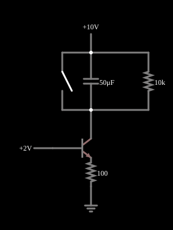

# Rampa com fonte de corrente

<!-- navegacao:inicio -->
[Índice](README.md) · [Anterior: Current Source](currentsrc.md) · [Próximo: Current Mirror](mirror.md)
<!-- navegacao:fim -->

## Objetivo

Mostrar como uma fonte de corrente constante, carregando um capacitor, produz uma tensão que cresce linearmente com o tempo (uma rampa), a base dos geradores de dente de serra.

## O circuito

<!-- esquema:inicio -->

<!-- esquema:fim -->

Um transistor NPN com a base em $2\ \text{V}$ e um resistor de emissor de $100\ \Omega$ é uma fonte de corrente de $\approx 13\ \text{mA}$. A corrente de coletor carrega um capacitor de $50\ \mu\text{F}$ ligado a $+10\ \text{V}$; um resistor de $10\ \text{k}\Omega$ em paralelo com o capacitor representa uma carga, e uma chave momentânea o descarrega (reinício da rampa). A tensão no capacitor é a saída.

<!-- componentes:inicio -->
| N.º | Tipo | Elemento | Valores |
|----:|------|----------|---------|
| 0 | `NTransistorElm` | transistor | Beta/hFE = 100; Swap E/C = não; Draw Circle = não; Model = default |
| 1 | `ResistorElm` | resistor | Resistance (ohms) = 100 |
| 2 | `GroundElm` | ground | Symbol = Earth |
| 3 | `RailElm` | voltage source | Voltage = 2; Waveform = D/C; DC Offset (V) = 0; Internal Resistance (ohms) = 0 |
| 7 | `RailElm` | voltage source | Voltage = 10; Waveform = D/C; DC Offset (V) = 0; Internal Resistance (ohms) = 0 |
| 8 | `CapacitorElm` | capacitor | Capacitance (F) = 50μ; Trapezoidal Approximation = sim; Initial Voltage (on Reset) = 1m; Series Resistance = 0 |
| 9 | `ResistorElm` | resistor | Resistance (ohms) = 10k |
| 12 | `SwitchElm` | switch (SPST) | Momentary Switch = sim; IEC Symbol = não; Label (for linking) = ; Keyboard Shortcut = ; On Resistance (ohms) = 0 |
<!-- componentes:fim -->

## Teoria

O transistor bipolar do simulador (modelo "default") segue o modelo de Ebers–Moll, com $V_{BE}$ e $V_{BC}$ as tensões base-emissor e base-coletor (para um NPN):

$$I_C = I_s\left(e^{V_{BE}/V_T} - e^{V_{BC}/V_T}\right) - \frac{I_s}{\beta_R}\left(e^{V_{BC}/V_T} - 1\right),\qquad I_B = \frac{I_s}{\beta}\left(e^{V_{BE}/V_T} - 1\right) + \frac{I_s}{\beta_R}\left(e^{V_{BC}/V_T} - 1\right),$$

com $I_s = 10^{-13}\ \text{A}$, $\beta = 100$, $\beta_R = 1$ e $V_T = 25{,}865\ \text{mV}$; sem efeito Early, sem capacitâncias e sem resistências série. Na **região ativa** ($V_{BE} \approx 0{,}65$ a $0{,}75\ \text{V}$, junção base-coletor com polarização inversa) isso se reduz a $I_C = \beta I_B = I_s\,e^{V_{BE}/V_T}$, com transcondutância $g_m = I_C/V_T$ e resistência de emissor $r_e = V_T/I_E$. O PNP é o complementar, com todas as tensões e correntes invertidas.

## Resultados esperados

Com a corrente $I$ constante, $v_C(t) = \dfrac{1}{C}\int I\,dt = \dfrac{I}{C}\,t$: uma rampa de inclinação $I/C$. Com o resistor de carga $R$ em paralelo com o capacitor, a rampa se encurva e tende, exponencialmente, a $IR$:

$$v_C(t) = I R\left(1 - e^{-t/RC}\right) \approx \frac{I}{C}\,t\quad (t \ll RC).$$

A rampa termina quando o transistor satura (a tensão de coletor cai a $V_E + V_{CE(sat)}$), com a tensão no capacitor perto de $V_{CC} - 1{,}5\ \text{V}$.

## O que observar

Com $V_E = 1{,}3375\ \text{V}$ ($V_{BE} = 0{,}6625\ \text{V}$): $I_E = 13{,}375\ \text{mA}$ e $I_C = 13{,}24\ \text{mA}$. Como $RC = 0{,}5\ \text{s}$ é muito maior que o tempo de rampa, a rampa é quase linear, com inclinação inicial $I_C/C = 265\ \text{V/s}$: $v_C = 1{,}317\ \text{V}$ em $5\ \text{ms}$, $2{,}622\ \text{V}$ em $10\ \text{ms}$ e $5{,}192\ \text{V}$ em $20\ \text{ms}$ (a pequena curvatura vem da carga de $10\ \text{k}\Omega$). A rampa chega a $8{,}7\ \text{V}$ em $50\ \text{ms}$, já saturando. As verificações conferem a tensão do capacitor em $5$, $10$ e $20\ \text{ms}$ e a corrente de emissor (tolerância de 1%; concordam com a integração independente a menos de $10^{-5}$).

## Limites do modelo

- A tensão do capacitor sobe em linha quase reta, com inclinação de $\approx 265\ \text{V/s}$.
- Aperte o botão: o capacitor se descarrega e a rampa recomeça.
- Dobre o capacitor: a inclinação cai pela metade.

## Referências

Uma rampa real é linear só enquanto o transistor está na região ativa (e o efeito Early e a variação de $V_{BE}$ com a temperatura a deformam). A descarga é instantânea (chave ideal).

O circuito deste exemplo faz parte da coleção do simulador original de Paul Falstad e Iain Sharp (CircuitJS1); a explicação é deste projeto.
