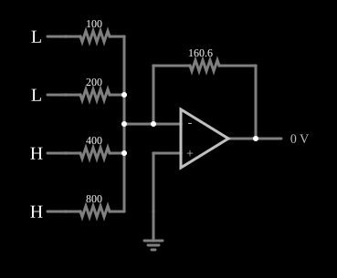

# Conversor D/A de resistores ponderados

<!-- navegacao:inicio -->
[Índice](README.md) · [Anterior: Half-Flash (Subranging) ADC](hfadc.md) · [Próximo: R-2R Ladder DAC](r2rladder.md)
<!-- navegacao:fim -->

## Objetivo

Mostrar o conversor digital-analógico mais direto: cada bit injeta, por um resistor de valor proporcional ao inverso do seu peso, uma corrente num amplificador somador.

## O circuito

<!-- esquema:inicio -->

<!-- esquema:fim -->

Quatro entradas lógicas ($0$ ou $5\ \text{V}$) ligam-se, por resistores de $100$, $200$, $400$ e $800\ \Omega$, à entrada inversora de um amp-op (saturação em $\pm 15\ \text{V}$), cuja entrada não inversora está na terra. A realimentação tem $160{,}6\ \Omega$, e a saída vai a um medidor (elemento 16). De cima para baixo, as entradas são o bit 3 (elemento 13, $100\ \Omega$), o bit 2 (elemento 8, $200\ \Omega$), o bit 1 (elemento 9, $400\ \Omega$) e o bit 0 (elemento 14, $800\ \Omega$). O exemplo abre com os bits 1 e 0 em $1$.

<!-- componentes:inicio -->
| N.º | Tipo | Elemento | Valores |
|----:|------|----------|---------|
| 2 | `ResistorElm` | resistor | Resistance (ohms) = 160.6 |
| 3 | `GroundElm` | ground | Symbol = Earth |
| 6 | `ResistorElm` | resistor | Resistance (ohms) = 200 |
| 7 | `ResistorElm` | resistor | Resistance (ohms) = 400 |
| 8 | `LogicInputElm` | logic input | Momentary Switch = não; High Logic Voltage = 5; Low Voltage = 0; Numeric = não; Ternary = não; Keyboard Shortcut =  |
| 9 | `LogicInputElm` | logic input | Momentary Switch = não; High Logic Voltage = 5; Low Voltage = 0; Numeric = não; Ternary = não; Keyboard Shortcut =  |
| 11 | `ResistorElm` | resistor | Resistance (ohms) = 800 |
| 12 | `ResistorElm` | resistor | Resistance (ohms) = 100 |
| 13 | `LogicInputElm` | logic input | Momentary Switch = não; High Logic Voltage = 5; Low Voltage = 0; Numeric = não; Ternary = não; Keyboard Shortcut =  |
| 14 | `LogicInputElm` | logic input | Momentary Switch = não; High Logic Voltage = 5; Low Voltage = 0; Numeric = não; Ternary = não; Keyboard Shortcut =  |
| 15 | `OpAmpElm` | op-amp | Max Output (V) = 15; Min Output (V) = -15; Gain = 100k |
| 16 | `OutputElm` | output | Show Voltage = sim; Scale = Auto |
<!-- componentes:fim -->

## Teoria

O nó inversor é uma terra virtual; cada bit em $1$ injeta $5\ \text{V}/R_k$, e as correntes somam-se na realimentação ([Summing Amplifier](amp-sum.md)):

$$V_{out} = -R_f \cdot 5\ \text{V} \left(\frac{b_3}{100} + \frac{b_2}{200} + \frac{b_1}{400} + \frac{b_0}{800}\right) = -\frac{160{,}6 \cdot 5}{800} N \approx -1{,}004\, N\ \text{V},$$

com $N = 8b_3 + 4b_2 + 2b_1 + b_0$. A saída é cerca de $-1\ \text{V}$ por unidade. O defeito deste conversor é a **faixa de valores** dos resistores, que dobra a cada bit: para $12$ bits, de $R$ a $2048 R$, com a precisão do maior resistor proporcional à do menor, o que é impraticável num circuito integrado. A [escada R-2R](r2rladder.md) resolve isso com dois valores.

## Resultados esperados

O simulador dá $-3{,}011\ \text{V}$ para $N = 3$ (os $12{,}5$ e $6{,}25\ \text{mA}$ dos resistores de $400$ e $800\ \Omega$), $-11{,}041\ \text{V}$ para $N = 11$ e $0$ para $N = 0$. Para $N = 15$ a fórmula dá $-15{,}06\ \text{V}$, além da saturação do amp-op, e a saída fica em $-15{,}0\ \text{V}$.

## O que observar

Ligue os bits um a um e veja a saída mudar em degraus de $1$, $2$, $4$ e $8\ \text{V}$.

## Limites do modelo

- Os resistores são exatos e as entradas lógicas são fontes ideais de $0$ e $5\ \text{V}$; num conversor real, as resistências das chaves somam-se às de cada bit e causam erros de linearidade.
- O valor de $160{,}6\ \Omega$ faz o passo ser $1{,}004\ \text{V}$ e não exatamente $1\ \text{V}$.

## Referências

Horowitz e Hill, *The Art of Electronics*, capítulo sobre conversão D/A; Kester (ed.), *Data Conversion Handbook*, Analog Devices.

O circuito deste exemplo faz parte da coleção do simulador original de Paul Falstad e Iain Sharp (CircuitJS1); a explicação é deste projeto.
