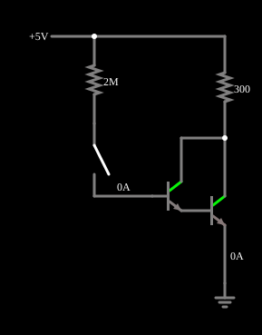

# Par Darlington

<!-- navegacao:inicio -->
[Índice](README.md) · [Anterior: Current Mirror](mirror.md)
<!-- navegacao:fim -->

## Objetivo

Mostrar o par Darlington: dois transistores em cascata, em que o emissor do primeiro alimenta a base do segundo, formam um "transistor" de ganho de corrente muito alto, o produto dos ganhos.

## O circuito

<!-- esquema:inicio -->

<!-- esquema:fim -->

Uma fonte de $5\ \text{V}$ alimenta uma carga de $300\ \Omega$ no coletor de um par Darlington de dois NPN ($\beta = 100$ cada). A base do primeiro recebe corrente por um resistor de $2\ \text{M}\Omega$ e uma chave (aberta no início).

<!-- componentes:inicio -->
| N.º | Tipo | Elemento | Valores |
|----:|------|----------|---------|
| 0 | `NTransistorElm` | transistor | Beta/hFE = 100; Swap E/C = não; Draw Circle = não; Model = default |
| 1 | `ResistorElm` | resistor | Resistance (ohms) = 2M |
| 2 | `SwitchElm` | switch (SPST) | Momentary Switch = não; IEC Symbol = não; Label (for linking) = ; Keyboard Shortcut = ; On Resistance (ohms) = 0 |
| 4 | `ResistorElm` | resistor | Resistance (ohms) = 300 |
| 6 | `NTransistorElm` | transistor | Beta/hFE = 100; Swap E/C = não; Draw Circle = não; Model = default |
| 11 | `RailElm` | voltage source | Voltage = 5; Waveform = D/C; DC Offset (V) = 0; Internal Resistance (ohms) = 0 |
| 12 | `GroundElm` | ground | Symbol = Earth |
<!-- componentes:fim -->

## Teoria

O transistor bipolar do simulador (modelo "default") segue o modelo de Ebers–Moll, com $V_{BE}$ e $V_{BC}$ as tensões base-emissor e base-coletor (para um NPN):

$$I_C = I_s\left(e^{V_{BE}/V_T} - e^{V_{BC}/V_T}\right) - \frac{I_s}{\beta_R}\left(e^{V_{BC}/V_T} - 1\right),\qquad I_B = \frac{I_s}{\beta}\left(e^{V_{BE}/V_T} - 1\right) + \frac{I_s}{\beta_R}\left(e^{V_{BC}/V_T} - 1\right),$$

com $I_s = 10^{-13}\ \text{A}$, $\beta = 100$, $\beta_R = 1$ e $V_T = 25{,}865\ \text{mV}$; sem efeito Early, sem capacitâncias e sem resistências série. Na **região ativa** ($V_{BE} \approx 0{,}65$ a $0{,}75\ \text{V}$, junção base-coletor com polarização inversa) isso se reduz a $I_C = \beta I_B = I_s\,e^{V_{BE}/V_T}$, com transcondutância $g_m = I_C/V_T$ e resistência de emissor $r_e = V_T/I_E$. O PNP é o complementar, com todas as tensões e correntes invertidas.

## Resultados esperados

A corrente de emissor do primeiro transistor, $I_{E1} = (\beta_1 + 1)I_{B1}$, é a corrente de base do segundo; a corrente total de coletor é

$$I_C \approx \beta_1\beta_2\,I_{B1} = \beta_{eq}\,I_{B1},\qquad \beta_{eq} \approx \beta_1\beta_2 = 10^4.$$

A tensão de entrada necessária é $V_{BE} \approx 2 \times 0{,}65\ \text{V} = 1{,}3\ \text{V}$ (duas junções em série). A impedância de entrada é muito alta ($\beta_{eq}$ vezes a de emissor), e a de saturação é maior (a saturação do conjunto é $V_{CE(sat)2} + V_{BE}$ do primeiro...). Serve para acionar cargas fortes com corrente de entrada minúscula.

## O que observar

Com a chave fechada, a corrente de base é de apenas $1{,}84\ \mu\text{A}$ (da fonte de $5\ \text{V}$ por $2\ \text{M}\Omega$, menos $V_{BE}$ total de $1{,}21\ \text{V}$) e a carga recebe $13{,}97\ \text{mA}$: ganho de corrente de $7\,600$ (menor que $10^4$ porque o segundo transistor está perto da saturação, $V_{CE} = 0{,}81\ \text{V}$). Com a chave aberta, a corrente na carga é nula ($\approx 0{,}1\ \mu\text{A}$ de vazamento do modelo). As verificações conferem a corrente da carga com a chave aberta e fechada e a de base, em $t = 10\ \text{ms}$ (tolerância de 1% a 5%; o simulador fica a menos de $0{,}1\%$ da integração independente).

## Limites do modelo

- Feche a chave: uma corrente de base de $2\ \mu\text{A}$ comanda $14\ \text{mA}$.
- Compare com um único transistor, que precisaria de $140\ \mu\text{A}$ na base para a mesma corrente.
- A tensão de entrada é o dobro da de um transistor: $\approx 1{,}2\ \text{V}$.

## Referências

O Darlington é mais lento (o primeiro transistor não tem um caminho para descarregar a base do segundo, e o par leva mais tempo para desligar) e tem tensão de saturação maior (cerca de $0{,}8\ \text{V}$ aqui). O modelo não tem capacitâncias.

O circuito deste exemplo faz parte da coleção do simulador original de Paul Falstad e Iain Sharp (CircuitJS1); a explicação é deste projeto.
