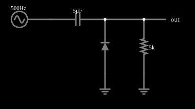

# Restauração de CC (grampo)

<!-- navegacao:inicio -->
[Índice](README.md) · [Anterior: Diode Limiter](diodelimit.md) · [Próximo: Blocking Inductive Kickback](inductkick-block.md)
<!-- navegacao:fim -->

## Objetivo

Mostrar um circuito de grampeamento (restauração de componente contínua): um capacitor e um diodo deslocam um sinal alternado para cima, de modo que seu pico negativo fique em zero (ou quase).

## O circuito

<!-- esquema:inicio -->

<!-- esquema:fim -->

Uma fonte senoidal de $5\ \text{V}$ de pico e $500\ \text{Hz}$ alimenta um capacitor de $5\ \mu\text{F}$ em série; o lado de saída do capacitor tem um diodo para a terra (com o cátodo ligado ao capacitor) e uma carga de $5\ \text{k}\Omega$. Um osciloscópio mostra a saída.

<!-- componentes:inicio -->
| N.º | Tipo | Elemento | Valores |
|----:|------|----------|---------|
| 0 | `RailElm` | A/C source | Max Voltage = 5; Waveform = A/C; DC Offset (V) = 0; Internal Resistance (ohms) = 0; Show Voltage = não; Frequency (Hz) = 500; Phase Offset (degrees) = 0 |
| 1 | `CapacitorElm` | capacitor | Capacitance (F) = 5μ; Trapezoidal Approximation = sim; Initial Voltage (on Reset) = 1m; Series Resistance = 0 |
| 2 | `DiodeElm` | diode | Model = default |
| 3 | `GroundElm` | ground | Symbol = Earth |
| 5 | `ResistorElm` | resistor | Resistance (ohms) = 5k |
| 6 | `GroundElm` | ground | Symbol = Earth |
| 7 | `OutputElm` | output | Show Voltage = não |
<!-- componentes:fim -->

## Teoria

O diodo do simulador (modelo "default") segue a equação de Shockley,

$$i = I_s\left(e^{v/(nV_T)} - 1\right),\qquad I_s = 1{,}714\cdot 10^{-7}\ \text{A},\quad n = 2,\quad V_T = 25{,}865\ \text{mV},$$

sem resistência série. Para uma corrente $i \gg I_s$ a tensão é $v = nV_T\ln(i/I_s + 1)$, que dá $0{,}806\ \text{V}$ em $1\ \text{A}$, $0{,}568\ \text{V}$ em $10\ \text{mA}$ e $0{,}449\ \text{V}$ em $1\ \text{mA}$: a tensão cresce $nV_T\ln 10 = 119\ \text{mV}$ a cada década de corrente. Para $v < 0$ a corrente tende a $-I_s = -0{,}17\ \mu\text{A}$.

## Resultados esperados

No primeiro semiciclo negativo o diodo conduz e carrega o capacitor com a tensão de pico menos a queda do diodo, $V_C \approx V_p - V_D$, com o lado da fonte negativo. Depois o diodo só conduz nos pontos em que a saída tenta ficar abaixo de $-V_D$ (recarregando o que o capacitor perdeu pela carga), e o capacitor mantém sua tensão: como $RC = 5\ \text{k}\Omega\cdot 5\ \mu\text{F} = 25\ \text{ms} \gg T = 2\ \text{ms}$, a perda é pequena. A saída é então a entrada somada a essa tensão contínua:

$$v_{saida}(t) = v_{in}(t) + V_C,$$

um sinal que oscila entre $-V_D$ e $2V_p - V_D$. Os "grampos" (clamps) são usados para restaurar a componente contínua de sinais acoplados por capacitor, como o vídeo.

## O que observar

A integração numérica independente do circuito, em regime (de $0{,}05$ a $0{,}06\ \text{s}$), dá:

| grandeza | valor |
|:---------|------:|
| pico negativo da saída | $-0{,}600\ \text{V}$ |
| pico positivo da saída | $9{,}315\ \text{V}$ |
| valor médio da saída | $4{,}325\ \text{V}$ |
| tensão contínua do capacitor | $4{,}325\ \text{V}$ |

O valor médio é a tensão do capacitor, $4{,}325\ \text{V}$, um pouco menor que $V_p - V_D = 4{,}4\ \text{V}$ porque a carga o descarrega um pouco entre os picos. As verificações conferem os dois extremos da saída e as médias da saída e do capacitor (tolerância de 1% a 2%; o simulador fica a menos de $0{,}001\%$ do cálculo independente).

## Limites do modelo

- A saída tem a mesma forma da entrada, deslocada para cima de $\approx 4{,}3\ \text{V}$: o pico negativo fica em $-0{,}6\ \text{V}$.
- Inverta o diodo: o sinal passa a ser grampeado no pico positivo e deslocado para baixo.
- Reduza a carga ($R$ menor): o capacitor perde mais e o deslocamento diminui.

## Referências

A fonte é ideal e o diodo, sem resistência série. Na prática, o deslocamento depende da carga e da frequência (o capacitor se descarrega entre os picos) e da queda do diodo. O primeiro ciclo tem um transitório até o capacitor se carregar.

O circuito deste exemplo faz parte da coleção do simulador original de Paul Falstad e Iain Sharp (CircuitJS1); a explicação é deste projeto.
