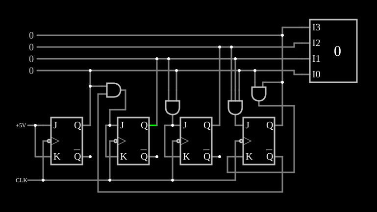

# Contador decimal

<!-- navegacao:inicio -->
[Índice](README.md) · [Anterior: Up/Down Counter](updownctr.md) · [Próximo: Gray Code Counter](graycode.md)
<!-- navegacao:fim -->

## Objetivo

Mostrar um contador **decimal** (de década, BCD): conta de $0$ a $9$ e volta a $0$, como um dígito de um contador de eventos ou de um relógio.

## O circuito

<!-- esquema:inicio -->

<!-- esquema:fim -->

Quatro flip-flops JK com o mesmo relógio (onda quadrada de $200\ \text{Hz}$) e portas AND que formam as entradas $J$ e $K$ de cada um, como num [contador síncrono](synccounter.md), mas com a lógica alterada para que o estado $9$ ($1001$) seja seguido por $0$. As saídas vão a saídas lógicas numéricas e a um mostrador decimal (elemento 68). O exemplo abre na contagem $2$.

<!-- componentes:inicio -->
| N.º | Tipo | Elemento | Valores |
|----:|------|----------|---------|
| 0 | `JKFlipFlopElm` | JK flip-flop | High Logic Voltage = 5; Reset Pin = não; Positive Edge Triggered = não; Invert Reset = não |
| 1 | `JKFlipFlopElm` | JK flip-flop | High Logic Voltage = 5; Reset Pin = não; Positive Edge Triggered = não; Invert Reset = não |
| 2 | `JKFlipFlopElm` | JK flip-flop | High Logic Voltage = 5; Reset Pin = não; Positive Edge Triggered = não; Invert Reset = não |
| 3 | `JKFlipFlopElm` | JK flip-flop | High Logic Voltage = 5; Reset Pin = não; Positive Edge Triggered = não; Invert Reset = não |
| 12 | `LogicOutputElm` | logic output | Threshold = 2.5; Current Required = não; Numeric = sim; Ternary = não |
| 13 | `RailElm` | voltage source | Voltage = 5; Waveform = D/C; DC Offset (V) = 0; Internal Resistance (ohms) = 0 |
| 14 | `RailElm` | square wave gen | Max Voltage = 2.5; Waveform = Square Wave; DC Offset (V) = 2.5; Internal Resistance (ohms) = 0; Show Voltage = não; Specify As = Frequency/Duty Cycle; Frequency (Hz) = 200; Phase Offset (degrees) = 0; Duty Cycle = 50; Rise/Fall Time (s) = 0 |
| 22 | `AndGateElm` | AND gate | # of Inputs = 2; High Logic Voltage = 5; Schmitt Inputs = não; Invert Inputs = não; Propagation Delay (s) = 0; DeMorgan's Symbol = não |
| 28 | `AndGateElm` | AND gate | # of Inputs = 3; High Logic Voltage = 5; Schmitt Inputs = não; Invert Inputs = não; Propagation Delay (s) = 0; DeMorgan's Symbol = não |
| 35 | `LogicOutputElm` | logic output | Threshold = 2.5; Current Required = não; Numeric = sim; Ternary = não |
| 36 | `LogicOutputElm` | logic output | Threshold = 2.5; Current Required = não; Numeric = sim; Ternary = não |
| 37 | `AndGateElm` | AND gate | # of Inputs = 2; High Logic Voltage = 5; Schmitt Inputs = não; Invert Inputs = não; Propagation Delay (s) = 0; DeMorgan's Symbol = não |
| 51 | `AndGateElm` | AND gate | # of Inputs = 2; High Logic Voltage = 5; Schmitt Inputs = não; Invert Inputs = não; Propagation Delay (s) = 0; DeMorgan's Symbol = não |
| 61 | `LogicOutputElm` | logic output | Threshold = 2.5; Current Required = não; Numeric = sim; Ternary = não |
| 68 | `DecimalDisplayElm` | decimal display | High Logic Voltage = 5; Bit Order = MSB First; # of Bits = 4; Display Mode = Decimal |
<!-- componentes:fim -->

## Teoria

Um contador binário de 4 bits tem $16$ estados; o contador de década usa só os dez primeiros. Na passagem de $9$ para o próximo valor, o binário iria a $10$ ($1010$); aqui a lógica de $J$ e $K$ impede que o bit $1$ suba enquanto $Q_3 = 1$ e faz o bit $3$ voltar a $0$, de modo que o estado seguinte é $0000$. Os estados $10$ a $15$ nunca são alcançados a partir da contagem normal.

Ligando contadores de década em cascata, com o bit $3$ de um como relógio do seguinte, obtêm-se unidades, dezenas, centenas…: cada década divide a frequência por $10$.

## Resultados esperados

O simulador conta $2, 3, \dots, 9$, uma unidade a cada $5\ \text{ms}$, mostra $9$ ($1001$) em $36{,}5\ \text{ms}$, $0$ em $41{,}5\ \text{ms}$ e $1$ em $46{,}5\ \text{ms}$: o ciclo tem $10$ estados, $50\ \text{ms}$.

## O que observar

Veja o mostrador voltar de $9$ a $0$; acompanhe nos osciloscópios que o bit mais significativo fica alto só durante os estados $8$ e $9$.

## Limites do modelo

- Portas sem atraso. Num contador real, convém verificar que, ligado num estado inválido ($10$ a $15$), ele volte sozinho à contagem normal; o exemplo não mostra esse caso.

## Referências

Mano e Ciletti, *Digital Design*, capítulo sobre contadores BCD; Texas Instruments, folhas de dados do SN7490 e do SN74160.

O circuito deste exemplo faz parte da coleção do simulador original de Paul Falstad e Iain Sharp (CircuitJS1); a explicação é deste projeto.
