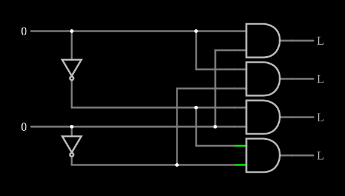

# Decodificador 1 de 4

<!-- navegacao:inicio -->
[Índice](README.md) · [Anterior: Full Adder](fulladd.md) · [Próximo: Priority Encoder](priencoder.md)
<!-- navegacao:fim -->

## Objetivo

Mostrar o **decodificador**: um número binário de $2$ bits seleciona **uma** de quatro saídas, que fica em $1$ enquanto as outras ficam em $0$. É o circuito que escolhe uma posição de memória ou um periférico a partir de um endereço.

## O circuito

<!-- esquema:inicio -->

<!-- esquema:fim -->

Duas entradas lógicas numéricas, $A_1$ (elemento 19, em cima) e $A_0$ (elemento 22, embaixo), e dois inversores que geram os seus complementos. Quatro portas AND de duas entradas recebem cada uma combinação diferente de $A_1$ ou $\overline{A_1}$ com $A_0$ ou $\overline{A_0}$ e acionam as saídas, de cima para baixo, $Y_3$ (elemento 24), $Y_1$ (elemento 25), $Y_2$ (elemento 26) e $Y_0$ (elemento 27). O exemplo abre com as duas entradas em $0$.

<!-- componentes:inicio -->
| N.º | Tipo | Elemento | Valores |
|----:|------|----------|---------|
| 0 | `AndGateElm` | AND gate | # of Inputs = 2; High Logic Voltage = 5; Schmitt Inputs = não; Invert Inputs = não; Propagation Delay (s) = 0; DeMorgan's Symbol = não |
| 1 | `AndGateElm` | AND gate | # of Inputs = 2; High Logic Voltage = 5; Schmitt Inputs = não; Invert Inputs = não; Propagation Delay (s) = 0; DeMorgan's Symbol = não |
| 2 | `AndGateElm` | AND gate | # of Inputs = 2; High Logic Voltage = 5; Schmitt Inputs = não; Invert Inputs = não; Propagation Delay (s) = 0; DeMorgan's Symbol = não |
| 3 | `AndGateElm` | AND gate | # of Inputs = 2; High Logic Voltage = 5; Schmitt Inputs = não; Invert Inputs = não; Propagation Delay (s) = 0; DeMorgan's Symbol = não |
| 18 | `InverterElm` | inverter | Slew Rate (V/ns) = 500m; High Logic Voltage = 5; DeMorgan's Symbol = não |
| 19 | `LogicInputElm` | logic input | Momentary Switch = não; High Logic Voltage = 5; Low Voltage = 0; Numeric = sim; Ternary = não; Keyboard Shortcut =  |
| 22 | `LogicInputElm` | logic input | Momentary Switch = não; High Logic Voltage = 5; Low Voltage = 0; Numeric = sim; Ternary = não; Keyboard Shortcut =  |
| 23 | `InverterElm` | inverter | Slew Rate (V/ns) = 500m; High Logic Voltage = 5; DeMorgan's Symbol = não |
| 24 | `LogicOutputElm` | logic output | Threshold = 2.5; Current Required = não; Numeric = não; Ternary = não |
| 25 | `LogicOutputElm` | logic output | Threshold = 2.5; Current Required = não; Numeric = não; Ternary = não |
| 26 | `LogicOutputElm` | logic output | Threshold = 2.5; Current Required = não; Numeric = não; Ternary = não |
| 27 | `LogicOutputElm` | logic output | Threshold = 2.5; Current Required = não; Numeric = não; Ternary = não |
<!-- componentes:fim -->

## Teoria

Cada saída é um **mintermo** das entradas, o produto que só vale $1$ numa combinação:

$$Y_0 = \overline{A_1}\,\overline{A_0}, \quad Y_1 = \overline{A_1}\,A_0, \quad Y_2 = A_1\,\overline{A_0}, \quad Y_3 = A_1\,A_0.$$

Para cada número $k = 2A_1 + A_0$, só $Y_k$ é $1$. Um decodificador de $n$ entradas tem $2^n$ saídas, e como cada saída é um mintermo, qualquer função lógica de $n$ variáveis pode ser feita com um decodificador e uma porta OR que junte os mintermos em que ela vale $1$.

## Resultados esperados

O simulador dá:

| $A_1$ | $A_0$ | Saída ativa |
|----:|----:|------|
| 0 | 0 | $Y_0$ (elemento 27) |
| 0 | 1 | $Y_1$ (elemento 25) |
| 1 | 0 | $Y_2$ (elemento 26) |
| 1 | 1 | $Y_3$ (elemento 24) |

Em cada caso, exatamente uma saída está em $5\ \text{V}$.

## O que observar

Clique nas entradas e veja a única saída acesa mudar de lugar. O circuito inverso, que transforma uma de várias entradas num número, é o [Priority Encoder](priencoder.md); o [7-Segment LED Decoder](7segdecoder.md) usa a mesma ideia para acender os segmentos de um dígito.

## Limites do modelo

- As portas são ideais e sem atraso; num decodificador real, quando as duas entradas mudam juntas, uma saída errada pode piscar por um instante.
- Os decodificadores integrados (como o 74139) costumam ter saídas ativas em nível baixo e uma entrada de habilitação, que este exemplo não tem.

## Referências

Mano e Ciletti, *Digital Design*, capítulo sobre decodificadores; Wakerly, *Digital Design: Principles and Practices*, capítulo sobre decodificadores.

O circuito deste exemplo faz parte da coleção do simulador original de Paul Falstad e Iain Sharp (CircuitJS1); a explicação é deste projeto.
