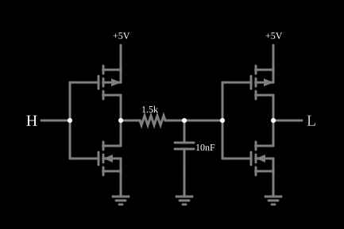

# Buffer com atraso (dois inversores e um RC)

<!-- navegacao:inicio -->
[Índice](README.md) · [Anterior: Sample-and-Hold](samplenhold.md) · [Próximo: Leading-Edge Detector](leadingedge.md)
<!-- navegacao:fim -->

## Objetivo

Mostrar como se faz um **atraso** num sinal digital com dois inversores CMOS e uma rede RC: o primeiro inversor carrega ou descarrega um capacitor através de um resistor; o segundo só troca de estado quando a tensão do capacitor cruza o seu limiar, atrasando a transição de $\approx 0{,}69\,RC$.

## O circuito

<!-- esquema:inicio -->

<!-- esquema:fim -->

Dois [inversores CMOS](cmosinverter.md) (modelo padrão, sem diodo de corpo) estão em série. A saída do primeiro liga-se, por um resistor de $1{,}5\ \text{k}\Omega$, a um capacitor de $10\ \text{nF}$ à terra ($RC = 15\ \mu\text{s}$), e a tensão do capacitor é a entrada do segundo. A entrada do primeiro é uma entrada lógica (um clique a alterna) e a saída do segundo é uma saída lógica (limiar $2{,}5\ \text{V}$). Dois osciloscópios mostram a tensão do capacitor e a saída.

<!-- componentes:inicio -->
| N.º | Tipo | Elemento | Valores |
|----:|------|----------|---------|
| 0 | `PMosfetElm` | MOSFET | Model = default-nodiode; Swap D/S = não |
| 1 | `NMosfetElm` | MOSFET | Model = default-nodiode; Swap D/S = não |
| 6 | `LogicInputElm` | logic input | Momentary Switch = não; High Logic Voltage = 5; Low Voltage = 0; Numeric = não; Ternary = não; Keyboard Shortcut =  |
| 7 | `RailElm` | voltage source | Voltage = 5; Waveform = D/C; DC Offset (V) = 0; Internal Resistance (ohms) = 0 |
| 8 | `GroundElm` | ground | Symbol = Earth |
| 9 | `ResistorElm` | resistor | Resistance (ohms) = 1.5k |
| 10 | `CapacitorElm` | capacitor | Capacitance (F) = 10n; Trapezoidal Approximation = sim; Initial Voltage (on Reset) = 5; Series Resistance = 0 |
| 11 | `GroundElm` | ground | Symbol = Earth |
| 15 | `PMosfetElm` | MOSFET | Model = default-nodiode; Swap D/S = não |
| 16 | `NMosfetElm` | MOSFET | Model = default-nodiode; Swap D/S = não |
| 19 | `LogicOutputElm` | logic output | Threshold = 2.5; Current Required = não; Numeric = não; Ternary = não |
| 20 | `GroundElm` | ground | Symbol = Earth |
| 21 | `RailElm` | voltage source | Voltage = 5; Waveform = D/C; DC Offset (V) = 0; Internal Resistance (ohms) = 0 |
<!-- componentes:fim -->

## Teoria

Após uma transição da entrada, a saída do primeiro inversor vai de um trilho ao outro (praticamente de forma instantânea) e o capacitor se carrega ou descarrega exponencialmente em direção a esse trilho: $v_C(t) = V_f + (V_i - V_f)\,e^{-t/\tau}$, com $\tau = (R + R_{on})C$, onde $R_{on} \approx 14\ \Omega$ é a resistência do transistor que conduz ($1/(\beta(V_{DD} - V_t))$). O segundo inversor troca de estado quando $v_C$ cruza o seu limiar de $V_{DD}/2 = 2{,}5\ \text{V}$, depois de

$$t_d = \tau\,\ln\frac{V_i - V_f}{V_{th} - V_f}.$$

Partindo de um trilho ($V_i = V_{DD}$, $V_f = 0$) e com $V_{th} = V_{DD}/2$, $t_d = \tau\ln 2 = 0{,}693\,\tau$.

## Resultados esperados

Com $\tau = (1500 + 14{,}3) \cdot 10\ \text{nF} = 15{,}14\ \mu\text{s}$: ao abrir o exemplo o capacitor, que começava em $\approx 5\ \text{V}$ ($4{,}973\ \text{V}$ no primeiro passo), cai e cruza $2{,}5\ \text{V}$ em $15{,}14 \cdot \ln(4{,}973/2{,}5) = 10{,}42\ \mu\text{s}$; o simulador dá $10{,}42\ \mu\text{s}$, e a saída sobe no mesmo instante ($10{,}418\ \mu\text{s}$): o atraso do buffer é de cerca de $10{,}4\ \mu\text{s}$. Em $10\ \mu\text{s}$, o capacitor está em $2{,}570\ \text{V}$ e a saída ainda baixa ($0{,}54\ \text{V}$, em transição); em $12\ \mu\text{s}$, o capacitor está em $2{,}252\ \text{V}$ e a saída em $4{,}75\ \text{V}$. Alternando a entrada em $50\ \mu\text{s}$ (quando o capacitor já desceu a $0{,}183\ \text{V}$), o capacitor sobe e cruza $2{,}5\ \text{V}$ em $59{,}94\ \mu\text{s}$, um atraso de $9{,}94\ \mu\text{s}$ (a fórmula dá $15{,}14 \cdot \ln\!\big((5 - 0{,}183)/2{,}5\big) = 9{,}93\ \mu\text{s}$), menor que $0{,}693\,RC$ porque partia de $0{,}18\ \text{V}$ e não de zero; a saída cai no mesmo instante. As verificações conferem o capacitor e a saída antes e depois das duas transições (tolerância de $0{,}5\%$ a $1\%$).

## O que observar

A saída é a entrada atrasada de cerca de $10\ \mu\text{s}$, e o capacitor mostra uma curva exponencial entre as duas transições. Para testar: dobre o capacitor para $20\ \text{nF}$ e veja o atraso dobrar; alterne a entrada de novo antes de o capacitor chegar ao limiar e veja que a saída não muda: o circuito não deixa passar pulsos mais curtos que o atraso (é um filtro de ruído digital).

## Limites do modelo

- O limiar do segundo inversor é ideal, $V_{DD}/2$; num circuito real ele varia com o processo e com a temperatura, e o atraso varia junto.
- Sem capacitâncias nos transistores, o único atraso do circuito vem do RC e da resistência de ligado; o atraso próprio de um inversor real, de dezenas de picossegundos, está ausente.
- Durante a passagem do capacitor pela região de $1{,}5$ a $3{,}5\ \text{V}$, o segundo inversor conduz corrente de curto-circuito (veja [CMOS Inverter (slow transition)](cmosinverterslow.md)): a carga tirada da alimentação nesse circuito, em $0{,}15\ \text{ms}$, é de $48\ \text{nC}$ (dominada pela carga do capacitor).
- Os instantes de cruzamento são interpolados das amostras do simulador e não fazem parte das verificações automáticas.

## Referências

Sedra e Smith, *Microelectronic Circuits*, capítulos sobre o MOSFET, a lógica CMOS e os circuitos de capacitor chaveado; Weste e Harris, *CMOS VLSI Design*.

O circuito deste exemplo faz parte da coleção do simulador original de Paul Falstad e Iain Sharp (CircuitJS1); a explicação é deste projeto.
