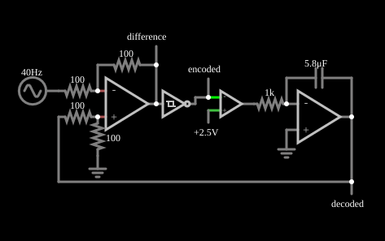

# Codificador PWM delta

<!-- navegacao:inicio -->
[Índice](README.md) · [Anterior: I-to-V Converter](itov.md) · [Próximo: Voltage Regulator](opamp-regulator.md)
<!-- navegacao:fim -->

## Objetivo

Mostrar um codificador por modulação delta: uma malha com integrador e disparador de Schmitt produz um fluxo de um bit (largura de pulso variável) cuja média acompanha o sinal de entrada, e a própria integral do fluxo (o sinal "decodificado") reconstrói o sinal.

## O circuito

<!-- esquema:inicio -->

<!-- esquema:fim -->

A entrada é uma senoide de $40\ \text{Hz}$ e $5\ \text{V}$ de pico. Um amplificador operacional diferencial (quatro resistores de $100\ \Omega$) subtrai da entrada o sinal decodificado e produz o sinal de *diferença*. Um disparador de Schmitt inversor, com limiares de $-0{,}1$ e $+0{,}1\ \text{V}$ e saída de $0$ a $5\ \text{V}$, converte-o no fluxo de bits ("*encoded*"). Um terceiro operacional compara esse fluxo com uma referência de $2{,}5\ \text{V}$ e o leva a $\pm 15\ \text{V}$; esse sinal passa por um resistor de $1\ \text{k}\Omega$ e é integrado por um operacional com capacitor de $5{,}8\ \mu\text{F}$, cuja saída é o sinal decodificado, realimentado ao diferencial. Quatro osciloscópios mostram a entrada, a diferença, o fluxo codificado e o sinal decodificado.

<!-- componentes:inicio -->
| N.º | Tipo | Elemento | Valores |
|----:|------|----------|---------|
| 2 | `OpAmpElm` | op-amp | Max Output (V) = 15; Min Output (V) = -15; Gain = 100k |
| 3 | `CapacitorElm` | capacitor | Capacitance (F) = 5.8μ; Trapezoidal Approximation = sim; Initial Voltage (on Reset) = 1m; Series Resistance = 0 |
| 4 | `ResistorElm` | resistor | Resistance (ohms) = 1k |
| 5 | `OpAmpElm` | op-amp | Max Output (V) = 15; Min Output (V) = -15; Gain = 100k |
| 6 | `ResistorElm` | resistor | Resistance (ohms) = 100 |
| 7 | `ResistorElm` | resistor | Resistance (ohms) = 100 |
| 8 | `ResistorElm` | resistor | Resistance (ohms) = 100 |
| 9 | `ResistorElm` | resistor | Resistance (ohms) = 100 |
| 12 | `GroundElm` | ground | Symbol = Earth |
| 14 | `GroundElm` | ground | Symbol = Earth |
| 17 | `RailElm` | A/C source | Max Voltage = 5; Waveform = A/C; DC Offset (V) = 0; Internal Resistance (ohms) = 0; Show Voltage = não; Frequency (Hz) = 40; Phase Offset (degrees) = 0 |
| 18 | `OpAmpElm` | op-amp | Max Output (V) = 15; Min Output (V) = -15; Gain = 100k |
| 19 | `RailElm` | voltage source | Voltage = 2.5; Waveform = D/C; DC Offset (V) = 0; Internal Resistance (ohms) = 0 |
| 20 | `InvertingSchmittElm` | inverting Schmitt trigger | Lower threshold (V) = -100m; Upper threshold (V) = 100m; Slew Rate (V/ns) = 500m; High Logic Voltage = 5; Low Voltage (V) = 0 |
| 23 | `LabeledNodeElm` | Labeled Node | Text = difference; Internal Node = não; Rotate Text When Vertical = não |
| 24 | `LabeledNodeElm` | Labeled Node | Text = decoded; Internal Node = não; Rotate Text When Vertical = não |
| 25 | `LabeledNodeElm` | Labeled Node | Text = encoded; Internal Node = não; Rotate Text When Vertical = não |
<!-- componentes:fim -->

## Teoria

A malha é um controle liga-desliga: o erro $e = V_\text{in} - V_\text{dec}$ é levado ao disparador de Schmitt, que inverte o sinal da corrente de integração sempre que $|e|$ passa de $0{,}1\ \text{V}$. O integrador, alimentado com $\pm 15\ \text{V}$ por $1\ \text{k}\Omega$, sobe ou desce com inclinação

$$S = \frac{15\ \text{V}}{R\,C} = \frac{15}{1\ \text{k}\Omega \cdot 5{,}8\ \mu\text{F}} \approx 2586\ \text{V/s},$$

e a saída do integrador "persegue" a entrada, oscilando em torno dela dentro da faixa de $\pm 0{,}1\ \text{V}$. Se a entrada subir, a saída do integrador fica mais tempo subindo que descendo: a **densidade** (ciclo de trabalho) do fluxo de bits mede a inclinação do sinal. O erro de rastreamento é pequeno enquanto a inclinação da entrada ($\le 2\pi f V_p = 1257\ \text{V/s}$) for menor que $S$.

Com entrada constante, a frequência de chaveamento é $S/(2\cdot 0{,}2\ \text{V}) \approx 6{,}5\ \text{kHz}$, bem maior que os $40\ \text{Hz}$ do sinal.

## Resultados esperados

O sinal decodificado reproduz a entrada com uma pequena ondulação e um pequeno atraso. Em $t = 10\ \text{ms}$, a entrada vale $2{,}944\ \text{V}$ e o sinal decodificado, $2{,}844\ \text{V}$ (diferença de $0{,}1\ \text{V}$, o limiar de disparo). Em um intervalo de $0{,}1\ \text{s}$ o decodificado atinge picos de cerca de $\pm 4{,}9\ \text{V}$ e o fluxo codificado, depois de amplificado, vai a $\pm 15\ \text{V}$. As verificações conferem esses valores (tolerância de $0{,}05\ \text{V}$ para os picos).

## O que observar

- O osciloscópio de fluxo codificado mostra pulsos mais largos onde a entrada sobe e mais estreitos onde ela desce.
- A diferença entre a entrada e o decodificado fica entre $-0{,}1$ e $+0{,}1\ \text{V}$, a faixa de histerese do disparador.
- Aumente a capacitância do integrador e a frequência de chaveamento cai, e o erro de rastreamento aumenta.

## Limites do modelo

O disparador de Schmitt do simulador é um componente lógico ideal com tempo de subida e descida pequenos, e os operacionais não têm *slew rate*; na prática, esses atrasos limitam a frequência de chaveamento. Esse tipo de codificação, quando a inclinação da entrada passa de $S$, perde o rastreamento (sobrecarga de inclinação).

## Referências

- A. S. Sedra e K. C. Smith, *Microeletrônica*, Pearson.
- P. Horowitz e W. Hill, *The Art of Electronics*, Cambridge University Press.
- A. V. Oppenheim e R. W. Schafer, *Discrete-Time Signal Processing*, Pearson.

O circuito deste exemplo faz parte da coleção do simulador original de Paul Falstad e Iain Sharp (CircuitJS1); a explicação é deste projeto.
