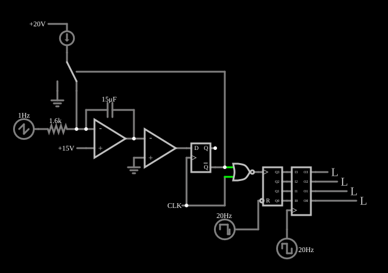

# Conversor A/D delta-sigma

<!-- navegacao:inicio -->
[Índice](README.md) · [Anterior: Flash ADC](flashadc.md) · [Próximo: Half-Flash (Subranging) ADC](hfadc.md)
<!-- navegacao:fim -->

## Objetivo

Mostrar o princípio do conversor **delta-sigma**: um integrador e um comparador em realimentação produzem um fluxo de bits cuja **densidade de uns** é proporcional à entrada; contar os uns numa janela de tempo dá o valor digital.

## O circuito

<!-- esquema:inicio -->

<!-- esquema:fim -->

- **Modulador:** um amp-op integrador (capacitor de $15\ \mu\text{F}$ na realimentação, entrada não inversora em $15\ \text{V}$) recebe a entrada através de $1{,}6\ \text{k}\Omega$. Uma fonte de corrente de $10\ \text{mA}$ é ligada ao nó de soma por uma chave de duas posições, comandada pela saída $Q$ de um flip-flop D. Um comparador (amp-op de $0$ a $5\ \text{V}$) lê a saída do integrador e aciona o $D$ do flip-flop, que recebe um relógio de $600\ \text{Hz}$.
- **Entrada:** uma rampa (dente de serra) de $1\ \text{Hz}$ que sobe de $0$ a $15\ \text{V}$.
- **Decimador:** uma porta NOR deixa passar o relógio para um contador de 4 bits apenas nos ciclos com $Q$ alto; uma onda de $20\ \text{Hz}$ com ciclo de trabalho de $90\%$ zera o contador a cada janela, e outra onda de $20\ \text{Hz}$ grava o resultado num latch de 4 bits, cujas saídas são os elementos 25 (bit mais significativo) a 28.

<!-- componentes:inicio -->
| N.º | Tipo | Elemento | Valores |
|----:|------|----------|---------|
| 0 | `OpAmpElm` | op-amp | Max Output (V) = 15; Min Output (V) = -15; Gain = 100k |
| 2 | `CapacitorElm` | capacitor | Capacitance (F) = 15μ; Trapezoidal Approximation = sim; Initial Voltage (on Reset) = 1m; Series Resistance = 0 |
| 5 | `AnalogSwitch2Elm` | analog switch (SPDT) | Swap NO/NC = não; On Resistance (ohms) = 20; Off Resistance (ohms) = 10G; Pulldown Resistor = não; Threshold = 2.5 |
| 7 | `GroundElm` | ground | Symbol = Earth |
| 8 | `ResistorElm` | resistor | Resistance (ohms) = 1.6k |
| 9 | `CurrentElm` | current source | Current (A) = 10m; Max Voltage (V, 0=unlimited) = 0 |
| 10 | `RailElm` | voltage source | Voltage = 20; Waveform = D/C; DC Offset (V) = 0; Internal Resistance (ohms) = 0 |
| 11 | `OpAmpElm` | op-amp | Max Output (V) = 5; Min Output (V) = 0; Gain = 100k |
| 12 | `GroundElm` | ground | Symbol = Earth |
| 13 | `DFlipFlopElm` | D flip-flop | High Logic Voltage = 5; Reset Pin = não; Set Pin = não; Invert Set/Reset = não |
| 17 | `RailElm` | square wave gen | Max Voltage = 2.5; Waveform = Square Wave; DC Offset (V) = 2.5; Internal Resistance (ohms) = 0; Show Voltage = não; Specify As = Frequency/Duty Cycle; Frequency (Hz) = 600; Phase Offset (degrees) = 0; Duty Cycle = 50; Rise/Fall Time (s) = 0 |
| 20 | `CounterElm` | Counter | High Logic Voltage = 5; Bit Order = MSB First; Invert reset pin = sim; # of Bits = 4; Modulus = 0; Up/Down Pin = não; Negative Edge Triggered = não |
| 21 | `RailElm` | square wave gen | Max Voltage = 2.5; Waveform = Square Wave; DC Offset (V) = 2.5; Internal Resistance (ohms) = 0; Show Voltage = não; Specify As = Frequency/Duty Cycle; Frequency (Hz) = 20; Phase Offset (degrees) = -10; Duty Cycle = 90; Rise/Fall Time (s) = 0 |
| 22 | `RailElm` | voltage source | Voltage = 15; Waveform = D/C; DC Offset (V) = 0; Internal Resistance (ohms) = 0 |
| 24 | `LatchElm` | Latch | High Logic Voltage = 5; Bit Order = MSB First; # of Bits = 4; Edge Triggered = sim; Reset Pin = não; Set Pin = não; Enable Pins = None |
| 25 | `LogicOutputElm` | logic output | Threshold = 2.5; Current Required = não; Numeric = não; Ternary = não |
| 26 | `LogicOutputElm` | logic output | Threshold = 2.5; Current Required = não; Numeric = não; Ternary = não |
| 27 | `LogicOutputElm` | logic output | Threshold = 2.5; Current Required = não; Numeric = não; Ternary = não |
| 28 | `LogicOutputElm` | logic output | Threshold = 2.5; Current Required = não; Numeric = não; Ternary = não |
| 31 | `RailElm` | square wave gen | Max Voltage = 2.5; Waveform = Square Wave; DC Offset (V) = 2.5; Internal Resistance (ohms) = 0; Show Voltage = não; Specify As = Frequency/Duty Cycle; Frequency (Hz) = 20; Phase Offset (degrees) = -180; Duty Cycle = 50; Rise/Fall Time (s) = 0 |
| 32 | `RailElm` | sawtooth gen | Max Voltage = 7.5; Waveform = Sawtooth; DC Offset (V) = 7.5; Internal Resistance (ohms) = 0; Show Voltage = não; Frequency (Hz) = 1; Phase Offset (degrees) = 0 |
| 33 | `NorGateElm` | NOR gate | # of Inputs = 2; High Logic Voltage = 5; Schmitt Inputs = não; Invert Inputs = não; Propagation Delay (s) = 0; DeMorgan's Symbol = não |
<!-- componentes:fim -->

## Teoria

O integrador soma o erro entre a corrente da entrada e a corrente de referência que a chave injeta. O laço de realimentação ajusta a fração $d$ de ciclos do relógio em que a referência entra, de modo que, **em média**, as duas correntes se equilibram e o integrador não sai do lugar:

$$d \cdot I_{ref} \approx \frac{V_{in} - V_{ofs}}{R} \quad\Rightarrow\quad d \text{ cresce linearmente com } V_{in}.$$

O fluxo de bits em $Q$ é uma representação de 1 bit, de alta taxa, do sinal de entrada; contar os uns numa janela fixa (um filtro de média seguido de redução da taxa, a *decimação*) dá um número de vários bits. Num conversor real, o modulador também empurra o ruído de quantização para altas frequências (*noise shaping*), e o filtro digital o remove; é assim que os conversores de áudio de 24 bits funcionam com um único comparador.

## Resultados esperados

O simulador dá a fração de tempo com $Q$ alto (média de $Q$ dividida por $5\ \text{V}$) crescendo com a entrada: $0{,}30$, $0{,}53$ e $0{,}77$ nas janelas de $50\ \text{ms}$ que terminam em $0{,}3$, $0{,}5$ e $0{,}8\ \text{s}$, quando a entrada está em torno de $4$, $7$ e $11{,}6\ \text{V}$. O código de 4 bits do latch sobe com a entrada, cerca de uma unidade por volt:

| $t$ (s) | $V_{in}$ (V) | Código |
|----:|----:|----:|
| 0,1 | 1,5 | 1 |
| 0,3 | 4,5 | 4 |
| 0,5 | 7,5 | 7 |
| 0,6 | 9,0 | 8 |
| 0,8 | 12,0 | 11 |
| 0,9 | 13,5 | 12 |
| 0,99 | 14,85 | 14 |

## O que observar

Nos osciloscópios, compare a densidade de pulsos de $Q$ no começo e no fim da rampa: poucos uns com a entrada baixa, quase só uns com a entrada alta.

## Limites do modelo

- Com só $27$ ciclos do relógio por janela, a resolução é de 4 bits e o código mostrado se refere à janela anterior (há um atraso de uma janela); um conversor real usa razões de sobreamostragem de 64 a 256 e filtros digitais de várias etapas.
- O modulador é de primeira ordem; os conversores comerciais usam moduladores de ordem mais alta para empurrar mais ruído para fora da banda.

## Referências

Schreier e Temes, *Understanding Delta-Sigma Data Converters*, Wiley; Johns e Martin, *Analog Integrated Circuit Design*, capítulo sobre conversores sobreamostrados.

O circuito deste exemplo faz parte da coleção do simulador original de Paul Falstad e Iain Sharp (CircuitJS1); a explicação é deste projeto.
