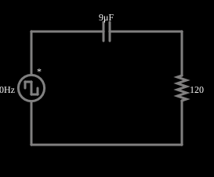

# Diferenciador RC

<!-- navegacao:inicio -->
[Índice](README.md) · [Anterior: 3- and 4-Way Light Switches](4way.md) · [Próximo: Wheatstone Bridge](wheatstone.md)
<!-- navegacao:fim -->

## Objetivo

Mostrar um circuito RC que aproxima a derivada do sinal de entrada: aplicada uma onda quadrada, a saída é uma sequência de pulsos agudos, um em cada borda.

## O circuito

<!-- esquema:inicio -->

<!-- esquema:fim -->

Uma fonte de onda quadrada de $\pm 5\ \text{V}$ e $40\ \text{Hz}$ alimenta um capacitor de $9\ \mu\text{F}$ em série com um resistor de $120\ \Omega$ ligado à terra; a saída é a tensão no resistor. Dois osciloscópios mostram a entrada e a saída.

<!-- componentes:inicio -->
| N.º | Tipo | Elemento | Valores |
|----:|------|----------|---------|
| 0 | `VoltageElm` | square wave gen | Max Voltage = 5; Waveform = Square Wave; DC Offset (V) = 0; Internal Resistance (ohms) = 0; Show Voltage = não; Specify As = Frequency/Duty Cycle; Frequency (Hz) = 40; Phase Offset (degrees) = 0; Duty Cycle = 50; Rise/Fall Time (s) = 0 |
| 1 | `CapacitorElm` | capacitor | Capacitance (F) = 9μ; Trapezoidal Approximation = sim; Initial Voltage (on Reset) = 1m; Series Resistance = 0 |
| 2 | `ResistorElm` | resistor | Resistance (ohms) = 120 |
<!-- componentes:fim -->

## Teoria

A corrente do capacitor é $i = C\,dv_C/dt$ e a tensão de saída é $v_R = R\,i$. Se $v_C \approx v_{in}$ (a queda no resistor é pequena frente à do capacitor), então

$$v_{out} = v_R = RC\,\frac{dv_{in}}{dt},$$

a derivada do sinal de entrada multiplicada por $RC = 120\cdot 9\ \mu\text{F} = 1{,}08\ \text{ms}$. É um filtro passa-altas de frequência de corte $f_c = \dfrac{1}{2\pi RC} = 147\ \text{Hz}$, e a aproximação vale para as componentes bem abaixo de $f_c$.

**Resposta ao degrau.** Numa borda em que a entrada salta de $-V$ para $+V$, o capacitor não pode mudar sua tensão instantaneamente, e o salto $\Delta V = 2V$ aparece todo sobre o resistor; depois a saída decai exponencialmente:

$$v_R(t) = \Delta V\,e^{-t/RC}.$$

O capacitor então se carrega através do resistor, com constante de tempo $RC$.

## Resultados esperados

A onda quadrada tem $\Delta V = 10\ \text{V}$ em cada borda, e $RC = 1{,}08\ \text{ms}$ é bem menor que o semiperíodo ($12{,}5\ \text{ms}$). A saída é uma sequência de pulsos positivos (bordas de subida) e negativos (bordas de descida), cada um começando em $\pm 10\ \text{V}$ e decaindo com $\tau = 1{,}08\ \text{ms}$; passado um tempo $\tau$, a saída vale $10\,e^{-1} = 3{,}679\ \text{V}$, e ao fim do semiperíodo ($10{,}8\tau$) já é praticamente nula. As verificações conferem a tensão $\tau$ depois de uma borda de subida ($+3{,}679\ \text{V}$) e de uma de descida ($-3{,}679\ \text{V}$), o valor quase nulo no fim do semiperíodo, e o pico e o vale ($\pm 10\ \text{V}$, com tolerância de 1%: o passo de simulação de $5\ \mu\text{s}$ faz o pico lido ficar cerca de 0,2% abaixo).

## O que observar

- Em cada borda da entrada aparece um pulso na saída; entre as bordas a saída é zero, como a derivada de um sinal constante.
- Aumente a frequência da fonte ou reduza o resistor para ver os pulsos ficarem mais finos; reduza a frequência e os pulsos se alargam até a saída se parecer com a entrada.
- Troque a onda quadrada por uma triangular (clique duas vezes na fonte): a derivada de uma rampa é uma constante, e a saída vira uma onda quadrada.

## Limites do modelo

Um diferenciador RC é só aproximado: para sinais cujas frequências não sejam bem menores que $f_c$ a saída não é a derivada. Uma onda quadrada ideal tem variação instantânea, cuja derivada seria um impulso infinito; a amplitude do pulso é limitada aqui pelo $\Delta V$ da fonte. O ruído de alta frequência é amplificado por um diferenciador (um motivo de se preferir integradores em medição).

## Referências

- J. W. Nilsson e S. A. Riedel, *Circuitos Elétricos*, Pearson.
- P. Horowitz e W. Hill, *The Art of Electronics*, Cambridge University Press.

O circuito deste exemplo faz parte da coleção do simulador original de Paul Falstad e Iain Sharp (CircuitJS1); a explicação é deste projeto.
