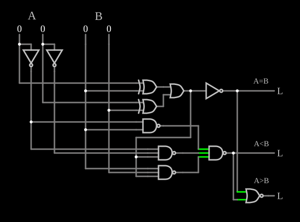

# Comparador de 2 bits

<!-- navegacao:inicio -->
[Índice](README.md) · [Anterior: Majority Logic](majority.md) · [Próximo: 7-Segment LED Decoder](7segdecoder.md)
<!-- navegacao:fim -->

## Objetivo

Mostrar o **comparador de magnitude**: dados dois números de $2$ bits, $A$ e $B$, o circuito indica se $A = B$, $A < B$ ou $A > B$.

## O circuito

<!-- esquema:inicio -->

<!-- esquema:fim -->

As entradas lógicas numéricas são $A_1$ (elemento 0) e $A_0$ (elemento 3), à esquerda, e $B_1$ (elemento 4) e $B_0$ (elemento 5), à direita; o bit da esquerda de cada número é o mais significativo. Duas portas XOR comparam os bits de mesma posição; portas NAND, inversores, uma NOR e uma OR combinam os resultados nas três saídas: $A = B$ (elemento 45), $A < B$ (elemento 44) e $A > B$ (elemento 53). O exemplo abre com as quatro entradas em $0$.

<!-- componentes:inicio -->
| N.º | Tipo | Elemento | Valores |
|----:|------|----------|---------|
| 0 | `LogicInputElm` | logic input | Momentary Switch = não; High Logic Voltage = 5; Low Voltage = 0; Numeric = sim; Ternary = não; Keyboard Shortcut =  |
| 2 | `InverterElm` | inverter | Slew Rate (V/ns) = 500m; High Logic Voltage = 5; DeMorgan's Symbol = não |
| 3 | `LogicInputElm` | logic input | Momentary Switch = não; High Logic Voltage = 5; Low Voltage = 0; Numeric = sim; Ternary = não; Keyboard Shortcut =  |
| 4 | `LogicInputElm` | logic input | Momentary Switch = não; High Logic Voltage = 5; Low Voltage = 0; Numeric = sim; Ternary = não; Keyboard Shortcut =  |
| 5 | `LogicInputElm` | logic input | Momentary Switch = não; High Logic Voltage = 5; Low Voltage = 0; Numeric = sim; Ternary = não; Keyboard Shortcut =  |
| 7 | `InverterElm` | inverter | Slew Rate (V/ns) = 500m; High Logic Voltage = 5; DeMorgan's Symbol = não |
| 8 | `XorGateElm` | XOR gate | # of Inputs = 2; High Logic Voltage = 5; Schmitt Inputs = não; Propagation Delay (s) = 0; DeMorgan's Symbol = não |
| 13 | `XorGateElm` | XOR gate | # of Inputs = 2; High Logic Voltage = 5; Schmitt Inputs = não; Propagation Delay (s) = 0; DeMorgan's Symbol = não |
| 18 | `NandGateElm` | NAND gate | # of Inputs = 2; High Logic Voltage = 5; Schmitt Inputs = não; Invert Inputs = não; Propagation Delay (s) = 0; DeMorgan's Symbol = não |
| 23 | `NandGateElm` | NAND gate | # of Inputs = 3; High Logic Voltage = 5; Schmitt Inputs = não; Invert Inputs = não; Propagation Delay (s) = 0; DeMorgan's Symbol = não |
| 28 | `NandGateElm` | NAND gate | # of Inputs = 3; High Logic Voltage = 5; Schmitt Inputs = não; Invert Inputs = não; Propagation Delay (s) = 0; DeMorgan's Symbol = não |
| 32 | `NandGateElm` | NAND gate | # of Inputs = 3; High Logic Voltage = 5; Schmitt Inputs = não; Invert Inputs = não; Propagation Delay (s) = 0; DeMorgan's Symbol = não |
| 38 | `OrGateElm` | OR gate | # of Inputs = 2; High Logic Voltage = 5; Schmitt Inputs = não; Invert Inputs = não; Propagation Delay (s) = 0; DeMorgan's Symbol = não |
| 43 | `InverterElm` | inverter | Slew Rate (V/ns) = 500m; High Logic Voltage = 5; DeMorgan's Symbol = não |
| 44 | `LogicOutputElm` | logic output | Threshold = 2.5; Current Required = não; Numeric = não; Ternary = não |
| 45 | `LogicOutputElm` | logic output | Threshold = 2.5; Current Required = não; Numeric = não; Ternary = não |
| 46 | `TextElm` | text | Text = A; Size = 24; Draw Bar On Top = não; Color = #c0c0c0 |
| 47 | `TextElm` | text | Text = B; Size = 24; Draw Bar On Top = não; Color = #c0c0c0 |
| 48 | `TextElm` | text | Text = A=B; Size = 16; Draw Bar On Top = não; Color = #c0c0c0 |
| 51 | `NorGateElm` | NOR gate | # of Inputs = 2; High Logic Voltage = 5; Schmitt Inputs = não; Invert Inputs = não; Propagation Delay (s) = 0; DeMorgan's Symbol = não |
| 53 | `LogicOutputElm` | logic output | Threshold = 2.5; Current Required = não; Numeric = não; Ternary = não |
| 54 | `TextElm` | text | Text = A<B; Size = 16; Draw Bar On Top = não; Color = #c0c0c0 |
| 55 | `TextElm` | text | Text = A>B; Size = 16; Draw Bar On Top = não; Color = #c0c0c0 |
<!-- componentes:fim -->

## Teoria

Dois bits são iguais quando a sua XOR é $0$; seja $e_i = \overline{A_i \oplus B_i}$. Então

$$(A = B) = e_1\,e_0 = \overline{(A_1 \oplus B_1) + (A_0 \oplus B_0)},$$

que o circuito faz com uma OR das duas XORs seguida de um inversor. A comparação de magnitude começa pelo bit mais significativo, como na comparação de números decimais: $A < B$ se $A_1 < B_1$, ou se $A_1 = B_1$ e $A_0 < B_0$:

$$(A < B) = \overline{A_1}\,B_1 + e_1\,\overline{A_0}\,B_0,$$

feita no circuito na forma NAND-NAND. A terceira saída não precisa de lógica própria: $A > B$ é verdadeiro quando nenhuma das outras duas é, e uma porta NOR dá $(A > B) = \overline{(A = B) + (A < B)}$. Exatamente uma das três saídas está sempre em $1$. Comparadores integrados (como o 7485) seguem a mesma ideia e têm entradas para ligar vários em cascata.

## Resultados esperados

O simulador dá, para as dezesseis combinações, exatamente uma saída em $5\ \text{V}$, de acordo com os números. Alguns casos:

| $A$ | $B$ | Saída ativa |
|----:|----:|------|
| $00 = 0$ | $00 = 0$ | $A = B$ |
| $10 = 2$ | $00 = 0$ | $A > B$ |
| $00 = 0$ | $01 = 1$ | $A < B$ |
| $10 = 2$ | $01 = 1$ | $A > B$ |
| $01 = 1$ | $10 = 2$ | $A < B$ |
| $11 = 3$ | $11 = 3$ | $A = B$ |
| $10 = 2$ | $11 = 3$ | $A < B$ |

O caso $A = 2$, $B = 1$ mostra a prioridade do bit mais significativo: $A_0 < B_0$, mas $A_1 > B_1$ decide.

## O que observar

Monte números nas duas metades e confira qual saída acende; tente casos em que os bits menos significativos "discordam" do resultado.

## Limites do modelo

- Portas ideais, sem atraso.

## Referências

Mano e Ciletti, *Digital Design*, capítulo sobre comparadores de magnitude; Wakerly, *Digital Design: Principles and Practices*, capítulo sobre comparadores.

O circuito deste exemplo faz parte da coleção do simulador original de Paul Falstad e Iain Sharp (CircuitJS1); a explicação é deste projeto.
