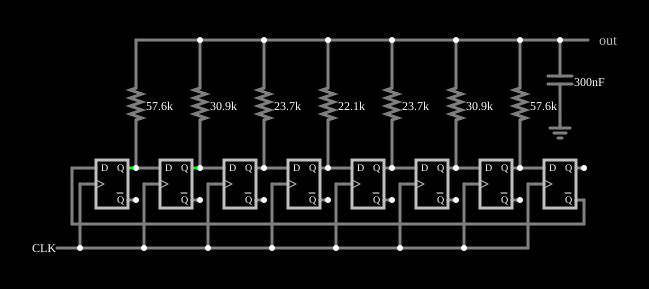

# Onda senoidal digital

<!-- navegacao:inicio -->
[Índice](README.md) · [Anterior: Switch-Tree DAC](swtreedac.md) · [Próximo: QAM-256 Modulator/Demodulator](qam-256.md)
<!-- navegacao:fim -->

## Objetivo

Mostrar como gerar uma senoide a partir de lógica: um contador Johnson percorre 16 estados, uma soma ponderada por resistores transforma os estados numa aproximação em degraus da senoide, e um capacitor suaviza os degraus.

## O circuito

<!-- esquema:inicio -->

<!-- esquema:fim -->

Oito flip-flops D em anel torcido (um [contador Johnson](johnsonctr.md)) recebem um relógio de $800\ \text{Hz}$. As saídas de sete deles se ligam, por resistores de $57{,}6$, $30{,}9$, $23{,}7$, $22{,}1$, $23{,}7$, $30{,}9$ e $57{,}6\ \text{k}\Omega$, a um mesmo nó de saída, que tem um capacitor de $300\ \text{nF}$ para a terra e um medidor (elemento 58).

<!-- componentes:inicio -->
| N.º | Tipo | Elemento | Valores |
|----:|------|----------|---------|
| 0 | `DFlipFlopElm` | D flip-flop | High Logic Voltage = 5; Reset Pin = não; Set Pin = não; Invert Set/Reset = não |
| 1 | `DFlipFlopElm` | D flip-flop | High Logic Voltage = 5; Reset Pin = não; Set Pin = não; Invert Set/Reset = não |
| 2 | `DFlipFlopElm` | D flip-flop | High Logic Voltage = 5; Reset Pin = não; Set Pin = não; Invert Set/Reset = não |
| 3 | `DFlipFlopElm` | D flip-flop | High Logic Voltage = 5; Reset Pin = não; Set Pin = não; Invert Set/Reset = não |
| 4 | `DFlipFlopElm` | D flip-flop | High Logic Voltage = 5; Reset Pin = não; Set Pin = não; Invert Set/Reset = não |
| 5 | `DFlipFlopElm` | D flip-flop | High Logic Voltage = 5; Reset Pin = não; Set Pin = não; Invert Set/Reset = não |
| 6 | `DFlipFlopElm` | D flip-flop | High Logic Voltage = 5; Reset Pin = não; Set Pin = não; Invert Set/Reset = não |
| 7 | `DFlipFlopElm` | D flip-flop | High Logic Voltage = 5; Reset Pin = não; Set Pin = não; Invert Set/Reset = não |
| 42 | `RailElm` | square wave gen | Max Voltage = 2.5; Waveform = Square Wave; DC Offset (V) = 2.5; Internal Resistance (ohms) = 0; Show Voltage = não; Specify As = Frequency/Duty Cycle; Frequency (Hz) = 800; Phase Offset (degrees) = 0; Duty Cycle = 50; Rise/Fall Time (s) = 0 |
| 43 | `ResistorElm` | resistor | Resistance (ohms) = 57.6k |
| 44 | `ResistorElm` | resistor | Resistance (ohms) = 30.9k |
| 45 | `ResistorElm` | resistor | Resistance (ohms) = 23.7k |
| 46 | `ResistorElm` | resistor | Resistance (ohms) = 22.1k |
| 47 | `ResistorElm` | resistor | Resistance (ohms) = 23.7k |
| 48 | `ResistorElm` | resistor | Resistance (ohms) = 30.9k |
| 49 | `ResistorElm` | resistor | Resistance (ohms) = 57.6k |
| 57 | `CapacitorElm` | capacitor | Capacitance (F) = 300n; Trapezoidal Approximation = sim; Initial Voltage (on Reset) = 1m; Series Resistance = 0 |
| 58 | `OutputElm` | output | Show Voltage = não |
| 59 | `GroundElm` | ground | Symbol = Earth |
<!-- componentes:fim -->

## Teoria

Um contador Johnson de 8 estágios tem $16$ estados e um ciclo de $16$ períodos do relógio:

$$f_{out} = \frac{800\ \text{Hz}}{16} = 50\ \text{Hz}.$$

Cada saída do contador fica alta durante meio ciclo, deslocada de $1/16$ de ciclo em relação à anterior; são ondas quadradas defasadas. A soma ponderada de ondas quadradas defasadas pode cancelar harmônicos: com os pesos escolhidos (condutâncias maiores no meio, proporcionais a uma senoide amostrada), a tensão do nó, que é a média das saídas ponderada pelas condutâncias, segue uma escada de 16 degraus que se aproxima de uma senoide de $50\ \text{Hz}$ centrada em $2{,}5\ \text{V}$, e os harmônicos mais baixos ficam por volta da $15.^{\text{a}}$ e da $17.^{\text{a}}$ ordem. O capacitor, com a resistência equivalente dos sete resistores em paralelo, forma um filtro passa-baixas que atenua esses degraus.

É o mesmo princípio dos sintetizadores digitais de senoide (DDS), em que um contador de fase endereça uma tabela de valores e um DAC os converte.

## Resultados esperados

O simulador dá uma onda de $50{,}0\ \text{Hz}$ que oscila entre $0{,}129$ e $4{,}871\ \text{V}$, com valor médio de $2{,}50\ \text{V}$ e valor eficaz total de $3{,}00\ \text{V}$; o valor eficaz da componente alternada é de $1{,}66\ \text{V}$, próximo dos $1{,}68\ \text{V}$ de uma senoide com a mesma amplitude de pico ($2{,}37\ \text{V}$).

## O que observar

No osciloscópio, a saída é uma senoide com pequenos degraus visíveis; sem o capacitor eles seriam os 16 patamares da escada.

## Limites do modelo

- Os flip-flops dão níveis exatos de $0$ e $5\ \text{V}$; a precisão real depende da igualdade dos níveis de saída e da tolerância dos resistores.
- O filtro é de primeira ordem; um gerador de senoide de baixa distorção usaria um filtro de ordem maior.

## Referências

Lancaster, *CMOS Cookbook*, capítulo sobre contadores (contadores Johnson); Kester (ed.), *Data Conversion Handbook*, Analog Devices, sobre síntese digital direta (DDS).

O circuito deste exemplo faz parte da coleção do simulador original de Paul Falstad e Iain Sharp (CircuitJS1); a explicação é deste projeto.
