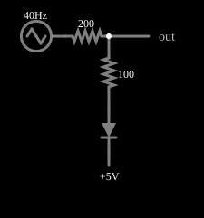

# Ceifador de forma de onda

<!-- navegacao:inicio -->
[Índice](README.md) · [Anterior: AM Detector](amdetect.md) · [Próximo: Triangle-to-Sine Converter](sinediode.md)
<!-- navegacao:fim -->

## Objetivo

Mostrar um ceifador polarizado: um diodo com uma tensão de referência limita o pico positivo da forma de onda a um nível escolhido, sem afetar o pico negativo.

## O circuito

<!-- esquema:inicio -->

<!-- esquema:fim -->

Uma onda triangular de $\pm 10\ \text{V}$ e $40\ \text{Hz}$ alimenta um resistor de $200\ \Omega$ e, depois dele, a saída; do nó de saída, um resistor de $100\ \Omega$ e um diodo levam a uma fonte de referência de $+5\ \text{V}$ (o diodo conduz quando a saída passa de $5\ \text{V}$ mais as quedas).

<!-- componentes:inicio -->
| N.º | Tipo | Elemento | Valores |
|----:|------|----------|---------|
| 0 | `ResistorElm` | resistor | Resistance (ohms) = 200 |
| 1 | `ResistorElm` | resistor | Resistance (ohms) = 100 |
| 2 | `DiodeElm` | diode | Model = default |
| 3 | `RailElm` | voltage source | Voltage = 5; Waveform = D/C; DC Offset (V) = 0; Internal Resistance (ohms) = 0 |
| 4 | `OutputElm` | output | Show Voltage = não |
| 5 | `RailElm` | triangle gen | Max Voltage = 10; Waveform = Triangle; DC Offset (V) = 0; Internal Resistance (ohms) = 0; Show Voltage = não; Frequency (Hz) = 40; Phase Offset (degrees) = 0 |
<!-- componentes:fim -->

## Teoria

O diodo do simulador (modelo "default") segue a equação de Shockley,

$$i = I_s\left(e^{v/(nV_T)} - 1\right),\qquad I_s = 1{,}714\cdot 10^{-7}\ \text{A},\quad n = 2,\quad V_T = 25{,}865\ \text{mV},$$

sem resistência série. Para uma corrente $i \gg I_s$ a tensão é $v = nV_T\ln(i/I_s + 1)$, que dá $0{,}806\ \text{V}$ em $1\ \text{A}$, $0{,}568\ \text{V}$ em $10\ \text{mA}$ e $0{,}449\ \text{V}$ em $1\ \text{mA}$: a tensão cresce $nV_T\ln 10 = 119\ \text{mV}$ a cada década de corrente. Para $v < 0$ a corrente tende a $-I_s = -0{,}17\ \mu\text{A}$.

## Resultados esperados

Enquanto a saída está abaixo de $V_{ref} + v_D + v_R$, o diodo bloqueia e a saída segue a entrada. Acima disso o diodo conduz, e a saída fica **presa** ("ceifada") em

$$V_{saida,max} = V_{ref} + v_D(i) + R_2\,i,\qquad i = \frac{V_{in} - V_{saida}}{R_1},$$

um nível que sobe só devagar com a entrada (a divisão entre $R_1 = 200\ \Omega$ e $R_2 = 100\ \Omega$ e a variação logarítmica de $v_D$). O pico negativo, sem diodo conduzindo, passa inalterado.

## O que observar

Com o pico de entrada de $10\ \text{V}$: corrente $i = 14{,}7\ \text{mA}$, queda no resistor de $100\ \Omega$ de $1{,}471\ \text{V}$ e no diodo de $0{,}588\ \text{V}$, de modo que a saída é ceifada em $5 + 0{,}588 + 1{,}471 = 7{,}058\ \text{V}$, contra os $10\ \text{V}$ do pico da entrada; o pico negativo permanece $-10\ \text{V}$. As verificações conferem os dois extremos da saída, a queda do diodo e a do resistor (tolerância de 1%; o cálculo independente concorda com o simulador a menos de $10^{-5}$).

## Limites do modelo

- A saída é um triângulo com o topo cortado, em cerca de $7{,}06\ \text{V}$; a base não é afetada.
- Mude a tensão de referência ($5\ \text{V}$): o nível de corte acompanha.
- O resistor de $100\ \Omega$ suaviza o corte (o topo sobe devagar com a entrada).

## Referências

Diodo e fontes ideais; o nível de corte depende da queda do diodo e da corrente. Um ceifador de precisão usa um amplificador operacional para eliminar a queda do diodo.

O circuito deste exemplo faz parte da coleção do simulador original de Paul Falstad e Iain Sharp (CircuitJS1); a explicação é deste projeto.
