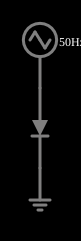

# Curva I×V do diodo

<!-- navegacao:inicio -->
[Índice](README.md) · [Anterior: Diode](diodevar.md) · [Próximo: Half-Wave Rectifier](rectify.md)
<!-- navegacao:fim -->

## Objetivo

Traçar a curva corrente-tensão de um diodo com uma fonte que varre a tensão: o osciloscópio no modo X–Y (corrente contra tensão) desenha a característica.

## O circuito

<!-- esquema:inicio -->

<!-- esquema:fim -->

Um gerador de onda triangular de $50\ \text{Hz}$, com $0{,}65\ \text{V}$ de amplitude e nível médio de $0{,}25\ \text{V}$ (a tensão varre de $-0{,}4\ \text{V}$ a $0{,}9\ \text{V}$), é ligado diretamente a um diodo. Três osciloscópios mostram a tensão, a corrente e a curva corrente contra tensão em escala logarítmica.

<!-- componentes:inicio -->
| N.º | Tipo | Elemento | Valores |
|----:|------|----------|---------|
| 0 | `RailElm` | triangle gen | Max Voltage = 650m; Waveform = Triangle; DC Offset (V) = 250m; Internal Resistance (ohms) = 0; Show Voltage = não; Frequency (Hz) = 50; Phase Offset (degrees) = 0 |
| 1 | `DiodeElm` | diode | Model = default |
| 2 | `GroundElm` | ground | Symbol = Earth |
<!-- componentes:fim -->

## Teoria

O diodo do simulador (modelo "default") segue a equação de Shockley,

$$i = I_s\left(e^{v/(nV_T)} - 1\right),\qquad I_s = 1{,}714\cdot 10^{-7}\ \text{A},\quad n = 2,\quad V_T = 25{,}865\ \text{mV},$$

sem resistência série. Para uma corrente $i \gg I_s$ a tensão é $v = nV_T\ln(i/I_s + 1)$, que dá $0{,}806\ \text{V}$ em $1\ \text{A}$, $0{,}568\ \text{V}$ em $10\ \text{mA}$ e $0{,}449\ \text{V}$ em $1\ \text{mA}$: a tensão cresce $nV_T\ln 10 = 119\ \text{mV}$ a cada década de corrente. Para $v < 0$ a corrente tende a $-I_s = -0{,}17\ \mu\text{A}$.

## Resultados esperados

Na varredura, o diodo vai de $v = -0{,}4\ \text{V}$ a $v = 0{,}9\ \text{V}$:

- em $v = -0{,}4\ \text{V}$ a corrente é $-I_s\,(1 - e^{-0{,}4/0{,}05173}) = -0{,}1714\ \mu\text{A}$;
- em $v = 0{,}9\ \text{V}$ ela é $I_s\,(e^{0{,}9/0{,}05173} - 1) = 6{,}165\ \text{A}$.

As verificações conferem os dois extremos da tensão e da corrente, em dois ciclos (de $0{,}04$ a $0{,}1\ \text{s}$); o pico de corrente tem tolerância de 3% porque a leitura cai em um dos passos de $5\ \mu\text{s}$ perto do pico, onde a corrente varia $1{,}3\%$ por passo.

## O que observar

- No gráfico logarítmico a corrente direta é uma reta (exponencial): $119\ \text{mV}$ por década de corrente.
- A varredura passa por zero em $v = 0$ e a curva é suave: não há um "degrau" em $0{,}7\ \text{V}$, que é só uma convenção prática (a tensão em que a corrente chega a algumas dezenas de mA).
- A corrente reversa, $-0{,}17\ \mu\text{A}$, é invisível na escala linear.

## Limites do modelo

Mesmas limitações do exemplo do diodo: sem resistência série, a corrente chega a ampères com menos de $1\ \text{V}$, o que um diodo real não suportaria.

## Referências

- A. S. Sedra e K. C. Smith, *Microeletrônica*, Pearson.
- P. Horowitz e W. Hill, *The Art of Electronics*, Cambridge University Press.

O circuito deste exemplo faz parte da coleção do simulador original de Paul Falstad e Iain Sharp (CircuitJS1); a explicação é deste projeto.
