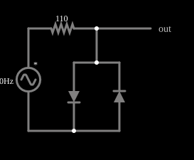

# Limitador de diodos

<!-- navegacao:inicio -->
[Índice](README.md) · [Anterior: Full-Wave Rectifier w/ Filter](fullrectf.md) · [Próximo: DC Restoration](dcrestoration.md)
<!-- navegacao:fim -->

## Objetivo

Mostrar um limitador simétrico: dois diodos em antiparalelo prendem a tensão de saída a cerca de $\pm 0{,}64\ \text{V}$, qualquer que seja a amplitude da entrada.

## O circuito

<!-- esquema:inicio -->

<!-- esquema:fim -->

Uma fonte senoidal de $5\ \text{V}$ de pico e $40\ \text{Hz}$ alimenta um resistor de $110\ \Omega$; no nó de saída, dois diodos em antiparalelo vão à terra. Dois osciloscópios mostram a entrada e a saída.

<!-- componentes:inicio -->
| N.º | Tipo | Elemento | Valores |
|----:|------|----------|---------|
| 0 | `VoltageElm` | A/C source | Max Voltage = 5; Waveform = A/C; DC Offset (V) = 0; Internal Resistance (ohms) = 0; Show Voltage = não; Frequency (Hz) = 40; Phase Offset (degrees) = 0 |
| 1 | `ResistorElm` | resistor | Resistance (ohms) = 110 |
| 7 | `DiodeElm` | diode | Model = default |
| 8 | `DiodeElm` | diode | Model = default |
| 9 | `OutputElm` | output | Show Voltage = não |
<!-- componentes:fim -->

## Teoria

O diodo do simulador (modelo "default") segue a equação de Shockley,

$$i = I_s\left(e^{v/(nV_T)} - 1\right),\qquad I_s = 1{,}714\cdot 10^{-7}\ \text{A},\quad n = 2,\quad V_T = 25{,}865\ \text{mV},$$

sem resistência série. Para uma corrente $i \gg I_s$ a tensão é $v = nV_T\ln(i/I_s + 1)$, que dá $0{,}806\ \text{V}$ em $1\ \text{A}$, $0{,}568\ \text{V}$ em $10\ \text{mA}$ e $0{,}449\ \text{V}$ em $1\ \text{mA}$: a tensão cresce $nV_T\ln 10 = 119\ \text{mV}$ a cada década de corrente. Para $v < 0$ a corrente tende a $-I_s = -0{,}17\ \mu\text{A}$.

## Resultados esperados

Na saída, em cada semiciclo um dos dois diodos conduz e fixa a tensão em $\pm v_D(i)$; o outro bloqueia. A corrente que passa pelo diodo é a do resistor, $i = (v_s - v_D)/R$, e a tensão de saída é a queda do diodo nessa corrente:

$$v_{saida} = \pm\,nV_T\ln\left(\frac{i}{I_s} + 1\right).$$

Como a queda de um diodo varia só $119\ \text{mV}$ por década de corrente, a saída fica quase constante mesmo que a amplitude da entrada varie muito.

## O que observar

No pico, $i = (5 - v_D)/110 = 39{,}6\ \text{mA}$ e $v_D = 0{,}6389\ \text{V}$; o resistor fica com $5 - 0{,}6389 = 4{,}361\ \text{V}$. A saída é uma senoide "achatada" entre $-0{,}639\ \text{V}$ e $+0{,}639\ \text{V}$. As verificações conferem os dois extremos da tensão do diodo e do resistor (tolerância de 1%; o cálculo independente fica a menos de $10^{-6}$ do simulador).

## Limites do modelo

- A saída tem o pico limitado a cerca de $0{,}64\ \text{V}$: o limitador protege entradas de amplificadores e conversores de sinais grandes.
- Reduza a amplitude da fonte a menos de $0{,}5\ \text{V}$: a saída deixa de ser limitada, porque os diodos quase não conduzem.
- Em cada semiciclo só um dos dois diodos conduz.

## Referências

O limiar de $\approx 0{,}64\ \text{V}$ depende da corrente (resistência de $110\ \Omega$) e da temperatura. A limitação é "suave": o pico cresce devagar com a entrada. Com diodos Schottky ou de germânio o limiar seria menor.

O circuito deste exemplo faz parte da coleção do simulador original de Paul Falstad e Iain Sharp (CircuitJS1); a explicação é deste projeto.
