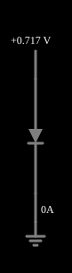

# O diodo

<!-- navegacao:inicio -->
[Índice](README.md) · [Próximo: Diode I/V Curve](diodecurve.md)
<!-- navegacao:fim -->

## Objetivo

Mostrar a característica de um diodo de junção: uma corrente que cresce exponencialmente com a tensão direta e é praticamente nula na tensão inversa.

## O circuito

<!-- esquema:inicio -->

<!-- esquema:fim -->

Uma fonte de tensão variável, com um *slider* de $-1\ \text{V}$ a $0{,}77\ \text{V}$ (rótulo "Voltage"), é ligada diretamente a um diodo de silício, sem resistência em série. O exemplo abre com o *slider* perto de $0{,}72\ \text{V}$ (na verificação, em $0{,}7169\ \text{V}$). A corrente do diodo aparece na tela.

<!-- componentes:inicio -->
| N.º | Tipo | Elemento | Valores |
|----:|------|----------|---------|
| 0 | `VarRailElm` | voltage source | Min Voltage = -1; Max Voltage = 770m; Slider Text = Voltage |
| 2 | `GroundElm` | ground | Symbol = Earth |
| 3 | `DiodeElm` | diode | Model = default |
<!-- componentes:fim -->

## Teoria

O diodo do simulador (modelo "default") segue a equação de Shockley,

$$i = I_s\left(e^{v/(nV_T)} - 1\right),\qquad I_s = 1{,}714\cdot 10^{-7}\ \text{A},\quad n = 2,\quad V_T = 25{,}865\ \text{mV},$$

sem resistência série. Para uma corrente $i \gg I_s$ a tensão é $v = nV_T\ln(i/I_s + 1)$, que dá $0{,}806\ \text{V}$ em $1\ \text{A}$, $0{,}568\ \text{V}$ em $10\ \text{mA}$ e $0{,}449\ \text{V}$ em $1\ \text{mA}$: a tensão cresce $nV_T\ln 10 = 119\ \text{mV}$ a cada década de corrente. Para $v < 0$ a corrente tende a $-I_s = -0{,}17\ \mu\text{A}$.

A resistência dinâmica (inclinação da curva) é $r_d = \dfrac{dv}{di} = \dfrac{nV_T}{i + I_s} \approx \dfrac{nV_T}{i}$: cai quando a corrente sobe.

## Resultados esperados

Com $v = 0{,}7169\ \text{V}$: $i = 1{,}714\cdot 10^{-7}\,(e^{0{,}7169/0{,}05173} - 1) = 179{,}0\ \text{mA}$ e $r_d = 0{,}289\ \Omega$. A tabela mostra a curva (cálculo pela equação):

| $v$ | $i$ |
|----:|----:|
| $-1{,}0\ \text{V}$ | $-0{,}17\ \mu\text{A}$ |
| $0{,}3\ \text{V}$ | $56{,}4\ \mu\text{A}$ |
| $0{,}5\ \text{V}$ | $2{,}70\ \text{mA}$ |
| $0{,}6\ \text{V}$ | $18{,}7\ \text{mA}$ |
| $0{,}7\ \text{V}$ | $129\ \text{mA}$ |
| $0{,}8\ \text{V}$ | $892\ \text{mA}$ |

As verificações conferem a tensão e a corrente do diodo na posição inicial do *slider* (o valor do *slider* não é calculado: ele é lido do próprio simulador), com tolerância de 0,2% e 1%.

## O que observar

- Arraste o *slider* e observe que abaixo de cerca de $0{,}5\ \text{V}$ a corrente é desprezível, e que acima de $0{,}7\ \text{V}$ ela dispara: cada $119\ \text{mV}$ multiplicam a corrente por $10$.
- Com tensão negativa, a corrente se limita a $-I_s$: o diodo bloqueia.
- Compare a corrente em $0{,}7\ \text{V}$ e em $0{,}8\ \text{V}$: a razão é $e^{0{,}1/0{,}05173} = 6{,}9$.

## Limites do modelo

O modelo não tem resistência série nem efeitos de alta injeção: em correntes de ampères um diodo real tem uma tensão bem maior que a da equação. A saturação $I_s$ e a tensão térmica $V_T$ dependem da temperatura (o simulador usa $27\ ^\circ\text{C}$), o que desloca a curva cerca de $-2\ \text{mV}/^\circ\text{C}$ nos diodos reais. Não há tensão de ruptura (veja os exemplos de diodo Zener).

## Referências

- A. S. Sedra e K. C. Smith, *Microeletrônica*, Pearson.
- P. Horowitz e W. Hill, *The Art of Electronics*, Cambridge University Press.

O circuito deste exemplo faz parte da coleção do simulador original de Paul Falstad e Iain Sharp (CircuitJS1); a explicação é deste projeto.
