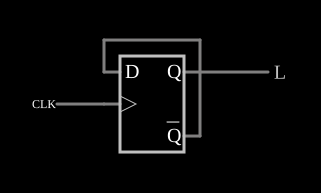

# Divisor de frequência por 2

<!-- navegacao:inicio -->
[Índice](README.md) · [Próximo: Divide-by-3](divideby3.md)
<!-- navegacao:fim -->

## Objetivo

Mostrar o divisor de frequência mais simples: um flip-flop D com a saída invertida realimentada na entrada muda de estado a cada pulso do relógio.

## O circuito

<!-- esquema:inicio -->

<!-- esquema:fim -->

Um flip-flop D disparado pela borda de subida tem $\overline{Q}$ ligado a $D$. O relógio é uma onda quadrada de $100\ \text{Hz}$, e a saída $Q$ vai a uma saída lógica (elemento 5).

<!-- componentes:inicio -->
| N.º | Tipo | Elemento | Valores |
|----:|------|----------|---------|
| 0 | `DFlipFlopElm` | D flip-flop | High Logic Voltage = 5; Reset Pin = não; Set Pin = não; Invert Set/Reset = não |
| 1 | `RailElm` | square wave gen | Max Voltage = 2.5; Waveform = Square Wave; DC Offset (V) = 2.5; Internal Resistance (ohms) = 0; Show Voltage = não; Specify As = Frequency/Duty Cycle; Frequency (Hz) = 100; Phase Offset (degrees) = 0; Duty Cycle = 50; Rise/Fall Time (s) = 0 |
| 5 | `LogicOutputElm` | logic output | Threshold = 2.5; Current Required = não; Numeric = não; Ternary = não |
<!-- componentes:fim -->

## Teoria

Com $D = \overline{Q}$, a cada borda de subida $Q^{+} = \overline{Q}$: o flip-flop funciona como um flip-flop T sempre habilitado. A saída completa um período a cada **dois** períodos do relógio:

$$f_{out} = \frac{f_{clk}}{2},$$

e o ciclo de trabalho da saída é exatamente $50\%$, qualquer que seja o do relógio, porque cada meio período da saída dura um período inteiro do relógio. Encadeando $n$ divisores obtém-se $f_{clk}/2^n$, a base dos [contadores em cascata](counter.md).

## Resultados esperados

O simulador dá a saída mudando a cada borda de subida ($0$, $10$, $20\ \text{ms}$, …): $5\ \text{V}$ em $5\ \text{ms}$, $0$ em $15\ \text{ms}$, com frequência de $50\ \text{Hz}$ e valor médio de $2{,}5\ \text{V}$ (ciclo de trabalho de $50\%$).

## O que observar

Compare no osciloscópio o relógio e a saída: um período da saída para dois do relógio.

## Limites do modelo

- O flip-flop não tem atraso; num circuito real, o atraso entre $\overline{Q}$ e $D$ precisa ser maior que o tempo de *hold* para o divisor funcionar.

## Referências

Mano e Ciletti, *Digital Design*, capítulo sobre flip-flops e contadores; Horowitz e Hill, *The Art of Electronics*, capítulo sobre lógica sequencial (divisores).

O circuito deste exemplo faz parte da coleção do simulador original de Paul Falstad e Iain Sharp (CircuitJS1); a explicação é deste projeto.
