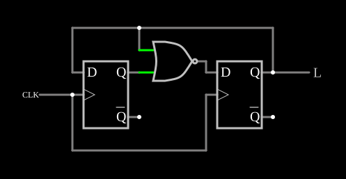

# Divisor de frequência por 3

<!-- navegacao:inicio -->
[Índice](README.md) · [Anterior: Divide-by-2](divideby2.md) · [Próximo: LED Flasher](ledflasher.md)
<!-- navegacao:fim -->

## Objetivo

Mostrar um divisor por um número **ímpar**: dois flip-flops D e uma porta NOR formam uma máquina de três estados, e a saída tem um terço da frequência do relógio.

## O circuito

<!-- esquema:inicio -->

<!-- esquema:fim -->

Dois flip-flops D disparados pela borda de subida recebem o mesmo relógio, uma onda quadrada de $150{,}1\ \text{Hz}$. A porta NOR recebe as saídas $Q$ dos dois e aciona o $D$ do segundo; o $Q$ do segundo, que é a saída (elemento 12), volta ao $D$ do primeiro. Os dois começam em $0$.

<!-- componentes:inicio -->
| N.º | Tipo | Elemento | Valores |
|----:|------|----------|---------|
| 0 | `DFlipFlopElm` | D flip-flop | High Logic Voltage = 5; Reset Pin = não; Set Pin = não; Invert Set/Reset = não |
| 1 | `DFlipFlopElm` | D flip-flop | High Logic Voltage = 5; Reset Pin = não; Set Pin = não; Invert Set/Reset = não |
| 11 | `RailElm` | square wave gen | Max Voltage = 2.5; Waveform = Square Wave; DC Offset (V) = 2.5; Internal Resistance (ohms) = 0; Show Voltage = não; Specify As = Frequency/Duty Cycle; Frequency (Hz) = 150.1; Phase Offset (degrees) = 0; Duty Cycle = 50; Rise/Fall Time (s) = 0 |
| 12 | `LogicOutputElm` | logic output | Threshold = 2.5; Current Required = não; Numeric = não; Ternary = não |
| 13 | `NorGateElm` | NOR gate | # of Inputs = 2; High Logic Voltage = 5; Schmitt Inputs = não; Invert Inputs = não; Propagation Delay (s) = 0; DeMorgan's Symbol = não |
<!-- componentes:fim -->

## Teoria

Sejam $A$ e $B$ as saídas do primeiro e do segundo flip-flop. A cada borda, $A^{+} = B$ e $B^{+} = \overline{A + B}$:

$$AB:\ 00 \to 01 \to 10 \to 00 \to \cdots$$

São três estados, e $B$ fica alto em um deles: a saída tem frequência $f_{clk}/3$ e ciclo de trabalho de $1/3$. O quarto estado, $11$, não pertence ao ciclo, e a NOR garante que, se o circuito começar nele, volta ao ciclo na borda seguinte ($11 \to 10$). Um divisor ímpar com ciclo de trabalho de $50\%$ exigiria usar também a borda de descida.

## Resultados esperados

O simulador dá a saída alta durante um período do relógio a cada três: sobe em $6{,}7\ \text{ms}$, desce em $13{,}3\ \text{ms}$, sobe de novo em $26{,}7\ \text{ms}$ (está em $0$ em $3\ \text{ms}$, em $5\ \text{V}$ em $10\ \text{ms}$ e em $0$ em $20\ \text{ms}$). A frequência é de $50{,}03\ \text{Hz}$ ($150{,}1/3$) e o valor médio, de $1{,}67\ \text{V}$ ($5\ \text{V}/3$).

## O que observar

Conte nos osciloscópios três períodos do relógio para cada período da saída.

## Limites do modelo

- Flip-flops sem atraso. O valor de $150{,}1\ \text{Hz}$ (em vez de $150$) não muda o funcionamento; só torna o período da saída um pouco menor que $20\ \text{ms}$.

## Referências

Wakerly, *Digital Design: Principles and Practices*, capítulo sobre máquinas de estados e contadores; Horowitz e Hill, *The Art of Electronics*, capítulo sobre divisores de frequência.

O circuito deste exemplo faz parte da coleção do simulador original de Paul Falstad e Iain Sharp (CircuitJS1); a explicação é deste projeto.
