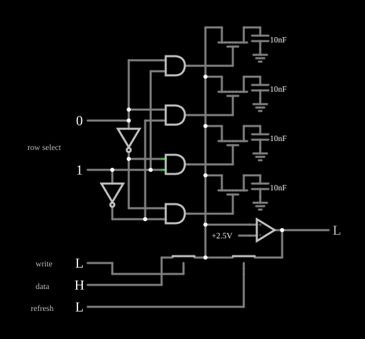

# Memória RAM dinâmica

<!-- navegacao:inicio -->
[Índice](README.md) · [Anterior: Static RAM](sram.md)
<!-- navegacao:fim -->

## Objetivo

Mostrar a célula de **RAM dinâmica** (DRAM): um bit guardado como carga num capacitor, acessado por um único transistor. A carga vaza com o tempo, e a memória precisa ser lida e reescrita periodicamente (*refresh*).

## O circuito

<!-- esquema:inicio -->

<!-- esquema:fim -->

- **Células:** quatro capacitores de $10\ \text{nF}$, cada um ligado por um NMOS de acesso ($V_t = 1{,}5\ \text{V}$, $\beta = 0{,}02\ \text{A/V}^2$) a uma **linha de bit** comum. O exemplo abre com as linhas 0 e 2 em $0$ e as linhas 1 e 3 em $5\ \text{V}$.
- **Endereço:** duas entradas numéricas (elementos 47 e 48), dois inversores e quatro ANDs formam um decodificador que ativa a porta de uma das células: $(47, 48) = (1, 1)$ seleciona a linha 0, $(0, 1)$ a linha 1, $(1, 0)$ a linha 2 e $(0, 0)$ a linha 3. O exemplo abre com a linha 2 selecionada.
- **Leitura:** um amp-op usado como comparador (saída de $0$ a $5\ \text{V}$) compara a linha de bit com $2{,}5\ \text{V}$ e aciona a saída *data* (elemento 69).
- **Escrita:** o botão *write* (elemento 61) fecha uma chave analógica que impõe na linha de bit o valor da entrada *data* (elemento 60).
- ***Refresh*:** o botão *refresh* (elemento 71) fecha outra chave, que devolve à linha de bit a saída do comparador, reescrevendo na célula o valor lido.

<!-- componentes:inicio -->
| N.º | Tipo | Elemento | Valores |
|----:|------|----------|---------|
| 1 | `CapacitorElm` | capacitor | Capacitance (F) = 10n; Trapezoidal Approximation = sim; Initial Voltage (on Reset) = 1m; Series Resistance = 0 |
| 3 | `GroundElm` | ground | Symbol = Earth |
| 4 | `NMosfetElm` | MOSFET | Model = default-digital; Swap D/S = não |
| 6 | `CapacitorElm` | capacitor | Capacitance (F) = 10n; Trapezoidal Approximation = sim; Initial Voltage (on Reset) = 1m; Series Resistance = 0 |
| 8 | `GroundElm` | ground | Symbol = Earth |
| 9 | `NMosfetElm` | MOSFET | Model = default-digital; Swap D/S = não |
| 12 | `CapacitorElm` | capacitor | Capacitance (F) = 10n; Trapezoidal Approximation = sim; Initial Voltage (on Reset) = 1m; Series Resistance = 0 |
| 14 | `GroundElm` | ground | Symbol = Earth |
| 15 | `NMosfetElm` | MOSFET | Model = default-digital; Swap D/S = não |
| 17 | `CapacitorElm` | capacitor | Capacitance (F) = 10n; Trapezoidal Approximation = sim; Initial Voltage (on Reset) = 1m; Series Resistance = 0 |
| 19 | `NMosfetElm` | MOSFET | Model = default-digital; Swap D/S = não |
| 26 | `AndGateElm` | AND gate | # of Inputs = 2; High Logic Voltage = 5; Schmitt Inputs = não; Invert Inputs = não; Propagation Delay (s) = 0; DeMorgan's Symbol = não |
| 27 | `AndGateElm` | AND gate | # of Inputs = 2; High Logic Voltage = 5; Schmitt Inputs = não; Invert Inputs = não; Propagation Delay (s) = 0; DeMorgan's Symbol = não |
| 28 | `AndGateElm` | AND gate | # of Inputs = 2; High Logic Voltage = 5; Schmitt Inputs = não; Invert Inputs = não; Propagation Delay (s) = 0; DeMorgan's Symbol = não |
| 29 | `AndGateElm` | AND gate | # of Inputs = 2; High Logic Voltage = 5; Schmitt Inputs = não; Invert Inputs = não; Propagation Delay (s) = 0; DeMorgan's Symbol = não |
| 35 | `InverterElm` | inverter | Slew Rate (V/ns) = 500m; High Logic Voltage = 5; DeMorgan's Symbol = não |
| 42 | `InverterElm` | inverter | Slew Rate (V/ns) = 500m; High Logic Voltage = 5; DeMorgan's Symbol = não |
| 47 | `LogicInputElm` | logic input | Momentary Switch = não; High Logic Voltage = 5; Low Voltage = 0; Numeric = sim; Ternary = não; Keyboard Shortcut =  |
| 48 | `LogicInputElm` | logic input | Momentary Switch = não; High Logic Voltage = 5; Low Voltage = 0; Numeric = sim; Ternary = não; Keyboard Shortcut =  |
| 50 | `OpAmpElm` | op-amp | Max Output (V) = 5; Min Output (V) = 0; Gain = 100k |
| 51 | `RailElm` | voltage source | Voltage = 2.5; Waveform = D/C; DC Offset (V) = 0; Internal Resistance (ohms) = 0 |
| 53 | `AnalogSwitchElm` | analog switch | Normally closed = não; On Resistance (ohms) = 20; Off Resistance (ohms) = 10G; Pulldown Resistor = não; Threshold = 2.5 |
| 54 | `AnalogSwitchElm` | analog switch | Normally closed = não; On Resistance (ohms) = 20; Off Resistance (ohms) = 10G; Pulldown Resistor = não; Threshold = 2.5 |
| 55 | `TextElm` | text | Text = row select; Size = 12; Draw Bar On Top = não; Color = #c0c0c0 |
| 56 | `GroundElm` | ground | Symbol = Earth |
| 60 | `LogicInputElm` | logic input | Momentary Switch = não; High Logic Voltage = 5; Low Voltage = 0; Numeric = não; Ternary = não; Keyboard Shortcut =  |
| 61 | `LogicInputElm` | logic input | Momentary Switch = sim; High Logic Voltage = 5; Low Voltage = 0; Numeric = não; Ternary = não; Keyboard Shortcut =  |
| 66 | `TextElm` | text | Text = write; Size = 12; Draw Bar On Top = não; Color = #c0c0c0 |
| 67 | `TextElm` | text | Text = refresh; Size = 12; Draw Bar On Top = não; Color = #c0c0c0 |
| 68 | `TextElm` | text | Text = data; Size = 12; Draw Bar On Top = não; Color = #c0c0c0 |
| 69 | `LogicOutputElm` | logic output | Threshold = 2.5; Current Required = não; Numeric = não; Ternary = não |
| 71 | `LogicInputElm` | logic input | Momentary Switch = sim; High Logic Voltage = 5; Low Voltage = 0; Numeric = não; Ternary = não; Keyboard Shortcut =  |
<!-- componentes:fim -->

## Teoria

A célula 1T1C é a menor célula de memória possível, o que dá às DRAMs a maior densidade. O preço:

- **Leitura por um NMOS:** com a porta em $5\ \text{V}$, o transistor de acesso só leva a linha de bit até $V_{DD} - V_t = 3{,}5\ \text{V}$ quando a célula guarda $1$; o comparador com limiar em $2{,}5\ \text{V}$ ainda distingue os dois níveis.
- **Fuga:** o transistor cortado não é um isolante perfeito (no modelo, uma condutância de $10^{-8}\ \text{S}$), e a constante de tempo com o capacitor é $\tau = C/G = 10\ \text{nF}/10^{-8}\ \text{S} = 1\ \text{s}$. As células vazam para a linha de bit, e os níveis se aproximam até o comparador ler errado.
- ***Refresh*:** ler a célula e reescrever o valor lido restaura a carga. Uma DRAM real faz isso em todas as linhas a cada poucos milissegundos.

## Resultados esperados

O simulador dá:

- **Leitura:** com a linha 3 selecionada (guarda $5\ \text{V}$), a linha de bit fica em $3{,}50\ \text{V}$ e *data* em $5\ \text{V}$; com a linha 2 (guarda $0$), *data* em $0$.
- **Escrita:** escrevendo $0$ na linha 3 (*data* em $0$ e um pulso em *write*), o capacitor vai a $2{,}5\ \text{mV}$ e a leitura passa a $0$. Escrevendo $1$ na linha 2, o capacitor vai a $4{,}99\ \text{V}$ em menos de $20\ \mu\text{s}$.
- **Fuga:** sem *refresh*, o $0$ guardado na linha 2 sobe para $1{,}59\ \text{V}$ em $0{,}25\ \text{s}$, e em $2\ \text{s}$ já é lido como $1$: o dado se perdeu.
- ***Refresh*:** um pulso de *refresh* em $0{,}2\ \text{s}$ devolve a célula a quase $0$; em $0{,}25\ \text{s}$ ela está em $0{,}32\ \text{V}$, contra $1{,}59\ \text{V}$ sem *refresh*.

## O que observar

Escreva valores nas quatro linhas, espere e veja as tensões dos capacitores convergirem; use o *refresh* em cada linha antes de o valor cruzar $2{,}5\ \text{V}$.

## Limites do modelo

- A escrita de $1$ leva o capacitor a $4{,}99\ \text{V}$, acima dos $\approx 3{,}5\ \text{V}$ que um NMOS de passagem com $V_t = 1{,}5\ \text{V}$ deixaria passar. A diferença parece vir do passo de simulação ($5\ \mu\text{s}$), muito maior que a constante de tempo de carga através do transistor (cerca de $0{,}3\ \mu\text{s}$); este projeto não a investigou a fundo.
- A linha de bit não tem capacitância, por isso a leitura não divide a carga da célula com a linha, o efeito que torna a leitura de uma DRAM real destrutiva e exige amplificadores sensores muito sensíveis.
- A fuga real de uma célula é muito menor; os tempos de retenção são de dezenas de milissegundos a segundos, não as frações de segundo do exemplo.

## Referências

Dennard, patente US 3.387.286 (1968), *Field-Effect Transistor Memory*; Rabaey, Chandrakasan e Nikolić, *Digital Integrated Circuits*, capítulo sobre memórias; Weste e Harris, *CMOS VLSI Design*, capítulo sobre DRAM.

O circuito deste exemplo faz parte da coleção do simulador original de Paul Falstad e Iain Sharp (CircuitJS1); a explicação é deste projeto.
