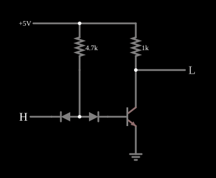

# Inversor DTL

<!-- navegacao:inicio -->
[Índice](README.md) · [Próximo: DTL NAND](dtlnand.md)
<!-- navegacao:fim -->

## Objetivo

Mostrar a **lógica diodo-transistor (DTL)**: a entrada é feita com diodos e um resistor, e um transistor saturado inverte e regenera o sinal. Ao contrário da RTL, a entrada DTL **absorve** corrente quando está em nível baixo, ideia que a TTL herdou.

## O circuito

<!-- esquema:inicio -->

<!-- esquema:fim -->

A alimentação de $5\ \text{V}$ alimenta, por $4{,}7\ \text{k}\Omega$, um nó interno. Desse nó partem dois diodos: um com o catodo na entrada lógica ($0$ ou $5\ \text{V}$) e outro com o catodo na base de um NPN ($\beta = 100$). O coletor do NPN é a saída, ligada a $5\ \text{V}$ por $1\ \text{k}\Omega$, e o emissor vai à terra. O exemplo abre com a entrada em $5\ \text{V}$.

<!-- componentes:inicio -->
| N.º | Tipo | Elemento | Valores |
|----:|------|----------|---------|
| 0 | `GroundElm` | ground | Symbol = Earth |
| 1 | `ResistorElm` | resistor | Resistance (ohms) = 4.7k |
| 2 | `ResistorElm` | resistor | Resistance (ohms) = 1k |
| 4 | `LogicOutputElm` | logic output | Threshold = 2.5; Current Required = não; Numeric = não; Ternary = não |
| 6 | `NTransistorElm` | transistor | Beta/hFE = 100; Swap E/C = não; Draw Circle = não; Model = default |
| 7 | `DiodeElm` | diode | Model = default |
| 8 | `DiodeElm` | diode | Model = default |
| 10 | `LogicInputElm` | logic input | Momentary Switch = não; High Logic Voltage = 5; Low Voltage = 0; Numeric = não; Ternary = não; Keyboard Shortcut =  |
| 11 | `RailElm` | voltage source | Voltage = 5; Waveform = D/C; DC Offset (V) = 0; Internal Resistance (ohms) = 0 |
<!-- componentes:fim -->

## Teoria

A corrente que desce pelo resistor de $4{,}7\ \text{k}\Omega$ tem dois caminhos, e quem decide é a entrada:

- **Entrada baixa ($0\ \text{V}$):** o diodo de entrada conduz e prende o nó interno a uma queda de diodo acima da terra. Essa tensão não chega para ligar a série "diodo de deslocamento + junção base-emissor", e o transistor corta: a saída sobe para $5\ \text{V}$. A corrente do resistor, $\approx (5 - 0{,}45)/4{,}7\ \text{k}\Omega \approx 0{,}97\ \text{mA}$, **sai pela entrada**: quem aciona uma entrada DTL tem de absorver essa corrente.
- **Entrada alta ($5\ \text{V}$):** o diodo de entrada fica reversamente polarizado e a corrente do resistor vai, pelo diodo de deslocamento, à base. $I_B \approx 0{,}83\ \text{mA}$ satura o transistor ($I_C \approx 5\ \text{mA}$ precisaria só de $50\ \mu\text{A}$), e a saída cai para algumas dezenas de milivolts.

Logo $Y = \overline{A}$. O diodo de deslocamento sobe o limiar de entrada em uma queda de diodo, o que melhora a margem de ruído no nível baixo.

## Resultados esperados

O simulador dá:

| Entrada | Saída | Corrente pelo resistor de entrada | Corrente da alimentação |
|--------:|------:|----------------------------------:|------------------------:|
| $5\ \text{V}$ | $55{,}1\ \text{mV}$ | $0{,}833\ \text{mA}$ (para a base) | $5{,}78\ \text{mA}$ |
| $0$ | $4{,}998\ \text{V}$ | $0{,}969\ \text{mA}$ (para a entrada) | $0{,}97\ \text{mA}$ |

Com a entrada baixa, o nó interno fica em $0{,}45\ \text{V}$. As verificações conferem a saída nos dois estados, as duas correntes do resistor (com o sinal da referência do resistor) e a corrente da alimentação.

## O que observar

Clique na entrada e repare para onde vai a corrente do resistor de $4{,}7\ \text{k}\Omega$: para a base (entrada alta) ou para fora pela entrada (entrada baixa). As portas [DTL NAND](dtlnand.md) e [DTL NOR](dtlnor.md) acrescentam diodos ou transistores a esta célula.

## Limites do modelo

- A porta DTL clássica tem ainda um resistor da base para uma fonte negativa ou para a terra, que acelera o corte; este exemplo o omite.
- O modelo de diodo padrão tem queda direta menor que a de um diodo de silício real à mesma corrente; os níveis internos são, por isso, um pouco mais baixos que os de um livro.
- Sem capacitâncias, a comutação é instantânea.

## Referências

Sedra e Smith, *Microelectronic Circuits*, capítulo sobre famílias lógicas bipolares; Hodges, Jackson e Saleh, *Analysis and Design of Digital Integrated Circuits*, capítulo sobre DTL e TTL.

O circuito deste exemplo faz parte da coleção do simulador original de Paul Falstad e Iain Sharp (CircuitJS1); a explicação é deste projeto.
