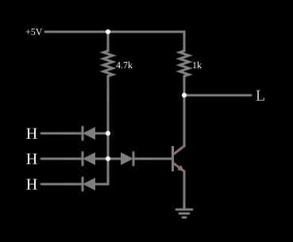

# Porta NAND DTL

<!-- navegacao:inicio -->
[Índice](README.md) · [Anterior: DTL Inverter](dtlinverter.md) · [Próximo: DTL NOR](dtlnor.md)
<!-- navegacao:fim -->

## Objetivo

Mostrar a porta **NAND** em DTL: diodos de entrada em paralelo formam uma porta E de diodos, e o transistor de saída a inverte. Foi a porta básica das famílias DTL e, depois, da TTL.

## O circuito

<!-- esquema:inicio -->

<!-- esquema:fim -->

É o [Inversor DTL](dtlinverter.md) com três diodos de entrada em vez de um: os três anodos estão no nó interno, alimentado por $4{,}7\ \text{k}\Omega$ a partir de $5\ \text{V}$, e cada catodo vai a uma entrada lógica ($0$ ou $5\ \text{V}$). Um diodo de deslocamento leva o nó à base do NPN, cujo coletor (a saída) tem $1\ \text{k}\Omega$ para $5\ \text{V}$. O exemplo abre com as três entradas em $5\ \text{V}$.

<!-- componentes:inicio -->
| N.º | Tipo | Elemento | Valores |
|----:|------|----------|---------|
| 0 | `GroundElm` | ground | Symbol = Earth |
| 1 | `ResistorElm` | resistor | Resistance (ohms) = 4.7k |
| 2 | `ResistorElm` | resistor | Resistance (ohms) = 1k |
| 4 | `LogicOutputElm` | logic output | Threshold = 2.5; Current Required = não; Numeric = não; Ternary = não |
| 6 | `NTransistorElm` | transistor | Beta/hFE = 100; Swap E/C = não; Draw Circle = não; Model = default |
| 7 | `DiodeElm` | diode | Model = default |
| 8 | `DiodeElm` | diode | Model = default |
| 9 | `LogicInputElm` | logic input | Momentary Switch = não; High Logic Voltage = 5; Low Voltage = 0; Numeric = não; Ternary = não; Keyboard Shortcut =  |
| 10 | `RailElm` | voltage source | Voltage = 5; Waveform = D/C; DC Offset (V) = 0; Internal Resistance (ohms) = 0 |
| 11 | `DiodeElm` | diode | Model = default |
| 12 | `DiodeElm` | diode | Model = default |
| 16 | `LogicInputElm` | logic input | Momentary Switch = não; High Logic Voltage = 5; Low Voltage = 0; Numeric = não; Ternary = não; Keyboard Shortcut =  |
| 17 | `LogicInputElm` | logic input | Momentary Switch = não; High Logic Voltage = 5; Low Voltage = 0; Numeric = não; Ternary = não; Keyboard Shortcut =  |
<!-- componentes:fim -->

## Teoria

Os diodos de entrada e o resistor formam uma **porta E de diodos**: o nó interno fica alto só se nenhuma entrada o puxar para baixo. Se uma entrada qualquer estiver em $0$, o seu diodo conduz, prende o nó a uma queda de diodo e o transistor corta. Com todas as entradas altas, os diodos ficam reversamente polarizados e a corrente do resistor satura o transistor. O transistor inverte o E:

$$Y = \overline{A \cdot B \cdot C}.$$

Quando mais de uma entrada está baixa, a corrente do resistor divide-se entre os diodos que conduzem; cada um conduz menos, a sua queda diminui e o nó interno desce um pouco, o que corta o transistor ainda mais.

## Resultados esperados

O simulador dá:

| Entradas baixas | Saída |
|----------------:|------:|
| nenhuma | $55{,}1\ \text{mV}$ |
| uma | $4{,}99755\ \text{V}$ |
| duas | $4{,}99926\ \text{V}$ |
| três | $4{,}99965\ \text{V}$ |

As pequenas diferenças no nível alto vêm da fuga do transistor cortado, que diminui à medida que o nó interno desce.

## O que observar

Clique nas entradas: a saída só desce com as três altas. Compare com a [DTL NOR](dtlnor.md), que obtém a NOR com dois inversores e as saídas ligadas.

## Limites do modelo

- Falta o resistor de base que, na DTL real, acelera o corte.
- As entradas são fontes ideais: numa cadeia, cada entrada baixa tem de ser absorvida pela saída da porta anterior.
- Sem capacitâncias, a comutação é instantânea.

## Referências

Sedra e Smith, *Microelectronic Circuits*, capítulo sobre famílias lógicas bipolares; Hodges, Jackson e Saleh, *Analysis and Design of Digital Integrated Circuits*.

O circuito deste exemplo faz parte da coleção do simulador original de Paul Falstad e Iain Sharp (CircuitJS1); a explicação é deste projeto.
