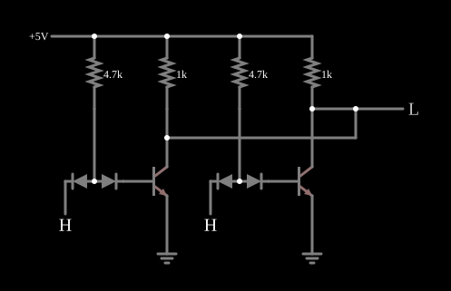

# Porta NOR DTL

<!-- navegacao:inicio -->
[Índice](README.md) · [Anterior: DTL NAND](dtlnand.md)
<!-- navegacao:fim -->

## Objetivo

Mostrar como se obtém a **NOR** em DTL: dois inversores DTL com os coletores ligados entre si (*wired-OR* no nível baixo), de modo que qualquer transistor que conduza puxa a saída comum para baixo.

## O circuito

<!-- esquema:inicio -->

<!-- esquema:fim -->

Há duas células do [Inversor DTL](dtlinverter.md), cada uma com o seu diodo de entrada, o seu diodo de deslocamento, o seu resistor de $4{,}7\ \text{k}\Omega$ e o seu NPN. Os dois coletores estão ligados entre si e à saída; cada um tem o seu resistor de $1\ \text{k}\Omega$ para $5\ \text{V}$, de modo que a carga equivalente é de $500\ \Omega$. O exemplo abre com as duas entradas em $5\ \text{V}$.

<!-- componentes:inicio -->
| N.º | Tipo | Elemento | Valores |
|----:|------|----------|---------|
| 0 | `NTransistorElm` | transistor | Beta/hFE = 100; Swap E/C = não; Draw Circle = não; Model = default |
| 1 | `ResistorElm` | resistor | Resistance (ohms) = 4.7k |
| 2 | `RailElm` | voltage source | Voltage = 5; Waveform = D/C; DC Offset (V) = 0; Internal Resistance (ohms) = 0 |
| 4 | `NTransistorElm` | transistor | Beta/hFE = 100; Swap E/C = não; Draw Circle = não; Model = default |
| 5 | `ResistorElm` | resistor | Resistance (ohms) = 4.7k |
| 8 | `ResistorElm` | resistor | Resistance (ohms) = 1k |
| 10 | `LogicOutputElm` | logic output | Threshold = 2.5; Current Required = não; Numeric = não; Ternary = não |
| 11 | `ResistorElm` | resistor | Resistance (ohms) = 1k |
| 17 | `DiodeElm` | diode | Model = default |
| 18 | `DiodeElm` | diode | Model = default |
| 19 | `DiodeElm` | diode | Model = default |
| 20 | `DiodeElm` | diode | Model = default |
| 23 | `LogicInputElm` | logic input | Momentary Switch = não; High Logic Voltage = 5; Low Voltage = 0; Numeric = não; Ternary = não; Keyboard Shortcut =  |
| 24 | `GroundElm` | ground | Symbol = Earth |
| 25 | `GroundElm` | ground | Symbol = Earth |
| 26 | `LogicInputElm` | logic input | Momentary Switch = não; High Logic Voltage = 5; Low Voltage = 0; Numeric = não; Ternary = não; Keyboard Shortcut =  |
<!-- componentes:fim -->

## Teoria

Cada transistor sozinho faria $\overline{A}$ ou $\overline{B}$. Ligados em **paralelo** entre a saída e a terra, basta um saturado para a saída descer; a saída só sobe com os dois cortados, isto é, com as duas entradas baixas:

$$Y = \overline{A} \cdot \overline{B} = \overline{A + B}.$$

Com os dois resistores de coletor em paralelo, um único transistor saturado tem de absorver $\approx 5\ \text{V}/500\ \Omega = 10\ \text{mA}$, o dobro do inversor sozinho, e o seu nível baixo fica um pouco mais alto. Com os dois saturados, a corrente divide-se e o nível baixo volta ao de um inversor.

## Resultados esperados

O simulador dá:

| $A$ | $B$ | Saída |
|----:|----:|------:|
| 0 | 0 | $4{,}998\ \text{V}$ |
| 0 | 1 | $71{,}3\ \text{mV}$ |
| 1 | 0 | $71{,}3\ \text{mV}$ |
| 1 | 1 | $55{,}1\ \text{mV}$ |

Com as duas entradas altas, a alimentação fornece $11{,}6\ \text{mA}$ (os dois coletores e as duas bases).

## O que observar

Clique nas entradas e confirme a tabela; compare o nível baixo com uma e com duas entradas altas. A [DTL NAND](dtlnand.md) usa o outro arranjo, com diodos de entrada em paralelo e um só transistor.

## Limites do modelo

- Ligar saídas entre si só funciona porque as saídas DTL têm um resistor passivo como carga; com saídas ativas (como a *totem-pole* da TTL) o mesmo arranjo poria duas saídas em curto.
- Falta o resistor de base da DTL real; sem capacitâncias, a comutação é instantânea.

## Referências

Sedra e Smith, *Microelectronic Circuits*, capítulo sobre famílias lógicas bipolares; Hodges, Jackson e Saleh, *Analysis and Design of Digital Integrated Circuits*.

O circuito deste exemplo faz parte da coleção do simulador original de Paul Falstad e Iain Sharp (CircuitJS1); a explicação é deste projeto.
