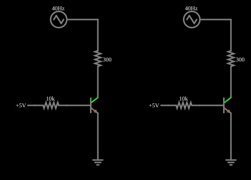

# Efeito Early

<!-- navegacao:inicio -->
[Índice](README.md) · [Anterior: Full-Wave Rectifier](transrectifier.md)
<!-- navegacao:fim -->

## Objetivo

Mostrar o **efeito Early**: num transistor bipolar real, a corrente de coletor não é constante quando se varia a tensão coletor-emissor na região ativa, mas cresce levemente com ela. O exemplo coloca lado a lado dois transistores idênticos, um com o modelo padrão do simulador (sem efeito Early) e outro com o modelo `early` (tensão de Early de $50\ \text{V}$), alimentados por uma tensão triangular que varre o coletor.

## O circuito

<!-- esquema:inicio -->

<!-- esquema:fim -->

Há dois circuitos iguais. Em cada um, um transistor NPN ($\beta = 100$) tem o emissor na terra, a base alimentada por $+5\ \text{V}$ através de um resistor de $10\ \text{k}\Omega$ (a base recebe uma **corrente** praticamente fixa) e o coletor ligado por um resistor de $300\ \Omega$ a um gerador triangular de $40\ \text{Hz}$ que vai de $1\ \text{V}$ a $41\ \text{V}$ (amplitude de $20\ \text{V}$ sobre um nível de $21\ \text{V}$). A única diferença entre os dois é o modelo do transistor. Dois osciloscópios mostram a corrente de cada um.

<!-- componentes:inicio -->
| N.º | Tipo | Elemento | Valores |
|----:|------|----------|---------|
| 0 | `NTransistorElm` | transistor | Beta/hFE = 100; Swap E/C = não; Draw Circle = não; Model = default |
| 1 | `ResistorElm` | resistor | Resistance (ohms) = 10k |
| 2 | `ResistorElm` | resistor | Resistance (ohms) = 300 |
| 4 | `GroundElm` | ground | Symbol = Earth |
| 5 | `RailElm` | voltage source | Voltage = 5; Waveform = D/C; DC Offset (V) = 0; Internal Resistance (ohms) = 0 |
| 6 | `RailElm` | triangle gen | Max Voltage = 20; Waveform = Triangle; DC Offset (V) = 21; Internal Resistance (ohms) = 0; Show Voltage = não; Frequency (Hz) = 40; Phase Offset (degrees) = 0 |
| 7 | `RailElm` | triangle gen | Max Voltage = 20; Waveform = Triangle; DC Offset (V) = 21; Internal Resistance (ohms) = 0; Show Voltage = não; Frequency (Hz) = 40; Phase Offset (degrees) = 0 |
| 8 | `RailElm` | voltage source | Voltage = 5; Waveform = D/C; DC Offset (V) = 0; Internal Resistance (ohms) = 0 |
| 9 | `GroundElm` | ground | Symbol = Earth |
| 11 | `ResistorElm` | resistor | Resistance (ohms) = 300 |
| 12 | `ResistorElm` | resistor | Resistance (ohms) = 10k |
| 13 | `NTransistorElm` | transistor | Beta/hFE = 100; Swap E/C = não; Draw Circle = não; Model = early |
<!-- componentes:fim -->

## Teoria

Na região ativa, o modelo de Ebers–Moll sem efeito Early dá uma corrente de coletor que só depende de $V_{BE}$:

$$I_C = I_s\,e^{V_{BE}/V_T}.$$

O estreitamento da região de base quando a tensão coletor-base cresce faz a corrente aumentar. No modelo de Gummel–Poon do simulador, isso entra com a **tensão de Early direta** $V_{AF}$, e a corrente de coletor passa a ser

$$I_C \approx I_{C0}\left(1 + \frac{V_{CB}}{V_{AF}}\right) = I_{C0}\left(1 - \frac{V_{BC}}{V_{AF}}\right),$$

onde $I_{C0}$ é a corrente sem efeito Early. A inclinação das curvas $I_C \times V_{CE}$ é $g_o = \partial I_C/\partial V_{CE} \approx I_{C0}/V_{AF}$, o que corresponde a uma resistência de saída $r_o = V_{AF}/I_{C0}$ (a rigor $(V_{AF} + V_{CB})/I_C$). O modelo `early` do exemplo define $V_{AF} = 1/0{,}02 = 50\ \text{V}$ e $V_{AR}$ infinita.

## Resultados esperados

A corrente de base é $(5 - 0{,}693)/10\ \text{k}\Omega = 0{,}431\ \text{mA}$ nos dois circuitos, e $I_{C0} = \beta I_B = 43{,}07\ \text{mA}$. O transistor **sem** efeito Early conduz exatamente $43{,}07\ \text{mA}$ tanto com a fonte em $21\ \text{V}$ ($V_{CE} = 8{,}08\ \text{V}$) quanto em $41\ \text{V}$ ($V_{CE} = 28{,}08\ \text{V}$). O transistor **com** efeito Early conduz $48{,}13\ \text{mA}$ em $21\ \text{V}$ ($V_{CE} = 6{,}56\ \text{V}$) e $61{,}82\ \text{mA}$ em $41\ \text{V}$ ($V_{CE} = 22{,}45\ \text{V}$). A fórmula acima dá, com $V_{CB} = 5{,}87\ \text{V}$ e $21{,}76\ \text{V}$, os fatores $1 + 5{,}87/50 = 1{,}117$ e $1 + 21{,}76/50 = 1{,}435$, e o simulador dá $48{,}13/43{,}07 = 1{,}117$ e $61{,}82/43{,}07 = 1{,}435$. A inclinação entre os dois pontos é $13{,}69\ \text{mA}/15{,}89\ \text{V} = 0{,}861\ \text{mA/V}$, que é $I_{C0}/V_{AF} = 43{,}07\ \text{mA}/50\ \text{V} = 0{,}861\ \text{mA/V}$ ($r_o \approx 1{,}16\ \text{k}\Omega$). Com a fonte em $1\ \text{V}$ ($t = 50\ \text{ms}$) os dois transistores saturam, com $V_{CE} \approx 0{,}06\ \text{V}$, e conduzem $3{,}19\ \text{mA}$. As verificações conferem as correntes nos dois transistores em $21\ \text{V}$ e $41\ \text{V}$, a tensão de coletor do transistor com efeito Early e a corrente de saturação (tolerância de $0{,}5\%$ a $1\%$).

## O que observar

Nos osciloscópios, a corrente do transistor sem efeito Early forma um patamar horizontal enquanto a fonte passa de poucos volts a $41\ \text{V}$, depois de uma subida rápida na saturação; a do transistor com efeito Early sobe em rampa suave, a $0{,}86\ \text{mA/V}$. Para testar: abra as propriedades do transistor da direita, edite o modelo e mude a tensão de Early (por exemplo, para $20\ \text{V}$) e veja a inclinação crescer ($I_{C0}/V_{AF}$); faça o inverso e veja a rampa ficar mais plana.

## Limites do modelo

- Nos dois transistores a tensão base-emissor é a mesma ($0{,}6929\ \text{V}$ nos instantes analisados) e a corrente de base também: o modelo `early` só muda a corrente de coletor, não a de base. As equações acima valem para este circuito.
- O modelo `early` tem só o efeito Early direto; não inclui a ruptura por avalanche, que num transistor real limita a tensão coletor-emissor.
- A aproximação linear $I_C \approx I_{C0}(1 + V_{CB}/V_{AF})$ vale para $V_{CB} \ll$ a tensão de ruptura; aqui o simulador a reproduz até $41\ \text{V}$.
- Quanto menor a tensão de Early, mais baixa a resistência de saída: em amplificadores ela limita o ganho de tensão a $g_m r_o$.

## Referências

Sedra e Smith, *Microelectronic Circuits*, seção sobre o efeito Early e a resistência de saída $r_o$; Horowitz e Hill, *The Art of Electronics*, seção 2.2.

O circuito deste exemplo faz parte da coleção do simulador original de Paul Falstad e Iain Sharp (CircuitJS1); a explicação é deste projeto.
