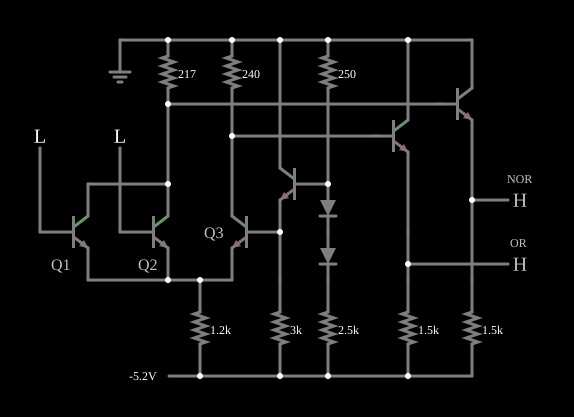

# Porta NOR/OR ECL

<!-- navegacao:inicio -->
[Índice](README.md)
<!-- navegacao:fim -->

## Objetivo

Mostrar a **lógica de emissor acoplado (ECL)**, a família bipolar mais rápida: os transistores **nunca saturam**. A porta é um par diferencial que desvia uma corrente constante para um lado ou para o outro, e dá ao mesmo tempo a saída NOR e a saída OR.

## O circuito

<!-- esquema:inicio -->

<!-- esquema:fim -->

A porta segue a estrutura da série ECL 10K, alimentada com $-5{,}2\ \text{V}$ e a terra como positivo:

- **Par diferencial:** os transistores de entrada Q1 e Q2 (em paralelo, cada base numa entrada lógica que vale $-1{,}4\ \text{V}$ no nível baixo e $-0{,}7\ \text{V}$ no alto) e o transistor de referência Q3 têm os emissores ligados entre si e a $-5{,}2\ \text{V}$ por $1{,}18\ \text{k}\Omega$. Os coletores de Q1/Q2 vão à terra por $217\ \Omega$, e o de Q3 por $240\ \Omega$.
- **Referência:** um seguidor de emissor polarizado por um divisor com dois diodos ($250\ \Omega$ e $2{,}46\ \text{k}\Omega$) gera a tensão de referência da base de Q3, com $2{,}96\ \text{k}\Omega$ no emissor.
- **Saídas:** dois seguidores de emissor (com $1{,}5\ \text{k}\Omega$ para $-5{,}2\ \text{V}$) baixam os coletores em uma queda de junção e acionam as saídas NOR (elemento 51, no coletor de Q1/Q2) e OR (elemento 52, no coletor de Q3), lidas com limiar de $-1\ \text{V}$.

O exemplo abre com as duas entradas em $-1{,}4\ \text{V}$.

<!-- componentes:inicio -->
| N.º | Tipo | Elemento | Valores |
|----:|------|----------|---------|
| 0 | `NTransistorElm` | transistor | Beta/hFE = 100; Swap E/C = não; Draw Circle = não; Model = default |
| 1 | `NTransistorElm` | transistor | Beta/hFE = 100; Swap E/C = não; Draw Circle = não; Model = default |
| 8 | `ResistorElm` | resistor | Resistance (ohms) = 1.2k |
| 11 | `NTransistorElm` | transistor | Beta/hFE = 100; Swap E/C = não; Draw Circle = não; Model = default |
| 15 | `ResistorElm` | resistor | Resistance (ohms) = 217 |
| 16 | `ResistorElm` | resistor | Resistance (ohms) = 240 |
| 18 | `NTransistorElm` | transistor | Beta/hFE = 100; Swap E/C = não; Draw Circle = não; Model = default |
| 22 | `ResistorElm` | resistor | Resistance (ohms) = 250 |
| 27 | `DiodeElm` | diode | Model = default |
| 28 | `DiodeElm` | diode | Model = default |
| 29 | `ResistorElm` | resistor | Resistance (ohms) = 2.5k |
| 32 | `NTransistorElm` | transistor | Beta/hFE = 100; Swap E/C = não; Draw Circle = não; Model = default |
| 35 | `NTransistorElm` | transistor | Beta/hFE = 100; Swap E/C = não; Draw Circle = não; Model = default |
| 39 | `ResistorElm` | resistor | Resistance (ohms) = 1.5k |
| 40 | `ResistorElm` | resistor | Resistance (ohms) = 1.5k |
| 43 | `ResistorElm` | resistor | Resistance (ohms) = 3k |
| 46 | `RailElm` | voltage source | Voltage = -5.2; Waveform = D/C; DC Offset (V) = 0; Internal Resistance (ohms) = 0 |
| 48 | `GroundElm` | ground | Symbol = Earth |
| 49 | `LogicInputElm` | logic input | Momentary Switch = não; High Logic Voltage = -700m; Low Voltage = -1.4; Numeric = não; Ternary = não; Keyboard Shortcut =  |
| 50 | `LogicInputElm` | logic input | Momentary Switch = não; High Logic Voltage = -700m; Low Voltage = -1.4; Numeric = não; Ternary = não; Keyboard Shortcut =  |
| 51 | `LogicOutputElm` | logic output | Threshold = -1; Current Required = não; Numeric = não; Ternary = não |
| 52 | `LogicOutputElm` | logic output | Threshold = -1; Current Required = não; Numeric = não; Ternary = não |
| 53 | `TextElm` | text | Text = NOR; Size = 12; Draw Bar On Top = não; Color = #c0c0c0 |
| 54 | `TextElm` | text | Text = OR; Size = 12; Draw Bar On Top = não; Color = #c0c0c0 |
| 59 | `TextElm` | text | Text = Q1; Size = 16; Draw Bar On Top = não; Color = #c0c0c0 |
| 60 | `TextElm` | text | Text = Q2; Size = 16; Draw Bar On Top = não; Color = #c0c0c0 |
| 61 | `TextElm` | text | Text = Q3; Size = 16; Draw Bar On Top = não; Color = #c0c0c0 |
<!-- componentes:fim -->

## Teoria

O resistor comum dos emissores fixa uma corrente quase constante, $I_E \approx (V_E + 5{,}2)/1{,}18\ \text{k}\Omega \approx 3\ \text{mA}$. O par diferencial a entrega ao lado cuja base estiver mais alta:

- **Entradas baixas** (abaixo da referência $V_{ref} \approx -1{,}0\ \text{V}$): Q3 conduz toda a corrente; o seu coletor desce $\approx 240\ \Omega \cdot 3\ \text{mA} \approx 0{,}73\ \text{V}$, enquanto o coletor de Q1/Q2 fica perto de $0$. Depois dos seguidores: NOR alta, OR baixa.
- **Uma entrada alta** (acima de $V_{ref}$): a corrente passa para Q1 ou Q2, e as saídas trocam.

$$Y_{NOR} = \overline{A + B}, \qquad Y_{OR} = A + B.$$

A excursão lógica é de apenas $\approx 0{,}7\ \text{V}$, e a tensão entre coletor e base dos transistores nunca chega a polarizar a junção diretamente: sem saturação, não há carga armazenada a remover, e a porta comuta em fração de nanossegundo. O preço é a corrente constante: a porta consome o mesmo em qualquer estado. A referência fica no meio da excursão, com margens de ruído iguais nos dois níveis.

## Resultados esperados

O simulador dá:

| $A$ | $B$ | NOR | OR |
|----:|----:|----:|---:|
| 0 | 0 | $-0{,}631\ \text{V}$ | $-1{,}346\ \text{V}$ |
| 1 | 0 | $-1{,}331\ \text{V}$ | $-0{,}631\ \text{V}$ |
| 0 | 1 | $-1{,}331\ \text{V}$ | $-0{,}631\ \text{V}$ |
| 1 | 1 | $-1{,}334\ \text{V}$ | $-0{,}631\ \text{V}$ |

A referência na base de Q3 fica em $-1{,}00\ \text{V}$ (a queda de $4{,}20\ \text{V}$ no resistor de $2{,}96\ \text{k}\Omega$), no meio da excursão de entrada. A alimentação fornece $11{,}6\ \text{mA}$ (cerca de $60\ \text{mW}$) com as entradas baixas e $11{,}9\ \text{mA}$ com uma entrada alta: quase o mesmo nos dois estados.

## O que observar

Clique nas entradas e veja as saídas NOR e OR mudarem sempre em oposição, com excursão de $0{,}7\ \text{V}$. Compare as tensões de coletor com as das famílias saturadas ([TTL](ttlinverter.md), [DTL](dtlinverter.md)): aqui nenhum transistor chega perto da saturação. O par diferencial é estudado em [Differential Amplifier](trans-diffamp.md) e um oscilador ECL aparece em [ECL Oscillator](eclosc.md).

## Limites do modelo

- Os resistores e a alimentação de $-5{,}2\ \text{V}$ são os da série 10K, mas a velocidade, que é a razão de ser da ECL, não aparece, porque o modelo não tem capacitâncias.
- As saídas não têm o resistor de terminação de $50\ \Omega$ para $-2\ \text{V}$ usado nas linhas de transmissão de sistemas ECL.
- O modelo de transistor não tem variação de $V_{BE}$ com a temperatura, que a referência real compensa.

## Referências

Hodges, Jackson e Saleh, *Analysis and Design of Digital Integrated Circuits*, capítulo sobre ECL; Sedra e Smith, *Microelectronic Circuits*, capítulo sobre ECL; Motorola, *MECL System Design Handbook*.

O circuito deste exemplo faz parte da coleção do simulador original de Paul Falstad e Iain Sharp (CircuitJS1); a explicação é deste projeto.
