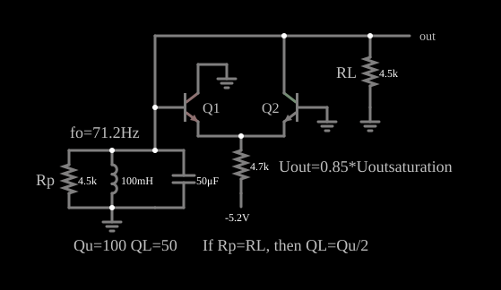

# Oscilador LC com acoplamento de emissor

<!-- navegacao:inicio -->
[Índice](README.md) · [Anterior: Hartley Oscillator](hartley.md) · [Próximo: Crystal Oscillator](crystalosc2.md)
<!-- navegacao:fim -->

## Objetivo

Mostrar um oscilador LC cujo elemento ativo é um **par diferencial** (de emissores acoplados) e cuja amplitude é limitada pela saturação de um dos transistores, e não por uma não linearidade suave. O texto do próprio circuito resume os dados: $f_0 = 71{,}2\ \text{Hz}$, $Q_u = 100$, $Q_L = 50$, $U_{out} = 0{,}85\,U_{sat}$.

## O circuito

<!-- esquema:inicio -->

<!-- esquema:fim -->

Um circuito ressonante paralelo tem um indutor de $100\ \text{mH}$, um capacitor de $50\ \mu\text{F}$, um resistor de perda $R_p = 4{,}5\ \text{k}\Omega$ e a carga $R_L = 4{,}5\ \text{k}\Omega$ (a saída), todos ligados à terra a partir do mesmo nó, que é a **base de Q1** e o **coletor de Q2**. Q1 tem o coletor na terra, e Q2 tem a base na terra; os emissores dos dois (NPN, $\beta = 100$) ficam juntos e ligados, por um resistor de cauda de $4{,}7\ \text{k}\Omega$, a uma fonte de $-5{,}2\ \text{V}$.

<!-- componentes:inicio -->
| N.º | Tipo | Elemento | Valores |
|----:|------|----------|---------|
| 0 | `InductorElm` | inductor | Inductance (H) = 100m; Trapezoidal Approximation = sim; Initial Current (on Reset) (A) = 0; Saturation Current (A) (0=none) = 0 |
| 1 | `CapacitorElm` | capacitor | Capacitance (F) = 50μ; Trapezoidal Approximation = sim; Initial Voltage (on Reset) = 1m; Series Resistance = 0 |
| 2 | `NTransistorElm` | transistor | Beta/hFE = 100; Swap E/C = não; Draw Circle = não; Model = default |
| 3 | `NTransistorElm` | transistor | Beta/hFE = 100; Swap E/C = não; Draw Circle = não; Model = default |
| 6 | `GroundElm` | ground | Symbol = Earth |
| 11 | `ResistorElm` | resistor | Resistance (ohms) = 4.7k |
| 12 | `RailElm` | voltage source | Voltage = -5.2; Waveform = D/C; DC Offset (V) = 0; Internal Resistance (ohms) = 0 |
| 21 | `GroundElm` | ground | Symbol = Earth |
| 22 | `GroundElm` | ground | Symbol = Earth |
| 23 | `OutputElm` | output | Show Voltage = não |
| 24 | `TextElm` | text | Text = Q1; Size = 16; Draw Bar On Top = não; Color = #c0c0c0 |
| 25 | `TextElm` | text | Text = Q2; Size = 16; Draw Bar On Top = não; Color = #c0c0c0 |
| 26 | `ResistorElm` | resistor | Resistance (ohms) = 4.5k |
| 27 | `GroundElm` | ground | Symbol = Earth |
| 29 | `TextElm` | text | Text = RL; Size = 18; Draw Bar On Top = não; Color = #c0c0c0 |
| 30 | `ResistorElm` | resistor | Resistance (ohms) = 4.5k |
| 31 | `TextElm` | text | Text = Qu=100 QL=50; Size = 18; Draw Bar On Top = não; Color = #c0c0c0 |
| 32 | `TextElm` | text | Text = Uout=0.85*Uoutsaturation; Size = 18; Draw Bar On Top = não; Color = #c0c0c0 |
| 35 | `TextElm` | text | Text = Rp; Size = 18; Draw Bar On Top = não; Color = #c0c0c0 |
| 36 | `TextElm` | text | Text = If Rp=RL, then QL=Qu/2; Size = 18; Draw Bar On Top = não; Color = #c0c0c0 |
| 37 | `TextElm` | text | Text = fo=71.2Hz; Size = 18; Draw Bar On Top = não; Color = #c0c0c0 |
<!-- componentes:fim -->

## Teoria

**Frequência.** Os resistores em paralelo com o circuito ressonante só introduzem perdas; a frequência é praticamente a de ressonância do LC:

$$f_0 = \frac{1}{2\pi\sqrt{L\,C}} = \frac{1}{2\pi\sqrt{0{,}1 \cdot 50 \cdot 10^{-6}}} \approx 71{,}18\ \text{Hz}.$$

**Fatores de qualidade.** A $f_0$, a reatância do indutor é $\omega_0 L = 44{,}7\ \Omega$. A perda $R_p$ sozinha dá $Q_u = R_p/(\omega_0 L) \approx 100$; com $R_L$ em paralelo, a resistência total é $R_p \parallel R_L = 2{,}25\ \text{k}\Omega$ e $Q_L = 2250/44{,}7 \approx 50$ (se $R_p = R_L$ então $Q_L = Q_u/2$).

**O par diferencial como amplificador regenerativo.** A base de Q2 está na terra e Q1 recebe a tensão do circuito ressonante. Quando essa tensão sobe, Q1 conduz e Q2 corta; quando desce, Q2 conduz e **puxa corrente do circuito ressonante** (a corrente de coletor entra em Q2 e sai do nó), o que reforça a descida: é a realimentação positiva que sustenta a oscilação. A corrente da cauda é praticamente constante, $I \approx (5{,}2 - 0{,}65)/4{,}7\ \text{k}\Omega \approx 0{,}97\ \text{mA}$ (a corrente de emissor varia pouco, só o ramo que conduz muda).

**Limitação da amplitude.** Com o coletor de Q2 no circuito ressonante e a base na terra, quando a tensão do circuito ressonante desce até $-0{,}6\ \text{V}$ a junção base-coletor de Q2 passa a conduzir (Q2 satura) e o ganho cai. É isso que fixa a amplitude, em cerca de $\pm 0{,}6\ \text{V}$.

## Resultados esperados

O simulador dá uma oscilação estável de $71{,}10\ \text{Hz}$, $0{,}1\%$ abaixo da frequência calculada, com amplitude de $\pm 0{,}5968\ \text{V}$ na saída (valor eficaz de $0{,}42\ \text{V}$, abaixo dos $0{,}422\ \text{V}$ de uma senoide da mesma amplitude, porque a onda é um pouco achatada). A corrente da cauda varia entre $0{,}976\ \text{mA}$ (quando a saída está no pico negativo) e $1{,}102\ \text{mA}$ (no pico positivo), em linha com a estimativa acima. A saturação de Q2 aparece no instante do pico negativo ($t = 1{,}9611\ \text{s}$): a tensão base-coletor de Q2 é $+0{,}596\ \text{V}$, ou seja, a junção está diretamente polarizada, enquanto no pico positivo ($t = 1{,}9822\ \text{s}$) a saída é $+0{,}596\ \text{V}$ e Q2 está cortado (base-emissor de apenas $0{,}019\ \text{V}$). Cada um dos dois resistores de $4{,}5\ \text{k}\Omega$ conduz no máximo $0{,}133\ \text{mA}$ ($0{,}597/4500$). As verificações conferem a frequência, o máximo e o mínimo da saída, a corrente da cauda (máximo e mínimo), a tensão base-coletor de Q2 no pico negativo e a saída no pico positivo (tolerância de $0{,}5\%$ a $1\%$).

## O que observar

No osciloscópio, uma senoide de $\pm 0{,}6\ \text{V}$ e período de $14\ \text{ms}$. Para testar: aumente $R_L$ ou $R_p$ (menos perdas) e veja se a amplitude muda: ela é fixada pela saturação de Q2, não pelas perdas; reduza-os muito (por exemplo, $R_p = R_L = 500\ \Omega$) e veja se a oscilação cessa, por falta de ganho; mude $C$ e veja a frequência acompanhar $1/\sqrt{C}$.

## Limites do modelo

- O indutor é ideal (sem resistência série): as perdas do circuito ressonante são representadas por $R_p$ em paralelo, que define $Q_u$.
- Não há capacitâncias nos transistores; em frequências mais altas elas deslocariam a frequência e o ganho.
- A amplitude ($0{,}597\ \text{V}$) depende de o modelo do transistor ter saturação com $V_{BC} \approx 0{,}6\ \text{V}$; outro modelo de transistor daria outra amplitude.
- O estimador $I\,R\,(2/\pi)$ da amplitude de um par diferencial não se aplica aqui: Q2 satura antes de o par poder fornecer essa tensão.

## Referências

Horowitz e Hill, *The Art of Electronics*, seção 5.x (osciladores LC); Sedra e Smith, *Microelectronic Circuits*, capítulo sobre osciladores senoidais.

O circuito deste exemplo faz parte da coleção do simulador original de Paul Falstad e Iain Sharp (CircuitJS1); a explicação é deste projeto.
