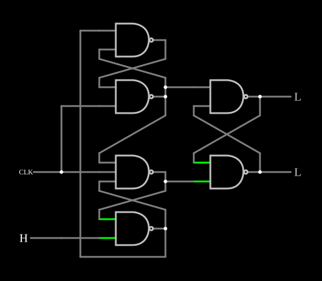

# Flip-flop D disparado pela borda

<!-- navegacao:inicio -->
[Índice](README.md) · [Anterior: Master-Slave Flip-Flop](masterslaveff.md) · [Próximo: JK Flip-Flop](jkff.md)
<!-- navegacao:fim -->

## Objetivo

Mostrar o flip-flop D **disparado pela borda de subida** feito com seis portas NAND, a estrutura do clássico 7474: a saída copia $D$ só no instante em que o relógio sobe.

## O circuito

<!-- esquema:inicio -->

<!-- esquema:fim -->

Seis NANDs (cinco de duas entradas e uma de três) formam três latches SR interligados. Dois deles recebem $D$ (elemento 30) e o relógio, uma onda quadrada de $100\ \text{Hz}$ (bordas de subida em $0$, $10$, $20\ \text{ms}$, …), e acionam o latch de saída, com $Q$ (elemento 32) e $\overline{Q}$ (elemento 33). O exemplo abre com $D = 1$.

<!-- componentes:inicio -->
| N.º | Tipo | Elemento | Valores |
|----:|------|----------|---------|
| 0 | `NandGateElm` | NAND gate | # of Inputs = 2; High Logic Voltage = 5; Schmitt Inputs = não; Invert Inputs = não; Propagation Delay (s) = 0; DeMorgan's Symbol = não |
| 1 | `NandGateElm` | NAND gate | # of Inputs = 2; High Logic Voltage = 5; Schmitt Inputs = não; Invert Inputs = não; Propagation Delay (s) = 0; DeMorgan's Symbol = não |
| 8 | `NandGateElm` | NAND gate | # of Inputs = 2; High Logic Voltage = 5; Schmitt Inputs = não; Invert Inputs = não; Propagation Delay (s) = 0; DeMorgan's Symbol = não |
| 9 | `NandGateElm` | NAND gate | # of Inputs = 2; High Logic Voltage = 5; Schmitt Inputs = não; Invert Inputs = não; Propagation Delay (s) = 0; DeMorgan's Symbol = não |
| 10 | `NandGateElm` | NAND gate | # of Inputs = 3; High Logic Voltage = 5; Schmitt Inputs = não; Invert Inputs = não; Propagation Delay (s) = 0; DeMorgan's Symbol = não |
| 11 | `NandGateElm` | NAND gate | # of Inputs = 2; High Logic Voltage = 5; Schmitt Inputs = não; Invert Inputs = não; Propagation Delay (s) = 0; DeMorgan's Symbol = não |
| 30 | `LogicInputElm` | logic input | Momentary Switch = não; High Logic Voltage = 5; Low Voltage = 0; Numeric = não; Ternary = não; Keyboard Shortcut =  |
| 31 | `RailElm` | square wave gen | Max Voltage = 2.5; Waveform = Square Wave; DC Offset (V) = 2.5; Internal Resistance (ohms) = 0; Show Voltage = não; Specify As = Frequency/Duty Cycle; Frequency (Hz) = 100; Phase Offset (degrees) = 0; Duty Cycle = 50; Rise/Fall Time (s) = 0 |
| 32 | `LogicOutputElm` | logic output | Threshold = 2.5; Current Required = não; Numeric = não; Ternary = não |
| 33 | `LogicOutputElm` | logic output | Threshold = 2.5; Current Required = não; Numeric = não; Ternary = não |
<!-- componentes:fim -->

## Teoria

Com o relógio baixo, os dois latches de entrada mantêm as duas linhas que vão ao latch de saída em $1$, e a saída guarda o estado; ao mesmo tempo, eles acompanham $D$. Na borda de subida, um dos dois desce, conforme o valor de $D$ naquele instante, e grava esse valor no latch de saída. Enquanto o relógio continua alto, a realimentação interna "trava" os latches de entrada: novas mudanças em $D$ são ignoradas até a próxima borda de subida.

Diferente do [Master-Slave Flip-Flop](masterslaveff.md), não há um mestre que acompanha $D$ durante meio período: só importa o valor de $D$ perto da borda.

## Resultados esperados

O simulador dá:

- $D$ levado a $0$ em $4\ \text{ms}$ (relógio ainda alto): $Q$ continua em $5\ \text{V}$ em $9\ \text{ms}$ e vai a $0$ na borda de $10\ \text{ms}$ (lido em $11\ \text{ms}$);
- $D$ levado a $0$ em $12\ \text{ms}$ (relógio alto): $Q$ continua em $5\ \text{V}$ em $19\ \text{ms}$ e vai a $0$ na borda de $20\ \text{ms}$.

## O que observar

Mude $D$ em qualquer momento e veja que a saída só muda na borda de subida seguinte. O exemplo tem osciloscópios com o relógio, $D$ e $Q$.

## Limites do modelo

- Sem atrasos de porta, os tempos de *setup* e *hold* e a metaestabilidade não aparecem.

## Referências

Mano e Ciletti, *Digital Design*, capítulo sobre flip-flops disparados pela borda; Texas Instruments, folha de dados do SN7474.

O circuito deste exemplo faz parte da coleção do simulador original de Paul Falstad e Iain Sharp (CircuitJS1); a explicação é deste projeto.
