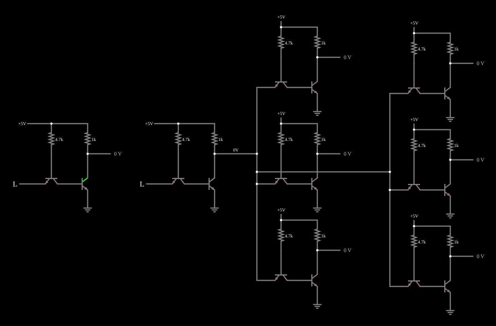

# Fan-out

<!-- navegacao:inicio -->
[Índice](README.md) · [Anterior: TTL NOR](ttlnor.md)
<!-- navegacao:fim -->

## Objetivo

Mostrar o **fan-out**, o número de entradas que uma saída consegue acionar: ligando seis entradas TTL a uma única saída, o nível alto dessa saída cai muito, e o exemplo põe ao lado um inversor sem carga para comparar.

## O circuito

<!-- esquema:inicio -->

<!-- esquema:fim -->

Todas as portas são o [Inversor TTL](ttlinverter.md) simplificado ($4{,}7\ \text{k}\Omega$ na base do transistor de entrada, $1\ \text{k}\Omega$ no coletor do de saída, alimentação de $5\ \text{V}$).

- **À esquerda**, um inversor isolado, acionado pela entrada do elemento 9, com a saída num medidor (elemento 8) e sem carga.
- **No centro**, o inversor *acionador*, com a entrada do elemento 10. A sua saída (o nó no resistor de coletor, elemento 14) vai às entradas de **seis** inversores de carga, cada um com a sua saída num medidor (elementos 27, 32, 42, 61, 71 e 77).

O exemplo abre com as duas entradas em $0$.

<!-- componentes:inicio -->
| N.º | Tipo | Elemento | Valores |
|----:|------|----------|---------|
| 0 | `NTransistorElm` | transistor | Beta/hFE = 100; Swap E/C = não; Draw Circle = não; Model = default |
| 1 | `NTransistorElm` | transistor | Beta/hFE = 100; Swap E/C = não; Draw Circle = não; Model = default |
| 2 | `GroundElm` | ground | Symbol = Earth |
| 3 | `ResistorElm` | resistor | Resistance (ohms) = 4.7k |
| 4 | `ResistorElm` | resistor | Resistance (ohms) = 1k |
| 6 | `RailElm` | voltage source | Voltage = 5; Waveform = D/C; DC Offset (V) = 0; Internal Resistance (ohms) = 0 |
| 8 | `OutputElm` | output | Show Voltage = sim; Scale = Auto |
| 9 | `LogicInputElm` | logic input | Momentary Switch = não; High Logic Voltage = 5; Low Voltage = 0; Numeric = não; Ternary = não; Keyboard Shortcut =  |
| 10 | `LogicInputElm` | logic input | Momentary Switch = não; High Logic Voltage = 5; Low Voltage = 0; Numeric = não; Ternary = não; Keyboard Shortcut =  |
| 12 | `RailElm` | voltage source | Voltage = 5; Waveform = D/C; DC Offset (V) = 0; Internal Resistance (ohms) = 0 |
| 14 | `ResistorElm` | resistor | Resistance (ohms) = 1k |
| 15 | `ResistorElm` | resistor | Resistance (ohms) = 4.7k |
| 16 | `GroundElm` | ground | Symbol = Earth |
| 17 | `NTransistorElm` | transistor | Beta/hFE = 100; Swap E/C = não; Draw Circle = não; Model = default |
| 18 | `NTransistorElm` | transistor | Beta/hFE = 100; Swap E/C = não; Draw Circle = não; Model = default |
| 20 | `NTransistorElm` | transistor | Beta/hFE = 100; Swap E/C = não; Draw Circle = não; Model = default |
| 21 | `NTransistorElm` | transistor | Beta/hFE = 100; Swap E/C = não; Draw Circle = não; Model = default |
| 22 | `GroundElm` | ground | Symbol = Earth |
| 23 | `ResistorElm` | resistor | Resistance (ohms) = 4.7k |
| 24 | `ResistorElm` | resistor | Resistance (ohms) = 1k |
| 27 | `OutputElm` | output | Show Voltage = sim; Scale = Auto |
| 29 | `RailElm` | voltage source | Voltage = 5; Waveform = D/C; DC Offset (V) = 0; Internal Resistance (ohms) = 0 |
| 30 | `RailElm` | voltage source | Voltage = 5; Waveform = D/C; DC Offset (V) = 0; Internal Resistance (ohms) = 0 |
| 32 | `OutputElm` | output | Show Voltage = sim; Scale = Auto |
| 35 | `ResistorElm` | resistor | Resistance (ohms) = 1k |
| 36 | `ResistorElm` | resistor | Resistance (ohms) = 4.7k |
| 37 | `GroundElm` | ground | Symbol = Earth |
| 38 | `NTransistorElm` | transistor | Beta/hFE = 100; Swap E/C = não; Draw Circle = não; Model = default |
| 39 | `NTransistorElm` | transistor | Beta/hFE = 100; Swap E/C = não; Draw Circle = não; Model = default |
| 40 | `RailElm` | voltage source | Voltage = 5; Waveform = D/C; DC Offset (V) = 0; Internal Resistance (ohms) = 0 |
| 42 | `OutputElm` | output | Show Voltage = sim; Scale = Auto |
| 45 | `ResistorElm` | resistor | Resistance (ohms) = 1k |
| 46 | `ResistorElm` | resistor | Resistance (ohms) = 4.7k |
| 47 | `GroundElm` | ground | Symbol = Earth |
| 48 | `NTransistorElm` | transistor | Beta/hFE = 100; Swap E/C = não; Draw Circle = não; Model = default |
| 49 | `NTransistorElm` | transistor | Beta/hFE = 100; Swap E/C = não; Draw Circle = não; Model = default |
| 54 | `NTransistorElm` | transistor | Beta/hFE = 100; Swap E/C = não; Draw Circle = não; Model = default |
| 55 | `NTransistorElm` | transistor | Beta/hFE = 100; Swap E/C = não; Draw Circle = não; Model = default |
| 56 | `GroundElm` | ground | Symbol = Earth |
| 57 | `ResistorElm` | resistor | Resistance (ohms) = 4.7k |
| 58 | `ResistorElm` | resistor | Resistance (ohms) = 1k |
| 61 | `OutputElm` | output | Show Voltage = sim; Scale = Auto |
| 63 | `RailElm` | voltage source | Voltage = 5; Waveform = D/C; DC Offset (V) = 0; Internal Resistance (ohms) = 0 |
| 64 | `NTransistorElm` | transistor | Beta/hFE = 100; Swap E/C = não; Draw Circle = não; Model = default |
| 65 | `NTransistorElm` | transistor | Beta/hFE = 100; Swap E/C = não; Draw Circle = não; Model = default |
| 66 | `GroundElm` | ground | Symbol = Earth |
| 67 | `ResistorElm` | resistor | Resistance (ohms) = 4.7k |
| 68 | `ResistorElm` | resistor | Resistance (ohms) = 1k |
| 71 | `OutputElm` | output | Show Voltage = sim; Scale = Auto |
| 73 | `RailElm` | voltage source | Voltage = 5; Waveform = D/C; DC Offset (V) = 0; Internal Resistance (ohms) = 0 |
| 74 | `RailElm` | voltage source | Voltage = 5; Waveform = D/C; DC Offset (V) = 0; Internal Resistance (ohms) = 0 |
| 77 | `OutputElm` | output | Show Voltage = sim; Scale = Auto |
| 80 | `ResistorElm` | resistor | Resistance (ohms) = 1k |
| 81 | `ResistorElm` | resistor | Resistance (ohms) = 4.7k |
| 82 | `GroundElm` | ground | Symbol = Earth |
| 83 | `NTransistorElm` | transistor | Beta/hFE = 100; Swap E/C = não; Draw Circle = não; Model = default |
| 84 | `NTransistorElm` | transistor | Beta/hFE = 100; Swap E/C = não; Draw Circle = não; Model = default |
<!-- componentes:fim -->

## Teoria

Cada entrada TTL ligada a uma saída lhe impõe uma corrente, e o sentido dessa corrente depende do nível:

- **Saída baixa:** cada entrada de carga despeja na saída a corrente do seu resistor de base, $\approx (5 - 0{,}65)/4{,}7\ \text{k}\Omega \approx 0{,}93\ \text{mA}$. O transistor de saída do acionador tem de absorver a corrente do seu resistor de coletor **mais** $N$ vezes essa corrente. Enquanto $\beta I_B$ for maior que o total, ele continua saturado.
- **Saída alta:** na TTL simplificada, o transistor de entrada de cada carga trabalha no modo ativo inverso e **puxa** corrente do nó da saída (é a corrente de emissor no modo inverso). Com seis cargas, essas correntes fazem cair no resistor de coletor de $1\ \text{k}\Omega$ uma tensão grande:

$$V_{OH} = 5\ \text{V} - R_C \sum I_{in} .$$

O fan-out é limitado pelo nível que ainda se lê corretamente. Na série 7400, a corrente máxima de entrada e a capacidade da saída são especificadas de modo que uma saída aciona dez entradas.

## Resultados esperados

O simulador dá, com a entrada do acionador em $0$ (a sua saída deveria estar alta):

- a saída do inversor sem carga em $5{,}00\ \text{V}$;
- a queda no resistor de coletor do acionador de $4{,}29\ \text{V}$, isto é, a saída do acionador em apenas $0{,}707\ \text{V}$: as seis cargas puxam $4{,}29\ \text{mA}$, cerca de $0{,}72\ \text{mA}$ cada;
- mesmo assim, as seis saídas de carga em $43{,}8\ \text{mV}$ (zero lógico), a leitura **correta**, porque o limiar de entrada desta TTL simplificada é baixo (a base do transistor de saída precisa só de uma queda de junção acima da terra).

Com a entrada do acionador em $5\ \text{V}$ (saída baixa), a saída do acionador fica em $57\ \text{mV}$, a queda no seu resistor de coletor é de $4{,}94\ \text{V}$, as seis cargas despejam mais $\approx 0{,}92\ \text{mA}$ cada, e as saídas de carga vão a $5\ \text{V}$. O inversor isolado, com a entrada em $5\ \text{V}$, dá $42{,}9\ \text{mV}$.

## O que observar

Compare o medidor do inversor sem carga com o nó da saída do acionador: o mesmo circuito dá $5\ \text{V}$ sem carga e $0{,}7\ \text{V}$ com seis cargas. A lógica ainda funciona, mas a margem de ruído no nível alto quase desapareceu: um pouco de ruído ou mais uma carga fariam as entradas lerem errado.

## Limites do modelo

- A TTL real tem saída *totem-pole*, que fornece corrente ativamente no nível alto, e transistores com ganho inverso muito pequeno; as entradas reais puxam só dezenas de microampères no nível alto, e o problema aparece sobretudo no nível baixo.
- O limiar de entrada desta TTL simplificada é bem menor que o de $\approx 1{,}4\ \text{V}$ de uma porta 7400.
- Sem capacitâncias, o efeito do fan-out sobre a velocidade (cada entrada acrescenta capacitância à saída) não aparece.

## Referências

Sedra e Smith, *Microelectronic Circuits*, capítulo sobre TTL e fan-out; Texas Instruments, *The TTL Data Book*, especificações de $I_{IL}$, $I_{IH}$, $I_{OL}$ e $I_{OH}$.

O circuito deste exemplo faz parte da coleção do simulador original de Paul Falstad e Iain Sharp (CircuitJS1); a explicação é deste projeto.
