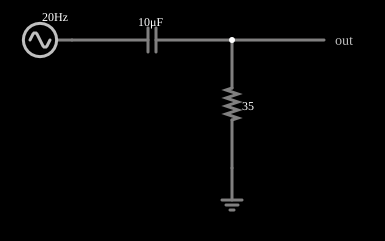

# Filtro passa-altas RC

<!-- navegacao:inicio -->
[Índice](README.md) · [Próximo: Low-Pass Filter (RC)](filt-lopass.md)
<!-- navegacao:fim -->

## Objetivo

Mostrar um filtro passa-altas de primeira ordem: o capacitor em série deixa passar as frequências altas e atenua as baixas, com frequência de corte $f_c = 1/(2\pi RC)$.

## O circuito

<!-- esquema:inicio -->

<!-- esquema:fim -->

Um capacitor de $10\ \mu\text{F}$ em série com um resistor de $35\ \Omega$ a terra; a saída é a tensão no resistor. O sinal de teste é uma fonte de **varredura de frequência** ("sweep"): uma senoide de 5 V de pico cuja frequência varia de forma logarítmica de 20 Hz a 1 kHz em 100 ms e depois volta (varredura bidirecional). Como a frequência é uma função conhecida do tempo,

$$f(t) = f_{min}\left(\frac{f_{max}}{f_{min}}\right)^{t/T},\qquad 0\le t\le T,$$

o osciloscópio que mostra a tensão de saída ao longo do tempo mostra, na prática, a **resposta em frequência** do filtro: a altura da curva em cada instante é a amplitude de saída na frequência daquele instante.

<!-- componentes:inicio -->
| N.º | Tipo | Elemento | Valores |
|----:|------|----------|---------|
| 0 | `CapacitorElm` | capacitor | Capacitance (F) = 10μ; Trapezoidal Approximation = sim; Initial Voltage (on Reset) = 1m; Series Resistance = 0 |
| 1 | `ResistorElm` | resistor | Resistance (ohms) = 35 |
| 2 | `OutputElm` | output | Show Voltage = não |
| 3 | `GroundElm` | ground | Symbol = Earth |
| 4 | `SweepElm` | sweep (log) | Min Frequency (Hz) = 20; Max Frequency (Hz) = 1k; Sweep Time (s) = 100m; Logarithmic = sim; Max Voltage = 5; Bidirectional = sim |
<!-- componentes:fim -->

## Teoria

A saída é o divisor $R$ / $(R + 1/j\omega C)$:

$$H(j\omega) = \frac{V_{out}}{V_{in}} = \frac{j\omega RC}{1 + j\omega RC},\qquad |H| = \frac{\omega RC}{\sqrt{1+(\omega RC)^2}},\qquad \varphi = 90^\circ - \arctan(\omega RC).$$

A **frequência de corte** (queda de 3 dB, onde $|H| = 1/\sqrt2 = 0{,}707$) é $f_c = \dfrac{1}{2\pi RC}$. Abaixo de $f_c$ o ganho cai $20\ \text{dB}$ por década (6 dB por oitava); acima, tende a 1.

## Resultados esperados

$f_c = 1/(2\pi\cdot35\cdot10\times10^{-6}) = 454{,}7\ \text{Hz}$. A varredura chega a essa frequência em $t = 0{,}1\cdot\ln(454{,}7/20)/\ln(50) = 79{,}9\ \text{ms}$.

| $f$ | instante | $\|H\|$ | $V_{out,pico}$ |
|----:|---------:|--------:|---------------:|
| 45,5 Hz | 21,0 ms | 0,100 | 0,50 V |
| 227 Hz | 62,1 ms | 0,447 | 2,23 V |
| **455 Hz** | **79,9 ms** | **0,707** | **3,54 V** |
| 910 Hz | 97,6 ms | 0,895 | 4,47 V |

As verificações medem a saída perto de $f_c$ e perto de 910 Hz (tolerância de 3%).

## O que observar

- A curva de saída sobe com a frequência e se aproxima de 5 V no fim da subida.
- No instante da frequência de corte a saída vale 70% da entrada.
- Mude $C$ ou $R$: $f_c$ se desloca (por exemplo, dobrando $C$ a frequência de corte cai pela metade).
- Compare com o passa-altas RL, que tem a mesma resposta.

## Limites do modelo

Como a frequência varia depressa (uma década a cada 0,0255 s), a amplitude observada num instante é uma aproximação da resposta em regime permanente naquela frequência: nas frequências baixas a variação durante um ciclo não é pequena. Por isso as verificações deste documento usam as frequências mais altas da varredura, em janelas curtas, e uma tolerância de 3%; nos testes o simulador ficou a menos de 2,5% da teoria. Os componentes são ideais.

## Referências

- J. W. Nilsson e S. A. Riedel, *Circuitos Elétricos*, Pearson.
- A. S. Sedra e K. C. Smith, *Microeletrônica*, Pearson.
- P. Horowitz e W. Hill, *The Art of Electronics*, Cambridge University Press.

O circuito deste exemplo faz parte da coleção do simulador original de Paul Falstad e Iain Sharp (CircuitJS1); a explicação é deste projeto.
