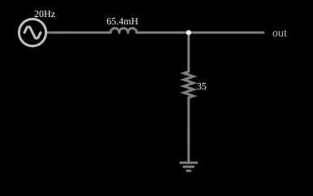

# Filtro passa-baixas RL

<!-- navegacao:inicio -->
[Índice](README.md) · [Anterior: High-Pass Filter (RL)](filt-hipass-l.md) · [Próximo: Band-pass Filter](bandpass.md)
<!-- navegacao:fim -->

## Objetivo

Mostrar um filtro passa-baixas de primeira ordem com indutor: o indutor em série bloqueia as frequências altas, com frequência de corte $f_c = R/(2\pi L)$.

## O circuito

<!-- esquema:inicio -->

<!-- esquema:fim -->

Um indutor de $65{,}4\ \text{mH}$ em série com a entrada e um resistor de $35\ \Omega$ para a terra; a saída é a tensão no resistor. O sinal de teste é uma fonte de **varredura de frequência** ("sweep"): uma senoide de 5 V de pico cuja frequência varia de forma logarítmica de 20 Hz a 1 kHz em 100 ms e depois volta (varredura bidirecional). Como a frequência é uma função conhecida do tempo,

$$f(t) = f_{min}\left(\frac{f_{max}}{f_{min}}\right)^{t/T},\qquad 0\le t\le T,$$

o osciloscópio que mostra a tensão de saída ao longo do tempo mostra, na prática, a **resposta em frequência** do filtro: a altura da curva em cada instante é a amplitude de saída na frequência daquele instante.

<!-- componentes:inicio -->
| N.º | Tipo | Elemento | Valores |
|----:|------|----------|---------|
| 0 | `ResistorElm` | resistor | Resistance (ohms) = 35 |
| 1 | `OutputElm` | output | Show Voltage = não |
| 2 | `GroundElm` | ground | Symbol = Earth |
| 3 | `InductorElm` | inductor | Inductance (H) = 65.4m; Trapezoidal Approximation = sim; Initial Current (on Reset) (A) = 0; Saturation Current (A) (0=none) = 0 |
| 4 | `SweepElm` | sweep (log) | Min Frequency (Hz) = 20; Max Frequency (Hz) = 1k; Sweep Time (s) = 100m; Logarithmic = sim; Max Voltage = 5; Bidirectional = sim |
<!-- componentes:fim -->

## Teoria

A saída é o divisor $R/(R + j\omega L)$:

$$H(j\omega) = \frac{1}{1 + j\omega L/R},\qquad |H| = \frac{1}{\sqrt{1+(\omega L/R)^2}},\qquad f_c = \frac{R}{2\pi L}.$$

## Resultados esperados

$f_c = 35/(2\pi\cdot65{,}4\times10^{-3}) = 85{,}2\ \text{Hz}$ (em $t=37{,}0\ \text{ms}$), $|H| = 0{,}196$ em 425 Hz ($0{,}98\ \text{V}$) e $0{,}100$ em 851 Hz ($0{,}50\ \text{V}$), os mesmos valores do passa-baixas RC. As verificações medem os dois últimos pontos (tolerância de 3%).

## O que observar

- Compare com o passa-baixas RC: a mesma curva com outros componentes.
- Aumente $R$: $f_c$ aumenta; aumente $L$: $f_c$ diminui.

## Limites do modelo

Como a frequência varia depressa (uma década a cada 0,0255 s), a amplitude observada num instante é uma aproximação da resposta em regime permanente naquela frequência: nas frequências baixas a variação durante um ciclo não é pequena. Por isso as verificações deste documento usam as frequências mais altas da varredura, em janelas curtas, e uma tolerância de 3%; nos testes o simulador ficou a menos de 2,5% da teoria. Os componentes são ideais.

## Referências

- J. W. Nilsson e S. A. Riedel, *Circuitos Elétricos*, Pearson.
- A. S. Sedra e K. C. Smith, *Microeletrônica*, Pearson.

O circuito deste exemplo faz parte da coleção do simulador original de Paul Falstad e Iain Sharp (CircuitJS1); a explicação é deste projeto.
