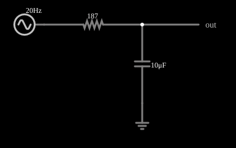

# Filtro passa-baixas RC

<!-- navegacao:inicio -->
[Índice](README.md) · [Anterior: High-Pass Filter (RC)](filt-hipass.md) · [Próximo: High-Pass Filter (RL)](filt-hipass-l.md)
<!-- navegacao:fim -->

## Objetivo

Mostrar um filtro passa-baixas de primeira ordem: o capacitor em derivação desvia as frequências altas para a terra, com frequência de corte $f_c = 1/(2\pi RC)$.

## O circuito

<!-- esquema:inicio -->

<!-- esquema:fim -->

Um resistor de $187\ \Omega$ em série com a entrada e um capacitor de $10\ \mu\text{F}$ para a terra; a saída é a tensão no capacitor. O sinal de teste é uma fonte de **varredura de frequência** ("sweep"): uma senoide de 5 V de pico cuja frequência varia de forma logarítmica de 20 Hz a 1 kHz em 100 ms e depois volta (varredura bidirecional). Como a frequência é uma função conhecida do tempo,

$$f(t) = f_{min}\left(\frac{f_{max}}{f_{min}}\right)^{t/T},\qquad 0\le t\le T,$$

o osciloscópio que mostra a tensão de saída ao longo do tempo mostra, na prática, a **resposta em frequência** do filtro: a altura da curva em cada instante é a amplitude de saída na frequência daquele instante.

<!-- componentes:inicio -->
| N.º | Tipo | Elemento | Valores |
|----:|------|----------|---------|
| 0 | `OutputElm` | output | Show Voltage = não |
| 1 | `GroundElm` | ground | Symbol = Earth |
| 2 | `ResistorElm` | resistor | Resistance (ohms) = 187 |
| 3 | `CapacitorElm` | capacitor | Capacitance (F) = 10μ; Trapezoidal Approximation = sim; Initial Voltage (on Reset) = 1m; Series Resistance = 0 |
| 4 | `SweepElm` | sweep (log) | Min Frequency (Hz) = 20; Max Frequency (Hz) = 1k; Sweep Time (s) = 100m; Logarithmic = sim; Max Voltage = 5; Bidirectional = sim |
<!-- componentes:fim -->

## Teoria

A saída é o divisor $(1/j\omega C)/(R + 1/j\omega C)$:

$$H(j\omega) = \frac{1}{1 + j\omega RC},\qquad |H| = \frac{1}{\sqrt{1+(\omega RC)^2}},\qquad \varphi = -\arctan(\omega RC).$$

A frequência de corte é $f_c = \dfrac{1}{2\pi RC}$; acima dela o ganho cai $20\ \text{dB}$ por década.

## Resultados esperados

$f_c = 1/(2\pi\cdot187\cdot10\times10^{-6}) = 85{,}1\ \text{Hz}$, atingida em $t = 37{,}0\ \text{ms}$.

| $f$ | instante | $\|H\|$ | $V_{out,pico}$ |
|----:|---------:|--------:|---------------:|
| 8,5 Hz | (antes do início) | 0,995 | 4,98 V |
| **85,1 Hz** | **37,0 ms** | **0,707** | **3,54 V** |
| 425 Hz | 78,1 ms | 0,196 | 0,98 V |
| 851 Hz | 95,9 ms | 0,100 | 0,50 V |

As verificações medem a saída em 425 Hz e em 851 Hz (tolerância de 3%).

## O que observar

- A curva de saída começa perto de 5 V e cai com a frequência.
- Em $f_c$ a saída vale 70% da entrada; uma década acima, 10%.
- Compare com o passa-baixas RL, que tem a mesma resposta.

## Limites do modelo

Como a frequência varia depressa (uma década a cada 0,0255 s), a amplitude observada num instante é uma aproximação da resposta em regime permanente naquela frequência: nas frequências baixas a variação durante um ciclo não é pequena. Por isso as verificações deste documento usam as frequências mais altas da varredura, em janelas curtas, e uma tolerância de 3%; nos testes o simulador ficou a menos de 2,5% da teoria. Os componentes são ideais.

## Referências

- J. W. Nilsson e S. A. Riedel, *Circuitos Elétricos*, Pearson.
- A. S. Sedra e K. C. Smith, *Microeletrônica*, Pearson.
- P. Horowitz e W. Hill, *The Art of Electronics*, Cambridge University Press.

O circuito deste exemplo faz parte da coleção do simulador original de Paul Falstad e Iain Sharp (CircuitJS1); a explicação é deste projeto.
