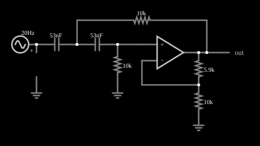

# Filtro passa-altas VCVS (Sallen-Key)

<!-- navegacao:inicio -->
[Índice](README.md) · [Anterior: VCVS Low-Pass Filter](filt-vcvs-lopass.md) · [Próximo: Switched-Capacitor Filter](switchedcap.md)
<!-- navegacao:fim -->

## Objetivo

Mostrar a versão passa-altas do filtro Sallen-Key de segunda ordem, com resposta de Butterworth: os papéis dos resistores e dos capacitores se trocam e as frequências baixas são rejeitadas.

## O circuito

<!-- esquema:inicio -->

<!-- esquema:fim -->

A fonte é um gerador de varredura logarítmica (*sweep*) de $5\ \text{V}$ de pico, que percorre as frequências de $20$ a $800\ \text{Hz}$ em $0{,}2\ \text{s}$ (no sentido de ida e volta), de modo que a resposta em frequência do filtro aparece como a variação da amplitude da saída ao longo do tempo. Dois capacitores de $53\ \text{nF}$ em série ligam a entrada à entrada não inversora do amplificador operacional; um resistor de $10\ \text{k}\Omega$ liga o nó entre os capacitores à saída (realimentação) e outro, de $10\ \text{k}\Omega$, liga a entrada não inversora à terra. O ganho do amplificador é $K = 1 + 5{,}86/10 = 1{,}586$. Um elemento de saída e dois osciloscópios mostram a entrada e a saída.

<!-- componentes:inicio -->
| N.º | Tipo | Elemento | Valores |
|----:|------|----------|---------|
| 0 | `ResistorElm` | resistor | Resistance (ohms) = 5.9k |
| 1 | `ResistorElm` | resistor | Resistance (ohms) = 10k |
| 2 | `GroundElm` | ground | Symbol = Earth |
| 4 | `GroundElm` | ground | Symbol = Earth |
| 6 | `OpAmpElm` | op-amp | Max Output (V) = 15; Min Output (V) = -15; Gain = 100k |
| 11 | `OutputElm` | output | Show Voltage = não |
| 12 | `ProbeElm` | voltmeter | Show Voltage = não; Value = Voltage; Scale = Auto; Use Circle Symbol = não; Series Resistance (0 = infinite) = 0 |
| 13 | `GroundElm` | ground | Symbol = Earth |
| 14 | `CapacitorElm` | capacitor | Capacitance (F) = 53n; Trapezoidal Approximation = sim; Initial Voltage (on Reset) = 1m; Series Resistance = 0 |
| 15 | `CapacitorElm` | capacitor | Capacitance (F) = 53n; Trapezoidal Approximation = sim; Initial Voltage (on Reset) = 1m; Series Resistance = 0 |
| 16 | `ResistorElm` | resistor | Resistance (ohms) = 10k |
| 17 | `ResistorElm` | resistor | Resistance (ohms) = 10k |
| 18 | `SweepElm` | sweep (log) | Min Frequency (Hz) = 20; Max Frequency (Hz) = 800; Sweep Time (s) = 200m; Logarithmic = sim; Max Voltage = 5; Bidirectional = sim |
<!-- componentes:fim -->

## Teoria

No Sallen-Key passa-altas com $R_1 = R_2 = R$ e $C_1 = C_2 = C$,

$$H(s) = \frac{K\,(sRC)^2}{1 + (3-K)\,sRC + (sRC)^2}, \qquad f_0 = \frac{1}{2\pi RC} = \frac{1}{2\pi\cdot 10\ \text{k}\Omega\cdot 53\ \text{nF}} \approx 300\ \text{Hz}, \quad Q = \frac{1}{3-K} = 0{,}707.$$

O módulo é

$$|H(f)| = \frac{K}{\sqrt{1 + (f_0/f)^4}},$$

que vale $K\,(f/f_0)^2$ muito abaixo de $f_0$ (subida de $40\ \text{dB}$ por década), $K/\sqrt 2 = 1{,}12$ em $f_0$ e tende a $K = 1{,}586$ em altas frequências.

## Resultados esperados

| Faixa de frequência | Ganho esperado | Amplitude da saída (entrada de $5\ \text{V}$) |
|---------------------|---------------:|----------------------------------:|
| $20$ a $42\ \text{Hz}$ (rejeição) | $\le 0{,}03$ | $0{,}104\ \text{V}$ (máximo na janela) |
| $274$ a $330\ \text{Hz}$ (em torno de $f_0$) | $1{,}0$ a $1{,}2$ | $5{,}84\ \text{V}$ (máximo na janela) |
| $616$ a $800\ \text{Hz}$ (banda passante) | $\approx 1{,}55$ a $1{,}57$ | $7{,}87\ \text{V}$ ($K\cdot 5 = 7{,}93\ \text{V}$) |

As verificações conferem as três janelas.

## O que observar

- A saída começa praticamente nula, cresce em torno de $300\ \text{Hz}$ e fica em cerca de $1{,}6$ vez a entrada no final da varredura, o oposto do filtro passa-baixas.
- O osciloscópio de saída mostra o envelope da resposta em frequência: uma "rampa" que sobe e satura.
- Com $Q = 0{,}707$ não há pico de ressonância; aumente $K$ para ver o pico em $f_0$.

## Limites do modelo

Operacional ideal e componentes sem tolerância. Num circuito real o ganho de malha aberta cai em altas frequências, e a resposta passa-altas se transforma em passa-banda por causa dessa limitação do operacional.

## Referências

- A. S. Sedra e K. C. Smith, *Microeletrônica*, Pearson.
- R. P. Sallen e E. L. Key, "A practical method of designing RC active filters", *IRE Transactions on Circuit Theory*, 2, 1955.
- S. Franco, *Design with Operational Amplifiers and Analog Integrated Circuits*, McGraw-Hill.

O circuito deste exemplo faz parte da coleção do simulador original de Paul Falstad e Iain Sharp (CircuitJS1); a explicação é deste projeto.
