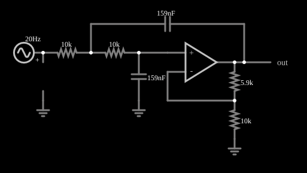

# Filtro passa-baixas VCVS (Sallen-Key)

<!-- navegacao:inicio -->
[Índice](README.md) · [Próximo: VCVS High-Pass Filter](filt-vcvs-hipass.md)
<!-- navegacao:fim -->

## Objetivo

Mostrar um filtro passa-baixas ativo de segunda ordem na topologia Sallen-Key (fonte de tensão controlada por tensão, VCVS), projetado para a resposta de Butterworth (a mais plana na banda passante), e ver a sua resposta em frequência com uma varredura.

## O circuito

<!-- esquema:inicio -->

<!-- esquema:fim -->

A fonte é um gerador de varredura logarítmica (*sweep*) de $5\ \text{V}$ de pico, que percorre as frequências de $20$ a $800\ \text{Hz}$ em $0{,}2\ \text{s}$ (no sentido de ida e volta), de modo que a resposta em frequência do filtro aparece como a variação da amplitude da saída ao longo do tempo. O filtro tem dois resistores de $10\ \text{k}\Omega$ em série, um capacitor de $159\ \text{nF}$ do nó entre eles à saída do amplificador (realimentação) e outro de $159\ \text{nF}$ da entrada não inversora à terra. O amplificador operacional é não inversor, com ganho $K = 1 + 5{,}86\ \text{k}\Omega/10\ \text{k}\Omega = 1{,}586$. Um elemento de saída e dois osciloscópios mostram a entrada e a saída.

<!-- componentes:inicio -->
| N.º | Tipo | Elemento | Valores |
|----:|------|----------|---------|
| 0 | `ResistorElm` | resistor | Resistance (ohms) = 10k |
| 1 | `ResistorElm` | resistor | Resistance (ohms) = 10k |
| 2 | `ResistorElm` | resistor | Resistance (ohms) = 5.9k |
| 3 | `ResistorElm` | resistor | Resistance (ohms) = 10k |
| 4 | `GroundElm` | ground | Symbol = Earth |
| 6 | `CapacitorElm` | capacitor | Capacitance (F) = 159n; Trapezoidal Approximation = sim; Initial Voltage (on Reset) = 1m; Series Resistance = 0 |
| 7 | `GroundElm` | ground | Symbol = Earth |
| 9 | `OpAmpElm` | op-amp | Max Output (V) = 15; Min Output (V) = -15; Gain = 100k |
| 14 | `CapacitorElm` | capacitor | Capacitance (F) = 159n; Trapezoidal Approximation = sim; Initial Voltage (on Reset) = 1m; Series Resistance = 0 |
| 15 | `OutputElm` | output | Show Voltage = não |
| 16 | `ProbeElm` | voltmeter | Show Voltage = não; Value = Voltage; Scale = Auto; Use Circle Symbol = não; Series Resistance (0 = infinite) = 0 |
| 17 | `GroundElm` | ground | Symbol = Earth |
| 18 | `SweepElm` | sweep (log) | Min Frequency (Hz) = 20; Max Frequency (Hz) = 800; Sweep Time (s) = 200m; Logarithmic = sim; Max Voltage = 5; Bidirectional = sim |
<!-- componentes:fim -->

## Teoria

Com $R_1 = R_2 = R$, $C_1 = C_2 = C$ e ganho $K$ do amplificador, a função de transferência do Sallen-Key passa-baixas é

$$H(s) = \frac{K}{1 + (3-K)\,sRC + (sRC)^2}.$$

A frequência de corte natural e o fator de qualidade são

$$f_0 = \frac{1}{2\pi RC} = \frac{1}{2\pi\cdot 10\ \text{k}\Omega\cdot 159\ \text{nF}} \approx 100\ \text{Hz}, \qquad Q = \frac{1}{3-K} = \frac{1}{3 - 1{,}586} = 0{,}707.$$

$Q = 1/\sqrt 2$ é a condição de Butterworth: o módulo vale

$$|H(f)| = \frac{K}{\sqrt{1 + (f/f_0)^4}},$$

com ganho $K = 1{,}586$ em baixas frequências, $K/\sqrt 2 = 1{,}12$ em $f_0$ (queda de $3\ \text{dB}$ em relação a $K$) e queda de $40\ \text{dB}$ por década depois dela.

## Resultados esperados

| Faixa de frequência | Ganho esperado | Amplitude da saída (entrada de $5\ \text{V}$) |
|---------------------|---------------:|----------------------------------:|
| $20$ a $42\ \text{Hz}$ (banda passante) | $\approx 1{,}58$ | $7{,}91\ \text{V}$ (simulador); $K\cdot 5 = 7{,}93\ \text{V}$ |
| $91$ a $109\ \text{Hz}$ (em torno de $f_0$) | $1{,}0$ a $1{,}2$ | $5{,}80\ \text{V}$ (máximo na janela) |
| $616$ a $800\ \text{Hz}$ (banda de rejeição) | $0{,}025$ a $0{,}042$ | $0{,}173\ \text{V}$ (máximo na janela; teoria: $0{,}12$ a $0{,}21\ \text{V}$) |

As verificações conferem a amplitude em cada janela de $10$ a $40\ \text{ms}$ da varredura (as amplitudes são o máximo da saída na janela, e o ganho muda ao longo dela).

## O que observar

- A amplitude da saída começa em cerca de $1{,}6$ vez a da entrada, cai ao passar por $100\ \text{Hz}$ e se reduz a quase nada em $800\ \text{Hz}$.
- Altere $R_f$ (de $5{,}86\ \text{k}\Omega$ para, por exemplo, $9\ \text{k}\Omega$) e $Q$ sobe, aparecendo um pico de ressonância na resposta; com $K = 3$ o filtro oscila.
- Para mudar a frequência de corte, mude os dois resistores ou os dois capacitores na mesma proporção.

## Limites do modelo

Operacional ideal (ganho $10^5$, sem *offset*, banda infinita) e componentes sem tolerância; em um filtro real, a tolerância de $R$ e $C$ (1% a 5%) desloca a frequência de corte e o $Q$. A amplitude medida na varredura é a de um sinal de frequência variável, e por isso o valor em cada janela é o máximo, não o de regime senoidal estacionário.

## Referências

- A. S. Sedra e K. C. Smith, *Microeletrônica*, Pearson.
- R. P. Sallen e E. L. Key, "A practical method of designing RC active filters", *IRE Transactions on Circuit Theory*, 2, 1955.
- S. Franco, *Design with Operational Amplifiers and Analog Integrated Circuits*, McGraw-Hill.

O circuito deste exemplo faz parte da coleção do simulador original de Paul Falstad e Iain Sharp (CircuitJS1); a explicação é deste projeto.
