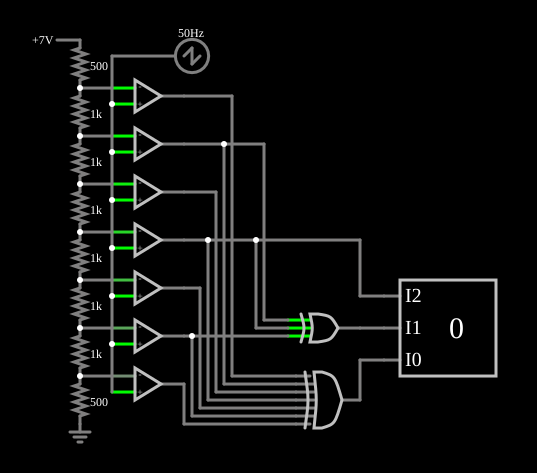

# Conversor A/D *flash*

<!-- navegacao:inicio -->
[Índice](README.md) · [Próximo: Delta-Sigma ADC](deltasigma.md)
<!-- navegacao:fim -->

## Objetivo

Mostrar o conversor analógico-digital mais rápido: uma escada de resistores gera todos os limiares de uma vez, um comparador por limiar decide em paralelo, e uma lógica converte o resultado em binário.

## O circuito

<!-- esquema:inicio -->

<!-- esquema:fim -->

- **Escada de referência:** de $7\ \text{V}$ à terra, $500\ \Omega$, seis resistores de $1\ \text{k}\Omega$ e mais $500\ \Omega$; os nós intermediários ficam em $6{,}5$, $5{,}5$, $4{,}5$, $3{,}5$, $2{,}5$, $1{,}5$ e $0{,}5\ \text{V}$.
- **Comparadores:** sete amp-ops (saída de $0$ a $5\ \text{V}$) comparam a entrada com cada nó.
- **Entrada:** uma onda dente de serra de $50\ \text{Hz}$ que sobe de $0$ a $7{,}6\ \text{V}$.
- **Codificador:** portas XOR (uma de sete entradas para o bit 0, uma de três para o bit 1; o bit 2 vem do comparador do meio) formam o código de 3 bits, mostrado num mostrador decimal (elemento 64).

<!-- componentes:inicio -->
| N.º | Tipo | Elemento | Valores |
|----:|------|----------|---------|
| 0 | `OpAmpElm` | op-amp | Max Output (V) = 5; Min Output (V) = 0; Gain = 100k |
| 1 | `OpAmpElm` | op-amp | Max Output (V) = 5; Min Output (V) = 0; Gain = 100k |
| 2 | `OpAmpElm` | op-amp | Max Output (V) = 5; Min Output (V) = 0; Gain = 100k |
| 3 | `OpAmpElm` | op-amp | Max Output (V) = 5; Min Output (V) = 0; Gain = 100k |
| 4 | `OpAmpElm` | op-amp | Max Output (V) = 5; Min Output (V) = 0; Gain = 100k |
| 5 | `OpAmpElm` | op-amp | Max Output (V) = 5; Min Output (V) = 0; Gain = 100k |
| 6 | `OpAmpElm` | op-amp | Max Output (V) = 5; Min Output (V) = 0; Gain = 100k |
| 7 | `ResistorElm` | resistor | Resistance (ohms) = 500 |
| 8 | `ResistorElm` | resistor | Resistance (ohms) = 1k |
| 9 | `ResistorElm` | resistor | Resistance (ohms) = 1k |
| 10 | `ResistorElm` | resistor | Resistance (ohms) = 1k |
| 11 | `ResistorElm` | resistor | Resistance (ohms) = 1k |
| 12 | `ResistorElm` | resistor | Resistance (ohms) = 1k |
| 13 | `ResistorElm` | resistor | Resistance (ohms) = 1k |
| 14 | `ResistorElm` | resistor | Resistance (ohms) = 500 |
| 15 | `RailElm` | voltage source | Voltage = 7; Waveform = D/C; DC Offset (V) = 0; Internal Resistance (ohms) = 0 |
| 30 | `RailElm` | sawtooth gen | Max Voltage = 3.8; Waveform = Sawtooth; DC Offset (V) = 3.8; Internal Resistance (ohms) = 0; Show Voltage = não; Frequency (Hz) = 50; Phase Offset (degrees) = 0 |
| 31 | `GroundElm` | ground | Symbol = Earth |
| 32 | `XorGateElm` | XOR gate | # of Inputs = 7; High Logic Voltage = 5; Schmitt Inputs = não; Propagation Delay (s) = 0; DeMorgan's Symbol = não |
| 53 | `XorGateElm` | XOR gate | # of Inputs = 3; High Logic Voltage = 5; Schmitt Inputs = não; Propagation Delay (s) = 0; DeMorgan's Symbol = não |
| 64 | `DecimalDisplayElm` | decimal display | High Logic Voltage = 5; Bit Order = MSB First; # of Bits = 3; Display Mode = Decimal |
<!-- componentes:fim -->

## Teoria

Os comparadores cujos limiares estão abaixo da entrada saem em $1$, os outros em $0$: a saída da fileira é um **código termômetro** com $k$ uns, onde $k$ é o número de limiares ultrapassados. Com limiares em $0{,}5, 1{,}5, \dots, 6{,}5\ \text{V}$ (os resistores de meio valor nas pontas deslocam a escada de meio degrau), o código é o valor da entrada **arredondado** ao volt mais próximo, de $0$ a $7$.

A conversão para binário usa a paridade: com $k$ uns no termômetro, a XOR de todas as saídas vale $k \bmod 2$, o bit 0; a XOR das saídas dos limiares $1{,}5$, $3{,}5$ e $5{,}5\ \text{V}$ dá o bit 1; e o comparador de $3{,}5\ \text{V}$ é o bit 2. Um conversor *flash* de $n$ bits precisa de $2^n - 1$ comparadores: é o mais rápido (uma só comparação) e o mais caro, usado em osciloscópios digitais e em receptores de rádio.

## Resultados esperados

A corrente na escada é de $1\ \text{mA}$, e os limiares ficam exatamente em $0{,}5$, $1{,}5$, …, $6{,}5\ \text{V}$. O simulador dá:

| $t$ (ms) | Entrada (V) | Código |
|----:|----:|----:|
| 1 | 0,37 | 0 |
| 3 | 1,12 | 1 |
| 5 | 1,87 | 2 |
| 9 | 3,37 | 3 |
| 11 | 4,12 | 4 |
| 13 | 4,87 | 5 |
| 15 | 5,62 | 6 |
| 19 | 7,12 | 7 |

Em todos os casos o código é a entrada arredondada.

## O que observar

Nos osciloscópios, a entrada sobe em rampa e o código sobe em degraus de $1\ \text{V}$; acima de $6{,}5\ \text{V}$ ele fica em $7$ (saturação).

## Limites do modelo

- Comparadores ideais e simultâneos; num conversor real, comparadores com tempos ligeiramente diferentes podem produzir "bolhas" no termômetro, e o codificador por XOR é sensível a elas.
- Não há circuito de amostragem e retenção: o código acompanha a entrada continuamente.

## Referências

Johns e Martin, *Analog Integrated Circuit Design*, capítulo sobre conversores A/D *flash*; Horowitz e Hill, *The Art of Electronics*, capítulo sobre conversão A/D.

O circuito deste exemplo faz parte da coleção do simulador original de Paul Falstad e Iain Sharp (CircuitJS1); a explicação é deste projeto.
