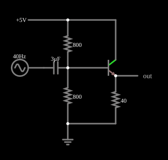

# Seguidor de emissor

<!-- navegacao:inicio -->
[Índice](README.md) · [Anterior: Switch](transswitch.md) · [Próximo: Common-Emitter Amplifier](ceamp.md)
<!-- navegacao:fim -->

## Objetivo

Mostrar o seguidor de emissor (coletor comum): o sinal de saída, no emissor, acompanha o da base com ganho de tensão próximo de 1, mas com muita capacidade de fornecer corrente (baixa impedância de saída).

## O circuito

<!-- esquema:inicio -->

<!-- esquema:fim -->

A alimentação de $5\ \text{V}$ alimenta o coletor e um divisor de dois resistores de $800\ \Omega$ que polariza a base em $\approx 2{,}5\ \text{V}$. O sinal (uma senoide de $5\ \text{V}$ de pico e $40\ \text{Hz}$) entra pela base por um capacitor de $3\ \mu\text{F}$. O emissor tem um resistor de $40\ \Omega$ para a terra e é a saída.

<!-- componentes:inicio -->
| N.º | Tipo | Elemento | Valores |
|----:|------|----------|---------|
| 1 | `ResistorElm` | resistor | Resistance (ohms) = 800 |
| 2 | `ResistorElm` | resistor | Resistance (ohms) = 800 |
| 3 | `NTransistorElm` | transistor | Beta/hFE = 100; Swap E/C = não; Draw Circle = não; Model = default |
| 5 | `ResistorElm` | resistor | Resistance (ohms) = 40 |
| 7 | `CapacitorElm` | capacitor | Capacitance (F) = 3μ; Trapezoidal Approximation = sim; Initial Voltage (on Reset) = 1m; Series Resistance = 0 |
| 8 | `RailElm` | A/C source | Max Voltage = 5; Waveform = A/C; DC Offset (V) = 0; Internal Resistance (ohms) = 0; Show Voltage = não; Frequency (Hz) = 40; Phase Offset (degrees) = 0 |
| 9 | `GroundElm` | ground | Symbol = Earth |
| 10 | `RailElm` | voltage source | Voltage = 5; Waveform = D/C; DC Offset (V) = 0; Internal Resistance (ohms) = 0 |
| 11 | `OutputElm` | output | Show Voltage = não |
<!-- componentes:fim -->

## Teoria

O transistor bipolar do simulador (modelo "default") segue o modelo de Ebers–Moll, com $V_{BE}$ e $V_{BC}$ as tensões base-emissor e base-coletor (para um NPN):

$$I_C = I_s\left(e^{V_{BE}/V_T} - e^{V_{BC}/V_T}\right) - \frac{I_s}{\beta_R}\left(e^{V_{BC}/V_T} - 1\right),\qquad I_B = \frac{I_s}{\beta}\left(e^{V_{BE}/V_T} - 1\right) + \frac{I_s}{\beta_R}\left(e^{V_{BC}/V_T} - 1\right),$$

com $I_s = 10^{-13}\ \text{A}$, $\beta = 100$, $\beta_R = 1$ e $V_T = 25{,}865\ \text{mV}$; sem efeito Early, sem capacitâncias e sem resistências série. Na **região ativa** ($V_{BE} \approx 0{,}65$ a $0{,}75\ \text{V}$, junção base-coletor com polarização inversa) isso se reduz a $I_C = \beta I_B = I_s\,e^{V_{BE}/V_T}$, com transcondutância $g_m = I_C/V_T$ e resistência de emissor $r_e = V_T/I_E$. O PNP é o complementar, com todas as tensões e correntes invertidas.

## Resultados esperados

Com o emissor seguindo a base, $v_E = v_B - V_{BE}$, e como $V_{BE}$ varia só $60\ \text{mV}$ por década de corrente, uma variação $\Delta v_B$ na base aparece quase igual no emissor:

$$A_v = \frac{v_e}{v_b} = \frac{R_E}{R_E + r_e} \approx 1,\qquad r_e = \frac{V_T}{I_E}.$$

A impedância de entrada vista pela base é $\approx \beta\,(R_E + r_e)$, bem maior que a do emissor, de modo que o seguidor serve de **buffer**: transforma uma fonte de impedância alta em uma de impedância baixa ($\approx r_e + R_B/\beta$). Não há inversão de fase.

## O que observar

Em regime, a integração numérica independente dá, para a tensão na base (o resistor inferior do divisor) e no emissor (resistor de $40\ \Omega$):

| ponto | mínimo | máximo | pico a pico |
|:------|-------:|-------:|------------:|
| base | $1.011\ \text{V}$ | $3.662\ \text{V}$ | $2.651\ \text{V}$ |
| emissor | $0.359\ \text{V}$ | $2.955\ \text{V}$ | $2.596\ \text{V}$ |

O ganho de tensão é $2.596/2.651 = 0.979$, próximo de $1$ (a resistência de emissor dinâmica, $r_e \approx 0{,}6\ \Omega$, está em série com os $40\ \Omega$). A tensão média no emissor é $1.651\ \text{V}$, uma queda $V_{BE}$ de $\approx 0{,}69\ \text{V}$ abaixo da base. O sinal de entrada, de $5\ \text{V}$ de pico, chega à base muito atenuado ($\approx 1{,}3\ \text{V}$), pelo divisor entre o capacitor de $3\ \mu\text{F}$ ($1{,}3\ \text{k}\Omega$ a $40\ \text{Hz}$) e a impedância de entrada do estágio. As verificações conferem o máximo, o mínimo e a média da tensão no emissor e o máximo e o mínimo na base, de $0{,}1$ a $0{,}15\ \text{s}$ (tolerância de 1%; concordam com o simulador a menos de $10^{-5}$).

## Limites do modelo

- O emissor reproduz a base, deslocado de $\approx 0{,}7\ \text{V}$ para baixo: ganho de tensão 1, ganho de corrente de $\beta + 1 = 101$.
- Aumente a carga (diminua o resistor de emissor): o ganho cai um pouco, porque $R_E$ fica comparável a $r_e$.
- Compare com o amplificador de emissor comum (próximo exemplo): lá o ganho de tensão é alto e o sinal é invertido.

## Referências

O modelo não tem capacitâncias, de modo que a resposta em frequência não é limitada pelo transistor. A saída varia em torno de $1{,}65\ \text{V}$: como o sinal de entrada é grande, o transistor opera numa faixa de correntes onde $r_e$ varia bastante, o que causa uma pequena distorção.

O circuito deste exemplo faz parte da coleção do simulador original de Paul Falstad e Iain Sharp (CircuitJS1); a explicação é deste projeto.
