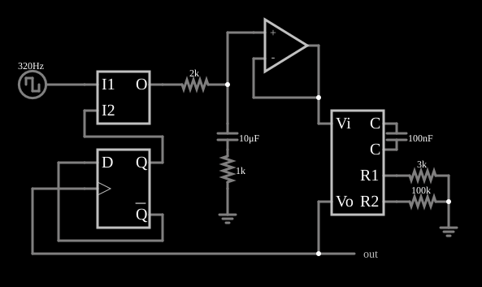

# Dobrador de frequência com PLL

<!-- navegacao:inicio -->
[Índice](README.md) · [Anterior: Type II PLL (fast)](pll2a.md)
<!-- navegacao:fim -->

## Objetivo

Mostrar a síntese de frequência com PLL: colocando um divisor por $2$ (um *flip-flop*) na realimentação entre o VCO e o comparador de fase, a malha trava com o VCO a **o dobro** da frequência da entrada.

## O circuito

<!-- esquema:inicio -->

<!-- esquema:fim -->

A entrada é uma onda quadrada de $320\ \text{Hz}$. O comparador de fase e frequência compara-a com a saída de um *flip-flop* D ligado como divisor por $2$, que recebe a saída do VCO. O filtro (resistor de $2\ \text{k}\Omega$, capacitor de $10\ \mu\text{F}$ em série com $1\ \text{k}\Omega$) e o seguidor aplicam $V_i$ ao VCO ($C = 100\ \text{nF}$, $R_1 = 3\ \text{k}\Omega$, $R_2 = 100\ \text{k}\Omega$). Um elemento de saída e dois osciloscópios mostram a entrada e a saída do VCO. O *slider* "Frequency" do painel lateral deveria mudar a frequência da fonte de entrada; no arquivo desta versão ele está ligado ao campo de resistência interna da fonte, e não ao de frequência (um erro conhecido do exemplo), então para variar a frequência edite a fonte de onda quadrada diretamente.

<!-- componentes:inicio -->
| N.º | Tipo | Elemento | Valores |
|----:|------|----------|---------|
| 0 | `VCOElm` | VCO |  |
| 1 | `CapacitorElm` | capacitor | Capacitance (F) = 100n; Trapezoidal Approximation = sim; Initial Voltage (on Reset) = 1m; Series Resistance = 0 |
| 2 | `ResistorElm` | resistor | Resistance (ohms) = 3k |
| 3 | `ResistorElm` | resistor | Resistance (ohms) = 100k |
| 5 | `GroundElm` | ground | Symbol = Earth |
| 6 | `RailElm` | square wave gen | Max Voltage = 2.5; Waveform = Square Wave; DC Offset (V) = 2.5; Internal Resistance (ohms) = 0; Show Voltage = não; Specify As = Frequency/Duty Cycle; Frequency (Hz) = 320; Phase Offset (degrees) = 0; Duty Cycle = 50; Rise/Fall Time (s) = 0 |
| 7 | `GroundElm` | ground | Symbol = Earth |
| 9 | `OpAmpElm` | op-amp | Max Output (V) = 15; Min Output (V) = -15; Gain = 100k |
| 14 | `PhaseCompElm` | phase comparator | High Logic Voltage = 5 |
| 15 | `ResistorElm` | resistor | Resistance (ohms) = 2k |
| 17 | `CapacitorElm` | capacitor | Capacitance (F) = 10μ; Trapezoidal Approximation = sim; Initial Voltage (on Reset) = 1m; Series Resistance = 0 |
| 18 | `DFlipFlopElm` | D flip-flop | High Logic Voltage = 5; Reset Pin = não; Set Pin = não; Invert Set/Reset = não |
| 30 | `OutputElm` | output | Show Voltage = não |
| 31 | `ResistorElm` | resistor | Resistance (ohms) = 1k |
<!-- componentes:fim -->

## Teoria

O VCO do simulador é um oscilador de relaxação com três pinos externos: a tensão de controle $V_i$ alimenta, pelo resistor $R_1$, uma corrente $V_i/R_1$, somada a uma corrente fixa $V_\text{ref}/R_2$ (com $V_\text{ref} = 5\ \text{V}$, pelo resistor $R_2$), que carrega e descarrega o capacitor externo $C$ entre $0{,}5$ e $4{,}5\ \text{V}$ ($\Delta V = 4\ \text{V}$), invertendo o sentido da corrente a cada limite. A saída é uma onda quadrada de $0$ a $5\ \text{V}$ com frequência

$$f_\text{VCO} = \frac{I}{2\,C\,\Delta V} = \frac{V_i/R_1 + 5/R_2}{8\,C}.$$

Em regime travado o comparador vê duas frequências iguais: a da entrada e a do VCO dividida por $2$. Logo

$$f_\text{VCO} = 2\,f_\text{ent} = 640\ \text{Hz}.$$

Para isso, a tensão de controle é

$$V_i = R_1\left(8\,C\,f_\text{VCO} - \frac{5}{R_2}\right) = 3\ \text{k}\Omega\,(512\ \mu\text{A} - 50\ \mu\text{A}) = 1{,}39\ \text{V}.$$

Com um divisor por $N$ a frequência do VCO é $N\,f_\text{ent}$: é o princípio dos sintetizadores de frequência.

## Resultados esperados

| Grandeza | Teoria | Simulador |
|----------|-------:|----------:|
| Frequência da entrada | $320\ \text{Hz}$ | $320{,}000\ \text{Hz}$ |
| Frequência do VCO | $640\ \text{Hz}$ | $639{,}97\ \text{Hz}$ |
| Tensão de controle $V_i$ | $1{,}39\ \text{V}$ | $1{,}4066\ \text{V}$ ($1{,}2\%$ acima) |

A frequência do VCO é, a menos de $0{,}005\%$, o dobro da entrada, já em $0{,}25\ \text{s}$ ($639{,}90\ \text{Hz}$) e depois em $0{,}55\ \text{s}$ ($639{,}97\ \text{Hz}$). As verificações conferem as frequências e a tensão de controle em uma janela de $50$ a $100\ \text{ms}$ em torno de $1{,}5\ \text{s}$.

## O que observar

- No osciloscópio, a saída do VCO tem dois ciclos para cada ciclo da entrada.
- Troque o *flip-flop* por uma cadeia de dois ($\div 4$) para obter $\times 4$.
- A frequência de saída segue a de entrada: pela teoria, com a fonte de entrada em $400\ \text{Hz}$ o VCO passa a $800\ \text{Hz}$ (isso não foi simulado aqui).

## Limites do modelo

O divisor é um *flip-flop* ideal; num sintetizador real, o divisor é programável e o VCO tem ruído de fase. A diferença de $1{,}2\%$ na tensão de controle vem das simplificações da fórmula do VCO (resistência de $1\ \text{M}\Omega$ em paralelo com o capacitor e atrasos na comutação).

## Referências

- R. E. Best, *Phase-Locked Loops: Design, Simulation, and Applications*, McGraw-Hill.
- F. M. Gardner, *Phaselock Techniques*, Wiley.
- B. Razavi, *Design of Analog CMOS Integrated Circuits*, McGraw-Hill.

O circuito deste exemplo faz parte da coleção do simulador original de Paul Falstad e Iain Sharp (CircuitJS1); a explicação é deste projeto.
