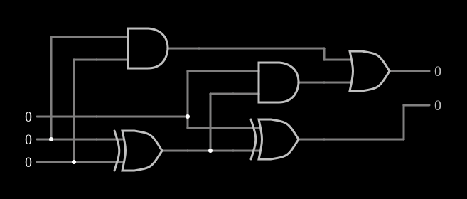

# Somador completo

<!-- navegacao:inicio -->
[Índice](README.md) · [Anterior: Half Adder](halfadd.md) · [Próximo: 1-of-4 Decoder](decoder.md)
<!-- navegacao:fim -->

## Objetivo

Mostrar o **somador completo**, que soma três bits (dois operandos e o vai-um da coluna anterior) e é a célula repetida em cada bit de um somador binário.

## O circuito

<!-- esquema:inicio -->

<!-- esquema:fim -->

Três entradas lógicas numéricas, $A$ (elemento 15), $B$ (elemento 16) e o vai-um de entrada $C_{in}$ (elemento 17), alimentam dois [meio-somadores](halfadd.md) em cascata: a primeira XOR e a primeira AND recebem $A$ e $B$; a segunda XOR e a segunda AND recebem o resultado da primeira XOR e $C_{in}$. Uma porta OR junta as duas ANDs. As saídas são a soma $S$ (elemento 25) e o vai-um de saída $C_{out}$ (elemento 10). O exemplo abre com as três entradas em $0$.

<!-- componentes:inicio -->
| N.º | Tipo | Elemento | Valores |
|----:|------|----------|---------|
| 0 | `XorGateElm` | XOR gate | # of Inputs = 2; High Logic Voltage = 5; Schmitt Inputs = não; Propagation Delay (s) = 0; DeMorgan's Symbol = não |
| 1 | `XorGateElm` | XOR gate | # of Inputs = 2; High Logic Voltage = 5; Schmitt Inputs = não; Propagation Delay (s) = 0; DeMorgan's Symbol = não |
| 10 | `LogicOutputElm` | logic output | Threshold = 2.5; Current Required = não; Numeric = sim; Ternary = não |
| 15 | `LogicInputElm` | logic input | Momentary Switch = não; High Logic Voltage = 5; Low Voltage = 0; Numeric = sim; Ternary = não; Keyboard Shortcut =  |
| 16 | `LogicInputElm` | logic input | Momentary Switch = não; High Logic Voltage = 5; Low Voltage = 0; Numeric = sim; Ternary = não; Keyboard Shortcut =  |
| 17 | `LogicInputElm` | logic input | Momentary Switch = não; High Logic Voltage = 5; Low Voltage = 0; Numeric = sim; Ternary = não; Keyboard Shortcut =  |
| 25 | `LogicOutputElm` | logic output | Threshold = 2.5; Current Required = não; Numeric = sim; Ternary = não |
| 26 | `AndGateElm` | AND gate | # of Inputs = 2; High Logic Voltage = 5; Schmitt Inputs = não; Invert Inputs = não; Propagation Delay (s) = 0; DeMorgan's Symbol = não |
| 27 | `AndGateElm` | AND gate | # of Inputs = 2; High Logic Voltage = 5; Schmitt Inputs = não; Invert Inputs = não; Propagation Delay (s) = 0; DeMorgan's Symbol = não |
| 28 | `OrGateElm` | OR gate | # of Inputs = 2; High Logic Voltage = 5; Schmitt Inputs = não; Invert Inputs = não; Propagation Delay (s) = 0; DeMorgan's Symbol = não |
<!-- componentes:fim -->

## Teoria

O primeiro meio-somador dá $P = A \oplus B$ e $G = AB$; o segundo soma $P$ com $C_{in}$. Resulta

$$S = A \oplus B \oplus C_{in}, \qquad C_{out} = AB + C_{in}(A \oplus B),$$

e $A + B + C_{in} = 2C_{out} + S$. A soma é $1$ quando um número **ímpar** de entradas é $1$; o vai-um é $1$ quando **pelo menos dois** são $1$ (a função maioria, ver [Majority Logic](majority.md)). Os termos $G$ (*gera* um vai-um) e $P$ (*propaga* o vai-um que chega) são a base dos somadores rápidos, como o [Brent-Kung Adder](brentkung.md).

Ligando $n$ somadores completos em cadeia, com o $C_{out}$ de cada bit no $C_{in}$ do seguinte, obtém-se um somador de $n$ bits com propagação do vai-um (*ripple carry*), cujo atraso cresce linearmente com $n$.

## Resultados esperados

O simulador dá a tabela completa:

| $A$ | $B$ | $C_{in}$ | $C_{out}$ | $S$ |
|----:|----:|----:|----:|----:|
| 0 | 0 | 0 | 0 | 0 |
| 1 | 0 | 0 | 0 | 1 |
| 0 | 1 | 0 | 0 | 1 |
| 1 | 1 | 0 | 1 | 0 |
| 0 | 0 | 1 | 0 | 1 |
| 1 | 0 | 1 | 1 | 0 |
| 0 | 1 | 1 | 1 | 0 |
| 1 | 1 | 1 | 1 | 1 |

## O que observar

Clique nas entradas e confira que $C_{out}\,S$, lido em binário, é sempre o número de entradas em $1$.

## Limites do modelo

- As portas são ideais e sem atraso: o atraso de propagação do vai-um, que limita os somadores reais, não aparece.

## Referências

Mano e Ciletti, *Digital Design*, capítulo sobre somadores; Weste e Harris, *CMOS VLSI Design*, capítulo sobre somadores (geração e propagação do vai-um).

O circuito deste exemplo faz parte da coleção do simulador original de Paul Falstad e Iain Sharp (CircuitJS1); a explicação é deste projeto.
